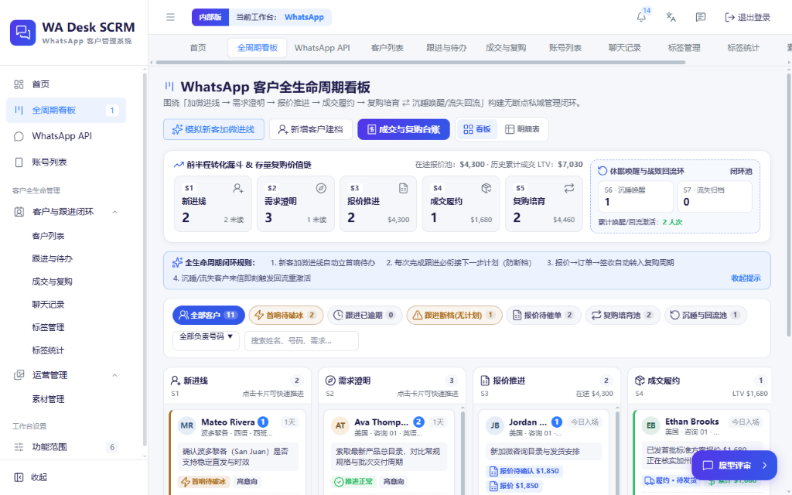
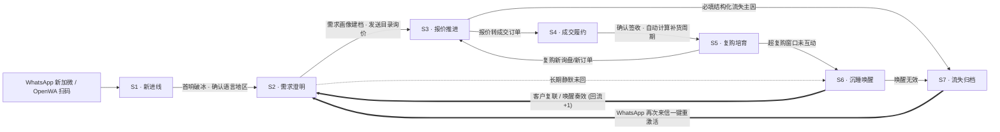

# WA Desk SCRM · WhatsApp 客户全生命周期工作台

面向内部多聊手私域团队的 **WhatsApp 客户全生命周期管理（SCRM）可交互原型与工程交接基线**。聚焦 Facebook / Instagram 广告及转介绍进线 WhatsApp 后的**无断点客户全生命流程闭环**（首版通信架构采用 `rmyndharis/OpenWA` 独立子户容器桥接）。



## 1. 快速运行与预览

本项目前端原型采用**零外部依赖、零网络外呼**的原生 HTML / CSS / JS 架构，克隆仓库后无需 `npm install` 即可直接预览或重新构建：

### 方式 A：双击单文件离线运行（最快）
直接在浏览器中打开以下独立构建文件即可体验完整交互：
- [`outputs/whatsapp-scrm-lifecycle.html`](outputs/whatsapp-scrm-lifecycle.html)（同构同步输出至 `outputs/whatsapp-replica-ui-fidelity.html`）

### 方式 B：启动本地预览服务（支持 `Alt + 左键` 点选控件落盘评审备注）
```bash
# 启动本地预览服务（默认监听 http://127.0.0.1:56141）
node work/wa-replica/serve.cjs
```
*(Windows 下也可直接双击根目录 `启动SCRM原型预览.cmd` 一键打开 `http://127.0.0.1:56141/#lifecycle`。)*

### 重新编译与完整性校验
```bash
node work/wa-replica/build-fidelity.cjs
node work/wa-replica/validate-scrm-lifecycle.cjs
```

---

## 2. 客户全生命周期 7 阶段闭环设计（`v0.6-scrm-lifecycle`）

针对传统聊天工具“只有会话与标签、没有客户全周期推进与后半程复购闭环”的痛点，系统将**自定义多维标签**与**唯一主生命周期状态机**解耦，建立完整闭环：



### 核心模块清单

| 模块路由 | 页面名称 | 核心闭环能力 |
| :--- | :--- | :--- |
| `#dashboard` | **首页经营与全周期概览** | 未读会话、待跟进、在线号码、客户总数、7 阶段闭环漏斗条与防漏雷达直达 |
| `#lifecycle` | **客户全生命周期看板** | 前半程漏斗 + 休眠回流环、防漏健康度雷达（首响待破冰/逾期/跟进断档/报价待催/复购窗口/复联待激活）、7 列看板与明细表双视图、阶段 SOP 指引、模拟新客加微进线 |
| `#inbox` | **WhatsApp API 在线聊天** | OpenWA 扫码绑定/掉线重连模拟、英/西语接收译文与草稿预览、聊天窗内嵌全周期状态协同条、一键推进阶段与模拟客户回复/复联 |
| `Drawer` | **客户 360° 全生命档案** | 600px 宽屏抽屉：7 阶段可点击进度条、LTV 与防漏指标、`画像与跟进 / 报价与订单 / 生命周期轨迹 / 沟通备注` 四栏、跨号接触防撞单提示 |
| `#deals` | **成交履约与复购中心** | 在途报价一键转成交订单、订单发货→签收履约流转（签收自动转入复购培育并排定周期关怀）、双语物流/复购通知草稿生成、流失与沉睡唤醒池 |
| `#followups` | **跟进与待办防漏中心** | 待办队列、S1–S5 活跃客户「漏跟进断档检测」、「完成跟进并衔接下一步」闭环弹窗、历史操作审计表 |
| `#customers` | **客户列表** | 多维组合检索、按生命周期阶段与防漏状态筛选、点击查看客户标签集合、CSV 导出 |
| `#tags` / `#tag-stats` | **标签管理与标签统计** | 自建分组维护自定义标签、批量打标与客户穿透查询 |
| `#materials` | **素材管理** | 运营常用文本、图片、名片、音视频素材分组维护与导入导出 |
| `#scope` | **功能范围与原型评审** | 模块保留/暂缓决策记录、点选界面备注说明与需求评审 JSON 导出 |

---

## 3. 仓库目录结构

```text
├── PRODUCT.md                                         # 产品定位、全周期业务边界与范围说明
├── DESIGN.md                                          # 桌面/窄屏布局规范与全生命周期交互架构
├── 启动SCRM原型预览.cmd                                # Windows 一键启动本地预览服务脚本
├── 重新构建原型.cmd                                    # Windows 一键重编译与自动化校验脚本
├── outputs/
│   ├── whatsapp-scrm-lifecycle.html                   # 独立单文件离线可交互原型（零依赖双击即用）
│   ├── whatsapp-replica-ui-fidelity.html              # 同构离线构建产物（兼容历史预览路径）
│   ├── wa-replica-prototype/                          # 模块化原型运行目录（由 serve.cjs 托管）
│   │   ├── index.html / app.js / app.css              # 编译后的前端入口、逻辑与令牌样式
│   │   ├── demo-data.js / icons.js                    # 虚构演示数据集与内联 Lucide 矢量图标集
│   │   ├── requirements.json                          # 结构化需求与模块评审配置
│   │   └── SCRM_Master_OpenWA_Handoff.md              # Master 控制平面 + 独立 OpenWA 子户架构交接文档
│   ├── scrm-customization-brief.json                  # SCRM 业务功能定制蓝图
│   └── review-prompts/                                # 界面点选评审备注记录（.md）
├── work/
│   └── wa-replica/                                    # 原型构建源码与校验工具链
│       ├── fidelity-base/                             # 基础工作台底座源码
│       ├── fidelity-lifecycle.js / .css               # 7阶段客户全生命周期、360°档案与交易复购闭环引擎
│       ├── fidelity-dashboard.js / .css               # 首页经营与全周期概览
│       ├── fidelity-openwa.js                         # OpenWA 扫码绑定、掉线重连与会话联动
│       ├── fidelity-ui.js / fidelity-customer-pages.js# 列表、标签、聊天记录与操作审计基础视图
│       ├── fidelity-operations.js / fidelity-subsite.js# 素材管理与聊手子站登录态控制
│       ├── build-fidelity.cjs                         # 零外部依赖构建打包器
│       ├── serve.cjs                                  # 本地静态预览与评审落盘服务
│       └── validate-scrm-lifecycle.cjs                # 离线产物无外呼与语法完整性自动校验
└── replica/                                           # 界面勘察说明、对比验证与测试记录
```

## 4. 安全与数据边界

- 仓库内所有客户姓名、美区/波多黎各号码、聊天对话、二维码、报价单与订单均为**纯本地虚构演示数据**，保存在浏览器 `localStorage`，不连接真实 WhatsApp 或任何外部接口。
- 本地勘察期产生的浏览器配置目录、网络抓包（`.har`）、原始采集大文件及第三方参考截图均已通过 `.gitignore` 严格排除，不进入代码仓库。
