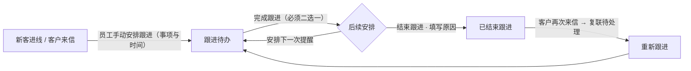

# WA Desk SCRM · WhatsApp 客户跟进闭环工作台

面向内部多聊手私域团队的 **WhatsApp 客户跟进闭环管理（SCRM）工作台**。聚焦 Facebook / Instagram 广告及转介绍进线 WhatsApp 后的**无断点客户跟进闭环**（首版通信架构采用 `rmyndharis/OpenWA` 独立子户容器桥接）。

## 1. 快速运行与预览

本项目采用**零外部依赖**的原生 HTML / CSS / JS 页面和一个 Node 服务，克隆仓库后无需 `npm install`。页面需要通过服务登录后使用，数据保存在服务器上。

### 启动服务
需要 Node 22.13 或更新版本（使用内置 SQLite）。数据目录与 AI 设置文件都放在**仓库以外**的私有位置：
```bash
# 账号与数据保存在 WA_SCRM_DATA_DIR；默认监听 http://127.0.0.1:56141
WA_SCRM_DATA_DIR=/path/to/private/data node work/wa-replica/serve.cjs
```
首次使用先创建账号（每位员工一个账号；`agent` 属于一个子站，子站编号由 `WA_SCRM_SITE_ID` 指定，默认 `default`）：
```bash
WA_SCRM_DATA_DIR=/path/to/private/data node work/wa-replica/site-admin.cjs user add <用户名> <agent|supervisor|admin> <显示名>
```
工具只显示一次临时密码，持有人首次登录后必须修改；自己设置的密码至少 8 位。员工登录后进入自己的子站，新子站从空白开始。主管与管理员登录后进入「主管视图」：员工总览列出每位员工的 WhatsApp 号码及连接状态、客户数、未读会话数、待跟进数和最近消息时间；点击「查看」可以只读方式查看该员工的客户与会话（含图片、语音、文件和已有译文）。主管视图不能发送消息，也不能修改任何员工工作区的数据；主管或管理员每读取一次子站数据，该子站的服务器都会记录一行日志（谁、哪个子站、读取了哪些内容）。主管与管理员还可以在主管视图里管理账号：查看全部账号，点击「新建账号」创建主管账号（填写密码则直接使用该密码，留空则生成只显示一次的临时密码，对方首次登录时必须修改），为他人「重置密码」，「停用」或「启用」账号。用容器运行整套平台时（见下文），「新建账号」还可以创建员工账号：系统同时为这位员工建立独立的工作区（子站）和 WhatsApp 连接，登录名即子站编号（3–32 位小写字母、数字或连字符，以字母或数字开头和结尾）；工作区数量达到上限或服务器内存不足时不会创建，也不会留下账号。停用员工账号会停止其工作区并空出位置（同一工作区还有其他可登录的员工时不停止），数据保留；启用时先启动工作区，无法启动则账号保持停用。「删除」会永久删除账号，删除前需输入对方的登录名确认：主管与管理员账号直接删除；员工账号连同其工作区一起删除——WhatsApp 号码先在手机上退出（无法自动退出时页面会提示到手机 WhatsApp 的「已关联的设备」中移除），全部客户、聊天记录及其译文一并删除，无法恢复；同一工作区还有其他员工的账号时，工作区保留。需要保留数据时请改用「停用」。不能操作自己的账号，管理员账号只能由管理员操作；每次操作都会记入服务器日志（谁、对哪个账号、做了什么）。未设置 `WA_SCRM_DATA_DIR` 时页面只显示「服务器尚未启用账号」。

多个子站可以共用同一个访问地址：每个子站各运行一个服务进程（`WA_SCRM_SITE_ID` 和端口各不相同，`WA_SCRM_DATA_DIR` 相同，账号只有一套），并通过各自的 `WA_SCRM_OPENWA_ENV` 连接自己的 OpenWA。登录时服务器除登录凭证外还会写入名为 `scrm_site` 的 Cookie，记录该员工所属的子站；前面的网关（nginx 或 OpenResty）按这个 Cookie 把 `/api/data` 和 `/api/wa/*` 转发到对应子站的进程，其余请求（页面文件、`/api/auth/*`、`/api/site/status`、`/api/ai/*`）固定交给其中一个进程。这个 Cookie 只决定请求的去向，不代表权限：每个子站都会自行核对登录状态和账号所属的子站。每个子站的进程也用子站自己的名字应答它的数据和 WhatsApp 连接：`/site/<子站编号>/api/data` 和 `/site/<子站编号>/api/wa/…` 等同于该子站的 `/api/data` 和 `/api/wa/…`；登录等其余接口只有原来的地址，输错密码的次数因此只由一个进程统计。主管视图用这种地址同时读取多个子站，各子站的 OpenWA 事件通知也送到 `/site/<子站编号>/api/wa/hook`；网关按路径里的子站编号转发即可。nginx 的写法如下（两个子站 `default` 与 `site-b`）：

```nginx
map $cookie_scrm_site $scrm_node {
    default  127.0.0.1:56141;
    site-b   127.0.0.1:56142;
}
map $scrm_named $scrm_named_node {
    default  127.0.0.1:56141;
    site-b   127.0.0.1:56142;
}
server {
    listen 8141;
    client_max_body_size 20m;
    location / { proxy_pass http://127.0.0.1:56141; }
    location = /api/data { proxy_pass http://$scrm_node; }
    location /api/wa/ { proxy_pass http://$scrm_node; }
    location ~ ^/site/(?<scrm_named>[a-z0-9-]+)/api/(data$|wa/) { proxy_pass http://$scrm_named_node; }
}
```

如果在服务前面放置反向代理（nginx、OpenResty 等），代理允许的请求体大小必须不低于 8 MB（例如 nginx 的 `client_max_body_size 10m;`）：页面把较大的修改拆成多次请求保存，但单个数据项最大 2 MB，服务本身一次请求最多接收 8 MB。上限过低时页面会提示「修改未能保存：内容超过服务器允许的大小」。

#### 用容器运行整套平台

`deploy/` 目录提供把整套平台放进 Docker 的文件。平台由三部分常驻容器和每个子站各两个容器组成，全部在同一个 Docker 网络 `wa-scrm` 里，只有网关对外开放端口：

- **网关**（`wa-scrm-gateway`，nginx，配置见 `deploy/gateway.conf`）：所有人访问的唯一地址。它通过 Docker 自带的名称解析按容器名找到其他容器，新建、启动或停止子站时不需要改任何配置。
- **主服务**（`wa-scrm-master`）：页面、登录、账号管理和 AI 中转；它不是任何员工的子站。
- **调度服务**（`wa-scrm-provisioner`，`work/wa-replica/site-provisioner.cjs`）：唯一能操作 Docker 的部分。它按固定的方式创建、启动、停止一个子站的两个容器（子站服务 `wa-scrm-site-<编号>` 和它专属的 OpenWA `wa-scrm-openwa-<编号>`），调用方只能给出子站编号；它只接受主服务凭共享密钥发来的请求，不对外开放。创建子站时它为 OpenWA 生成密钥、写好该子站的连接设置文件；超过子站数量上限（默认 4）或服务器剩余内存不足（默认 1400 MB）时拒绝创建和启动。

首次部署和以后每次更新代码用同一个脚本（在服务器上，以能使用 Docker 的用户执行）：

```bash
cp deploy/platform.env.template /私有目录/platform.env     # 仅首次：填写数据目录、AI 设置文件、共享密钥文件等路径
bash deploy/upgrade.sh /私有目录/platform.env
```

脚本构建服务镜像，启动或更新三个常驻容器（网关配置有变化时重建网关），在服务器上还没有 OpenWA 镜像时拉取它，并让每个子站的服务换用新镜像；子站的 OpenWA 不会被重启，WhatsApp 连接不中断。调度服务不正常时脚本不改动任何子站；某个子站没能重新启动时脚本以错误结束，排除原因后重新执行即可。数据目录、AI 设置文件和共享密钥文件都放在仓库之外。

WhatsApp 改动网页版后，新号码扫码绑定时可能不出现二维码：2026 年 11 月下旬起，未登录的浏览器会被转到新的 `/login/` 页面，OpenWA 0.31.0 不认识它，等待 30 秒后报“auth timeout”。这时可以在设置文件里用 `WA_SCRM_OPENWA_WEB_VERSION` 指定一个仍能显示二维码的 WhatsApp Web 版本（例如 `2.3000.1055837054-alpha`），再运行 `deploy/upgrade.sh`：此后调度服务新建的 OpenWA 都使用这个版本。已有的 OpenWA 保持创建时的版本，已绑定的号码照常重新连接；要让还没有绑定号码的 OpenWA 换用新版本，在服务器上删除它的容器（`docker rm -f wa-scrm-openwa-<编号>`，数据保留），再在「主管视图」里把该员工停用后重新启用。OpenWA 修复这一问题后，清空这项设置。

网关不在内存里暂存上传的内容，访问日志不记录查询参数（其中可能含有客户号码）；路径里带反斜杠、编码后的斜杠或反斜杠（%2F、%5C）、空段或只由点组成的段的请求一律拒绝，网关和各个服务都会检查；OpenWA 的事件只在容器之间传递，不经过对外地址。

平台运行后，员工账号在「主管视图」里创建（见上文）：主服务把子站编号交给调度服务，调度服务创建并启动该子站的两个容器，网关随即按容器名找到它，不需要再登录服务器操作。新员工登录后在「WhatsApp API」里扫码绑定自己的号码。

#### 接入 AI 翻译（可选）
服务带有 AI 中转接口（`/api/ai/*`，只对已登录用户开放）：页面只调用本站服务器，由服务器携带密钥调用模型服务，密钥不进入浏览器。把 `work/wa-replica/ai.env.example` 复制到私有位置并填写，再用环境变量 `WA_SCRM_AI_ENV` 指向它启动服务。未设置或文件不完整时没有翻译（「AI 能力」页显示「未连接」）。填好的文件不要提交到仓库。

会话里的消息只翻译一次：译文连同译成的语言保存在消息上，随会话数据存入服务器；打开会话时只为还没有译文的消息请求翻译（从最新的开始，同时最多两条），新到的消息到达时翻译一次，再次打开会话或刷新页面不会重复请求。服务器另把做过的翻译保存在数据目录的 `ai-translations.db` 中（只存原文的指纹与译文，不存原文），相同的文字在任何会话里都只请求模型一次；这个文件可以随时删除，删除后相同的文字会重新翻译。

回复译成哪种语言由每位客户的「客户语言」决定：在聊天界面会话上方右侧选择（常用语言列表，或选「其他语言…」填写任意语言名称）。系统不预设客户语言——从 WhatsApp 同步或新来信生成的客户没有语言，未选择时回复按原文发送。

消息框上方工具栏的「改写」按人设改写输入的回复（`/api/ai/rewrite`）：员工写下要求（例如「更热情一点」「更简短」），模型以所选人设的身份和口吻、用尽量小的改动改写，并写成客户语言；改写结果和它在译文语言中的意思显示在消息框上方，确认后按 Enter 发送，消息框里输入的内容保持不变，改动它后改写结果作废。人设在「AI 能力」页面添加（按模板填写：我是谁、我提供什么、产品详情与政策、优势与案例、沟通目标、语气、需要避免的说法或承诺、参考回复），可以有多个，其中一个是默认人设；改写时为会话选择的人设记在这位客户上，没有选择过的会话使用默认人设，也可以选「不使用人设」。改写不会自行加入报价、折扣或承诺；需要先选择客户语言。翻译回复不使用人设。

同一个设置文件里的 `VOICE_PROVIDER`、`VOICE_API_KEY`（以及可选的 `VOICE_BASE_URL`、`VOICE_MODEL`）指定语音转文字服务：员工点击语音消息下方的「转文字」时，服务器把这条语音交给语音服务（`/api/wa/transcribe`），文字显示在语音下方并保存在服务器上，同一条语音只转一次。未填写时不显示「转文字」。

#### 接入 OpenWA（WhatsApp 连接，可选）
服务带有子站与其专属 OpenWA 之间的连接接口（`/api/wa/*`，需要已设置 `WA_SCRM_DATA_DIR`）：为号码创建并启动会话、返回扫码二维码、接收 OpenWA 的事件通知并在落库后应答、按顺序提供给页面，以及发送文本消息和文件。把 `work/wa-replica/openwa.env.example` 复制到私有位置并填写，再用环境变量 `WA_SCRM_OPENWA_ENV` 指向它启动服务。OpenWA 的密钥只保存在服务器；OpenWA 的通知必须带有效签名才会被接收。页面通过这些接口扫码绑定号码、接收消息并发送文本消息和文件。号码上线时，服务器会自动取回该号码上已有的一对一会话及每个会话最近的 50 条消息，之后每 15 分钟补取一次通知没有送达的内容（逐个会话读取，中间留有间隔）；未设置时，号码管理会提示服务器尚未接入 WhatsApp 连接。

消息里的图片、语音、视频和文件由服务器按需从 OpenWA 取回（`/api/wa/media`，只对已登录用户开放），首次取回后保存在数据目录的 `wa-media-<子站>` 文件夹中，之后直接读取；这个文件夹可以随时清空，需要时会重新取回。只有内容确实是图片、音频或视频的文件才会在页面内显示，其余一律作为下载提供。

员工可以从消息框发送文件：点击消息框下方的「+」（添加文件）、把文件粘贴到消息框，或把文件拖到会话里。一次最多添加 10 个文件，每个最大 16 MB；它们按顺序逐个发出，每个文件是一条单独的消息（WhatsApp 本身也是这样发送多个文件的），消息框里的文字作为第一个文件的说明一起发出（最多 1024 个字符）。某个文件没有发出时，它和后面的文件仍留在消息框上方，再按一次发送即可继续。文件由服务器经 OpenWA 发送（`/api/wa/send-file`），按内容而不是文件名判断类型：JPG、PNG 作为图片发送，MP4（H.264）作为视频，MP3、OGG、M4A、AAC 作为音频，其余一律作为文件发送并保留原文件名。同一次发送重复请求不会重复发出；发出的文件同样保存在 `wa-media-<子站>` 文件夹中，页面立即显示。服务器前面的反向代理需要允许不小于 16 MB 的请求体（例如 nginx 的 `client_max_body_size 20m`），并且等待应答的时间不短于 60 秒。在浏览器里录制语音需要 HTTPS，暂不提供。

号码绑定后，会话列表、聊天界面顶部、工作台首页的未读会话和客户 360° 档案里的客户头像显示客户的 WhatsApp 头像（`/api/wa/avatar`，只对已登录用户开放）。服务器经 OpenWA 查询头像地址，只从 WhatsApp 自己的服务器或网关本身取回图片，保存在 `wa-media-<子站>` 文件夹中，一天后重新查询；号码掉线时继续使用已保存的头像。客户没有设置头像，或把头像设为对这个号码不可见时，继续显示姓名首字母。

### 重新编译与完整性校验
```bash
node work/wa-replica/build-fidelity.cjs
node work/wa-replica/validate-scrm-lifecycle.cjs
node --test work/wa-replica/ai-relay.test.cjs   # AI 中转接口的测试（使用本地替身，不调用真实服务）
node --test work/wa-replica/site-api.test.cjs   # 账号、会话与数据接口的测试（需要 Node 22.13 或更新版本）
node --test work/wa-replica/openwa-link.test.cjs   # OpenWA 连接接口的测试（使用本地替身，不连接真实 OpenWA；需要 Node 22.13 或更新版本）
node --test work/wa-replica/price-file.test.cjs   # 价格表文件读取的测试（需要 Node 22.13 或更新版本）
```

---

## 2. 客户跟进闭环设计（`v0.8-scrm-engagement`）

自 v0.8 起不再设置生命周期阶段、漏斗、流程配置与报价/订单台账（均已暂缓，实现保留在 Git 历史 v0.7）。系统只做一件事：**保证已安排的客户跟进不断档**，并以**完全自定义的标签**辅助分类与筛选。



- **跟进由人建立**：由人安排了待办的客户处于「跟进中」，由人结束的为「已结束跟进」；已结束的跟进可以由人从「已结束跟进」列表中移除（需确认，移除会记入操作日志），移除后该客户不再显示跟进信息。没有人安排过跟进的客户没有跟进状态：聊天界面、客户列表、客户档案、首页与导出文件都不显示关于它的任何跟进信息（状态、下次跟进时间、提示）。
- **待办只由人建立**：系统不自动生成跟进待办。待办来自「新建跟进任务」（填写事项与计划时间），或完成一次跟进时安排的下一步；待办队列中的每条待办都可以由本人删除（需确认，删除会记入操作日志）。新客户来信只体现为会话未读，不产生跟进信息。
- **三种跟进状态提示**：客户待回复、跟进已逾期、复联待处理（平常状态为「跟进正常」或「已结束跟进」）。它们只出现在已由人安排或结束跟进的客户上，由系统根据未读消息和待办时间得出，显示在客户列表（状态标签与筛选）、聊天界面和首页；跟进闭环中心只列出人工建立的待办及其到期、逾期提醒，不再设「待处理信号」视图。
- **标签为辅**：标签由用户自建；可按标签筛选跟进闭环中心，并在完成或结束跟进时同步更新客户标签。系统不预置、不自动打标。
- **等级与状态**：每位客户有手动设置的客户等级（S / A / B / C / D）与客户状态（已成交 / 弃单 / 自然线索），在聊天界面或客户档案中直接调整。
- **订单追踪**：客户档案的「订单追踪」栏显示客户首次联系时间，并按订单号分区列出每笔订单，订单号旁显示下单时间。每个订单的分区内，订单每到达一个物流状态就有一条记录（状态与时间）：登记订单时为「待发货」并带下单时间；点击「标记已发货」「标记已签收」或「标记异常」后新增对应记录。物流状态沿「待发货 → 已发货 → 已签收」逐步推进，或在签收前标记为「异常」；「撤销上一步」可随时撤回最近一步。这些操作在订单标题右侧以图标按钮呈现，位置固定，悬停显示名称。订单分区默认折叠为一行，标题内以三段进度条显示物流状态；点击订单号展开或收起该订单的物流记录。登记订单表单固定在抽屉底部，订单列表在其上方滚动。订单由聊手手动登记，未对接店铺或物流系统。

### 核心模块清单

| 模块路由 | 页面名称 | 核心能力 |
| :--- | :--- | :--- |
| `#dashboard` | **首页经营概览** | 未读会话、待跟进、在线号码、客户总数、跟进闭环概览；跟进中（有人工待办）与已结束跟进的客户数，三种跟进状态提示的数量，点击后打开按该状态筛选的客户列表 |
| `#followups` | **跟进闭环中心** | 跟进待办队列、已结束跟进、操作日志三视图（内容均由人工录入，系统只提示今日到期与已逾期）；按标签筛选；「完成并闭环」必须安排下一步或结束跟进 |
| `#numbers` | **号码管理** | 通过 OpenWA 扫码绑定真实号码、掉线后重新连接、解除绑定；每个号码的连接状态、负责人、会话数与最近活跃；从号码进入聊天 |
| `#inbox` | **WhatsApp API 在线聊天** | 接收消息与发送文本；号码与客户来源显示在客户姓名下方；消息框上方工具栏（客户语言、发送保护、报价、快捷回复），下方与 WhatsApp 相同的输入栏；接收译文与草稿预览、聊天窗内嵌跟进协同条（跟进状态、下次跟进、标签、安排跟进）；可直接调整客户等级与客户状态；可将会话快照移入聊天记录；会话卡片直接显示客户标签，不显示跟进状态；点击协同条的跟进状态或下次跟进可跳转到跟进闭环并定位该客户 |
| `Drawer` | **客户 360° 档案** | 600px 宽屏抽屉：跟进状态与下次跟进（已安排或已结束跟进的客户才显示）、`画像与跟进 / 互动轨迹 / 订单追踪 / 沟通备注` 四栏、结束跟进与重新跟进、跨号接触防撞单提示 |
| `#customers` | **客户列表** | 多维组合检索；按客户等级、客户状态与跟进状态筛选；最近互动与标签集合；CSV 导出（含等级与状态） |
| `#chat-records` | **聊天记录（归档）** | 从 WhatsApp 会话移入的快照列表；移入原因、移入人与时间；快照内搜索、译文开关；不设评分或结论分类 |
| `#tags` / `#tag-stats` | **标签管理与标签统计** | 自建分组维护自定义标签、批量打标与客户穿透查询 |
| `#ai` | **AI 能力** | AI 功能的统一接入点：能力清单与逐项启停（会话消息翻译、发送前翻译、语音转文字、改写回复）、译文语言、回复语气、业务说明与发送保护设置、人设（「改写」使用，可建多个，其中一个为默认）、按能力累计的调用次数与字符数、最近调用记录；经本站服务器中转调用模型服务；服务器未配置时显示「未连接」，不提供翻译 |
| `#prices` | **价格表** | 上传一份 Excel（.xlsx）或 CSV 文件作为价格表：文件在浏览器内读取，先预览识别结果，确认后替换当前价格表；按简称、名称、规格搜索。聊天界面消息框旁的「报价」按钮从价格表查找产品，点击价格即把一行报价（如 `Product Alpha PRDA01 (100*10 Units): $40`）放入消息框，由员工确认后发送；系统不自动报价、不自动发送。「彻底删除价格表」把价格表从系统中完全移除：服务器删除它的数据、把它从保存记录中抹去，并重写数据库文件，不留下任何内容（接口 `DELETE /api/data`）；已经放进消息或草稿里的报价不受影响 |

---

## 3. 仓库目录结构

```text
├── PRODUCT.md                                         # 产品定位、跟进闭环业务边界与范围说明
├── DESIGN.md                                          # 桌面/窄屏布局规范与跟进闭环交互架构
├── 重新构建原型.cmd                                    # Windows 一键重编译与自动化校验脚本
├── deploy/                                            # 容器部署：服务镜像、网关配置、常驻三个容器的编排文件、升级脚本
├── outputs/
│   ├── wa-replica-prototype/                          # 模块化原型运行目录（由 serve.cjs 托管）
│   │   ├── index.html / app.js / app.css              # 编译后的前端入口、逻辑与令牌样式
│   │   ├── boot.js / icons.js                         # 启动、登录与数据同步脚本；内联 Lucide 矢量图标集
│   │   ├── pricefile.js                               # 价格表文件读取脚本（fidelity-pricefile.js 的构建副本）
│   │   ├── master.js                                  # 主管视图脚本（fidelity-master.js 的构建副本）
│   │   ├── requirements.json                          # 结构化需求与模块评审配置
│   │   └── SCRM_Master_OpenWA_Handoff.md              # Master 控制平面 + 独立 OpenWA 子户架构交接文档
│   ├── scrm-customization-brief.json                  # SCRM 业务功能定制蓝图
│   └── review-prompts/                                # 早期界面评审备注的存档（.md；点选备注工具已移除）
├── work/
│   └── wa-replica/                                    # 原型构建源码与校验工具链
│       ├── fidelity-base/                             # 基础工作台底座源码
│       ├── fidelity-lifecycle.js / .css               # 跟进闭环引擎：跟进状态、待处理信号、跟进闭环中心与客户档案（文件名沿用）
│       ├── fidelity-dashboard.js / .css               # 首页经营概览与跟进闭环概览
│       ├── fidelity-openwa.js                         # 真实 WhatsApp 连接：扫码绑定、事件流（来信、回执、号码状态）、发送与重试、消息中的图片/语音/视频/文件
│       ├── fidelity-ai.js                             # AI 能力接入点：能力清单、服务器中转、回复翻译与发送保护、用量记录与「AI 能力」页
│       ├── fidelity-boot.js                           # 页面启动：登录界面、读取子站数据、把修改保存到服务器
│       ├── fidelity-master.js                         # 主管视图：员工总览，以及只读的客户与会话查看
│       ├── fidelity-pricelist.js                      # 「价格表」页（上传、预览、搜索）与聊天界面消息框旁的「报价」
│       ├── fidelity-pricefile.js / price-file.test.cjs# Excel（.xlsx）/ CSV 价格表文件的读取（在浏览器内运行）及其测试
│       ├── ai-relay.cjs / ai-relay.test.cjs           # 预览服务的 AI 中转接口（读取服务器上的密钥并调用模型服务与语音服务）及其测试
│       ├── ai.env.example                             # AI 设置文件示例（填写后的副本放在仓库之外）
│       ├── openwa-link.cjs / openwa-link.test.cjs     # 子站与其专属 OpenWA 的连接接口（会话、二维码、事件通知、发送、消息媒体）及其测试
│       ├── openwa.env.example                         # OpenWA 连接设置文件示例（填写后的副本放在仓库之外）
│       ├── site-auth.cjs / site-data.cjs              # 账号与登录会话；子站数据文档（内置 SQLite）
│       ├── site-api.cjs / site-api.test.cjs           # 登录与数据接口及其测试
│       ├── site-admin.cjs                             # 账号与数据管理工具（在服务器上运行）
│       ├── site-provisioner.cjs / .test.cjs           # 子站容器的创建与启停（唯一与 Docker 打交道的部分）及其测试
│       ├── fidelity-ui.js / fidelity-customer-pages.js# 列表、标签、标签统计与聊天记录归档视图
│       ├── fidelity-operations.js / fidelity-subsite.js# 素材管理与聊手子站登录态控制
│       ├── build-fidelity.cjs                         # 零外部依赖构建打包器
│       ├── serve.cjs                                  # 预览服务：页面、AI 中转，以及可选的账号与数据接口、OpenWA 连接接口
│       └── validate-scrm-lifecycle.cjs                # 离线产物无外呼与语法完整性自动校验
└── replica/                                           # 界面勘察说明、对比验证与测试记录
```

## 4. 安全与数据边界

- 客户、会话、标签与待办等数据保存在服务器的数据目录（`WA_SCRM_DATA_DIR`，SQLite 文件，位于仓库之外）；浏览器只保存草稿、已打开页签等界面状态；账号密码以 scrypt 哈希保存。WhatsApp 的收发经由本站服务器与子站专属的 OpenWA 完成，浏览器不直接连接 OpenWA。对外的调用有三类：服务器与 OpenWA 之间的连接；AI 翻译——仅当预览服务配置了模型服务时，待翻译的消息文本经本站服务器发送给该模型服务；语音转文字——仅当配置了语音服务且员工点击「转文字」时，这条语音文件经本站服务器发送给该语音服务。密钥都只保存在服务器上，仓库内不含任何密钥。
- 本地勘察期产生的浏览器配置目录、网络抓包（`.har`）、原始采集大文件及第三方参考截图均已通过 `.gitignore` 严格排除，不进入代码仓库。
