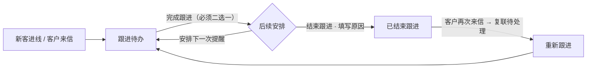

# WA Desk SCRM · WhatsApp 客户跟进闭环工作台

面向内部多聊手私域团队的 **WhatsApp 客户跟进闭环管理（SCRM）可交互原型与工程交接基线**。聚焦 Facebook / Instagram 广告及转介绍进线 WhatsApp 后的**无断点客户跟进闭环**（首版通信架构采用 `rmyndharis/OpenWA` 独立子户容器桥接）。

## 1. 快速运行与预览

本项目前端原型采用**零外部依赖、零网络外呼**的原生 HTML / CSS / JS 架构，克隆仓库后无需 `npm install` 即可直接预览或重新构建：

### 方式 A：双击单文件离线运行（最快）
直接在浏览器中打开以下独立构建文件即可体验完整交互：
- [`outputs/whatsapp-scrm-lifecycle.html`](outputs/whatsapp-scrm-lifecycle.html)（同构同步输出至 `outputs/whatsapp-replica-ui-fidelity.html`）

### 方式 B：启动本地预览服务（支持 `Alt + 左键` 点选控件落盘评审备注）
```bash
# 启动本地预览服务（默认监听 http://127.0.0.1:56141）
node work/wa-replica/serve.cjs
```
*(Windows 下也可直接双击根目录 `启动SCRM原型预览.cmd` 一键打开 `http://127.0.0.1:56141/#followups`。)*

### 重新编译与完整性校验
```bash
node work/wa-replica/build-fidelity.cjs
node work/wa-replica/validate-scrm-lifecycle.cjs
```

---

## 2. 客户跟进闭环设计（`v0.8-scrm-engagement`）

自 v0.8 起原型不再设置生命周期阶段、漏斗、流程配置与报价/订单台账（均已暂缓，实现保留在 Git 历史 v0.7）。系统只做一件事：**保证每位客户的跟进不断档**，并以**完全自定义的标签**辅助分类与筛选。



- **两种跟进状态**：跟进中、已结束跟进。跟进中的客户必须有下一条待办，否则提示「跟进断档」。
- **四类待处理信号**：客户待回复、跟进已逾期、跟进断档、复联待处理。
- **标签为辅**：标签由用户自建；可按标签筛选跟进闭环中心，并在完成或结束跟进时同步更新客户标签。系统不预置、不自动打标。
- **等级与状态**：每位客户有手动设置的客户等级（S / A / B / C / D）与客户状态（已成交 / 弃单 / 自然线索），在聊天界面或客户档案中直接调整。

### 核心模块清单

| 模块路由 | 页面名称 | 核心能力 |
| :--- | :--- | :--- |
| `#dashboard` | **首页经营概览** | 未读会话、待跟进、在线号码、客户总数、跟进闭环概览与四类信号直达 |
| `#followups` | **跟进闭环中心** | 跟进待办队列、待处理信号、已结束跟进、操作日志四视图；按标签筛选；「完成并闭环」必须安排下一步或结束跟进；模拟新客进线 |
| `#inbox` | **WhatsApp API 在线聊天** | OpenWA 扫码绑定/掉线重连模拟、英/西语接收译文与草稿预览、聊天窗内嵌跟进协同条（跟进状态、下次跟进、标签、安排跟进）；可直接调整客户等级与客户状态；可将会话快照移入聊天记录 |
| `Drawer` | **客户 360° 档案** | 600px 宽屏抽屉：跟进状态与下次跟进、`画像与跟进 / 互动轨迹 / 沟通备注` 三栏、结束跟进与重新跟进、跨号接触防撞单提示 |
| `#customers` | **客户列表** | 多维组合检索；按客户等级、客户状态与跟进状态筛选；最近互动与标签集合；CSV 导出（含等级与状态） |
| `#chat-records` | **聊天记录（归档）** | 从 WhatsApp 会话移入的快照列表；移入原因、移入人与时间；快照内搜索、译文开关；不设评分或结论分类 |
| `#tags` / `#tag-stats` | **标签管理与标签统计** | 自建分组维护自定义标签、批量打标与客户穿透查询 |
| `#materials` | **素材管理** | 运营常用文本、图片、名片、音视频素材分组维护与导入导出 |
| `#ai` | **AI 能力** | AI 功能的统一接入点：能力清单与逐项启停（接收消息翻译、发送前翻译）、按能力累计的调用次数与字符数、最近调用记录；当前为本地演示，不连接外部服务 |
| `#scope` | **功能范围与原型评审** | 模块保留/暂缓决策记录（含已暂缓的生命周期看板、流程配置与成交复购中心）、点选界面备注说明与需求评审 JSON 导出 |

---

## 3. 仓库目录结构

```text
├── PRODUCT.md                                         # 产品定位、跟进闭环业务边界与范围说明
├── DESIGN.md                                          # 桌面/窄屏布局规范与跟进闭环交互架构
├── 启动SCRM原型预览.cmd                                # Windows 一键启动本地预览服务脚本
├── 重新构建原型.cmd                                    # Windows 一键重编译与自动化校验脚本
├── outputs/
│   ├── whatsapp-scrm-lifecycle.html                   # 独立单文件离线可交互原型（零依赖双击即用）
│   ├── whatsapp-replica-ui-fidelity.html              # 同构离线构建产物（兼容历史预览路径）
│   ├── wa-replica-prototype/                          # 模块化原型运行目录（由 serve.cjs 托管）
│   │   ├── index.html / app.js / app.css              # 编译后的前端入口、逻辑与令牌样式
│   │   ├── demo-data.js / icons.js                    # 虚构演示数据集与内联 Lucide 矢量图标集
│   │   ├── requirements.json                          # 结构化需求与模块评审配置
│   │   └── SCRM_Master_OpenWA_Handoff.md              # Master 控制平面 + 独立 OpenWA 子户架构交接文档
│   ├── scrm-customization-brief.json                  # SCRM 业务功能定制蓝图
│   └── review-prompts/                                # 界面点选评审备注记录（.md）
├── work/
│   └── wa-replica/                                    # 原型构建源码与校验工具链
│       ├── fidelity-base/                             # 基础工作台底座源码
│       ├── fidelity-lifecycle.js / .css               # 跟进闭环引擎：跟进状态、待处理信号、跟进闭环中心与客户档案（文件名沿用）
│       ├── fidelity-dashboard.js / .css               # 首页经营概览与跟进闭环概览
│       ├── fidelity-openwa.js                         # OpenWA 扫码绑定、掉线重连与会话联动
│       ├── fidelity-ai.js                             # AI 能力接入点：能力清单、演示提供方、用量记录与「AI 能力」页
│       ├── fidelity-ui.js / fidelity-customer-pages.js# 列表、标签、标签统计与聊天记录归档视图
│       ├── fidelity-operations.js / fidelity-subsite.js# 素材管理与聊手子站登录态控制
│       ├── build-fidelity.cjs                         # 零外部依赖构建打包器
│       ├── serve.cjs                                  # 本地静态预览与评审落盘服务
│       └── validate-scrm-lifecycle.cjs                # 离线产物无外呼与语法完整性自动校验
└── replica/                                           # 界面勘察说明、对比验证与测试记录
```

## 4. 安全与数据边界

- 仓库内所有客户姓名、美区/波多黎各号码、聊天对话与二维码均为**纯本地虚构演示数据**，保存在浏览器 `localStorage`，不连接真实 WhatsApp 或任何外部接口。
- 本地勘察期产生的浏览器配置目录、网络抓包（`.har`）、原始采集大文件及第三方参考截图均已通过 `.gitignore` 严格排除，不进入代码仓库。
