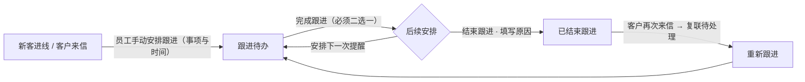

# WA Desk SCRM · WhatsApp 客户跟进闭环工作台

面向内部多聊手私域团队的 **WhatsApp 客户跟进闭环管理（SCRM）工作台**。聚焦 Facebook / Instagram 广告及转介绍进线 WhatsApp 后的**无断点客户跟进闭环**（首版通信架构采用 `rmyndharis/OpenWA` 独立子户容器桥接）。

## 1. 快速运行与预览

本项目采用**零外部依赖**的原生 HTML / CSS / JS 页面和一个 Node 服务，克隆仓库后无需 `npm install`。页面需要通过服务登录后使用，数据保存在服务器上。

### 启动服务
需要 Node 22.13 或更新版本（使用内置 SQLite）。数据目录与 AI 设置文件都放在**仓库以外**的私有位置：
```bash
# 账号与数据保存在 WA_SCRM_DATA_DIR；默认监听 http://127.0.0.1:56141
WA_SCRM_DATA_DIR=/path/to/private/data node work/wa-replica/serve.cjs
```
首次使用先创建账号（每位员工一个账号；`agent` 属于一个子站，子站编号由 `WA_SCRM_SITE_ID` 指定，默认 `default`）：
```bash
WA_SCRM_DATA_DIR=/path/to/private/data node work/wa-replica/site-admin.cjs user add <用户名> <agent|supervisor|admin> <显示名>
```
工具只显示一次临时密码，持有人首次登录后必须修改。员工登录后进入自己的子站，新子站从空白开始；主管与管理员的查看入口将随主站提供。未设置 `WA_SCRM_DATA_DIR` 时页面只显示「服务器尚未启用账号」。

如果在服务前面放置反向代理（nginx、OpenResty 等），代理允许的请求体大小必须不低于 8 MB（例如 nginx 的 `client_max_body_size 10m;`）：页面把较大的修改拆成多次请求保存，但单个数据项最大 2 MB，服务本身一次请求最多接收 8 MB。上限过低时页面会提示「修改未能保存：内容超过服务器允许的大小」。

#### 接入 AI 翻译（可选）
服务带有 AI 中转接口（`/api/ai/*`，只对已登录用户开放）：页面只调用本站服务器，由服务器携带密钥调用模型服务，密钥不进入浏览器。把 `work/wa-replica/ai.env.example` 复制到私有位置并填写，再用环境变量 `WA_SCRM_AI_ENV` 指向它启动服务。未设置或文件不完整时没有翻译（「AI 能力」页显示「未连接」）。填好的文件不要提交到仓库。

同一个设置文件里的 `VOICE_PROVIDER`、`VOICE_API_KEY`（以及可选的 `VOICE_BASE_URL`、`VOICE_MODEL`）指定语音转文字服务：员工点击语音消息下方的「转文字」时，服务器把这条语音交给语音服务（`/api/wa/transcribe`），文字显示在语音下方并保存在服务器上，同一条语音只转一次。未填写时不显示「转文字」。

#### 接入 OpenWA（WhatsApp 连接，可选）
服务带有子站与其专属 OpenWA 之间的连接接口（`/api/wa/*`，需要已设置 `WA_SCRM_DATA_DIR`）：为号码创建并启动会话、返回扫码二维码、接收 OpenWA 的事件通知并在落库后应答、按顺序提供给页面，以及发送文本消息。把 `work/wa-replica/openwa.env.example` 复制到私有位置并填写，再用环境变量 `WA_SCRM_OPENWA_ENV` 指向它启动服务。OpenWA 的密钥只保存在服务器；OpenWA 的通知必须带有效签名才会被接收。页面通过这些接口扫码绑定号码、接收消息并发送文本消息。号码上线时，服务器会自动取回该号码上已有的一对一会话及每个会话最近的 50 条消息，之后每 15 分钟补取一次通知没有送达的内容（逐个会话读取，中间留有间隔）；未设置时，号码管理会提示服务器尚未接入 WhatsApp 连接。

消息里的图片、语音、视频和文件由服务器按需从 OpenWA 取回（`/api/wa/media`，只对已登录用户开放），首次取回后保存在数据目录的 `wa-media-<子站>` 文件夹中，之后直接读取；这个文件夹可以随时清空，需要时会重新取回。只有内容确实是图片、音频或视频的文件才会在页面内显示，其余一律作为下载提供。

### 重新编译与完整性校验
```bash
node work/wa-replica/build-fidelity.cjs
node work/wa-replica/validate-scrm-lifecycle.cjs
node --test work/wa-replica/ai-relay.test.cjs   # AI 中转接口的测试（使用本地替身，不调用真实服务）
node --test work/wa-replica/site-api.test.cjs   # 账号、会话与数据接口的测试（需要 Node 22.13 或更新版本）
node --test work/wa-replica/openwa-link.test.cjs   # OpenWA 连接接口的测试（使用本地替身，不连接真实 OpenWA；需要 Node 22.13 或更新版本）
```

---

## 2. 客户跟进闭环设计（`v0.8-scrm-engagement`）

自 v0.8 起不再设置生命周期阶段、漏斗、流程配置与报价/订单台账（均已暂缓，实现保留在 Git 历史 v0.7）。系统只做一件事：**保证每位客户的跟进不断档**，并以**完全自定义的标签**辅助分类与筛选。



- **两种跟进状态**：跟进中、已结束跟进。跟进中的客户必须有下一条待办，否则提示「跟进断档」。
- **待办只由人建立**：系统不自动生成跟进待办。待办来自「新建跟进任务」（填写事项与计划时间），或完成一次跟进时安排的下一步。新客户来信出现在「客户待回复」信号中；尚未安排跟进的客户提示「跟进断档」。
- **四类待处理信号**：客户待回复、跟进已逾期、跟进断档、复联待处理。
- **标签为辅**：标签由用户自建；可按标签筛选跟进闭环中心，并在完成或结束跟进时同步更新客户标签。系统不预置、不自动打标。
- **等级与状态**：每位客户有手动设置的客户等级（S / A / B / C / D）与客户状态（已成交 / 弃单 / 自然线索），在聊天界面或客户档案中直接调整。
- **订单追踪**：客户档案的「订单追踪」栏显示客户首次联系时间，并按订单号分区列出每笔订单，订单号旁显示下单时间。每个订单的分区内，订单每到达一个物流状态就有一条记录（状态与时间）：登记订单时为「待发货」并带下单时间；点击「标记已发货」「标记已签收」或「标记异常」后新增对应记录。物流状态沿「待发货 → 已发货 → 已签收」逐步推进，或在签收前标记为「异常」；「撤销上一步」可随时撤回最近一步。这些操作在订单标题右侧以图标按钮呈现，位置固定，悬停显示名称。订单分区默认折叠为一行，标题内以三段进度条显示物流状态；点击订单号展开或收起该订单的物流记录。登记订单表单固定在抽屉底部，订单列表在其上方滚动。订单由聊手手动登记，未对接店铺或物流系统。

### 核心模块清单

| 模块路由 | 页面名称 | 核心能力 |
| :--- | :--- | :--- |
| `#dashboard` | **首页经营概览** | 未读会话、待跟进、在线号码、客户总数、跟进闭环概览与四类信号直达 |
| `#followups` | **跟进闭环中心** | 跟进待办队列、待处理信号、已结束跟进、操作日志四视图；按标签筛选；「完成并闭环」必须安排下一步或结束跟进 |
| `#inbox` | **WhatsApp API 在线聊天** | 通过 OpenWA 扫码绑定真实号码、接收消息与发送文本、掉线后重新连接、解除绑定；接收译文与草稿预览、聊天窗内嵌跟进协同条（跟进状态、下次跟进、标签、安排跟进）；可直接调整客户等级与客户状态；可将会话快照移入聊天记录；会话卡片直接显示客户标签，不显示跟进状态；点击协同条的跟进状态或下次跟进可跳转到跟进闭环并定位该客户 |
| `Drawer` | **客户 360° 档案** | 600px 宽屏抽屉：跟进状态与下次跟进、`画像与跟进 / 互动轨迹 / 订单追踪 / 沟通备注` 四栏、结束跟进与重新跟进、跨号接触防撞单提示 |
| `#customers` | **客户列表** | 多维组合检索；按客户等级、客户状态与跟进状态筛选；最近互动与标签集合；CSV 导出（含等级与状态） |
| `#chat-records` | **聊天记录（归档）** | 从 WhatsApp 会话移入的快照列表；移入原因、移入人与时间；快照内搜索、译文开关；不设评分或结论分类 |
| `#tags` / `#tag-stats` | **标签管理与标签统计** | 自建分组维护自定义标签、批量打标与客户穿透查询 |
| `#ai` | **AI 能力** | AI 功能的统一接入点：能力清单与逐项启停（接收消息翻译、发送前翻译、语音转文字）、译文语言、回复语气、业务说明与发送保护设置、按能力累计的调用次数与字符数、最近调用记录；经本站服务器中转调用模型服务；服务器未配置时显示「未连接」，不提供翻译 |

---

## 3. 仓库目录结构

```text
├── PRODUCT.md                                         # 产品定位、跟进闭环业务边界与范围说明
├── DESIGN.md                                          # 桌面/窄屏布局规范与跟进闭环交互架构
├── 重新构建原型.cmd                                    # Windows 一键重编译与自动化校验脚本
├── outputs/
│   ├── wa-replica-prototype/                          # 模块化原型运行目录（由 serve.cjs 托管）
│   │   ├── index.html / app.js / app.css              # 编译后的前端入口、逻辑与令牌样式
│   │   ├── boot.js / icons.js                         # 启动、登录与数据同步脚本；内联 Lucide 矢量图标集
│   │   ├── requirements.json                          # 结构化需求与模块评审配置
│   │   └── SCRM_Master_OpenWA_Handoff.md              # Master 控制平面 + 独立 OpenWA 子户架构交接文档
│   ├── scrm-customization-brief.json                  # SCRM 业务功能定制蓝图
│   └── review-prompts/                                # 早期界面评审备注的存档（.md；点选备注工具已移除）
├── work/
│   └── wa-replica/                                    # 原型构建源码与校验工具链
│       ├── fidelity-base/                             # 基础工作台底座源码
│       ├── fidelity-lifecycle.js / .css               # 跟进闭环引擎：跟进状态、待处理信号、跟进闭环中心与客户档案（文件名沿用）
│       ├── fidelity-dashboard.js / .css               # 首页经营概览与跟进闭环概览
│       ├── fidelity-openwa.js                         # 真实 WhatsApp 连接：扫码绑定、事件流（来信、回执、号码状态）、发送与重试、消息中的图片/语音/视频/文件
│       ├── fidelity-ai.js                             # AI 能力接入点：能力清单、服务器中转、回复翻译与发送保护、用量记录与「AI 能力」页
│       ├── fidelity-boot.js                           # 页面启动：登录界面、读取子站数据、把修改保存到服务器
│       ├── ai-relay.cjs / ai-relay.test.cjs           # 预览服务的 AI 中转接口（读取服务器上的密钥并调用模型服务与语音服务）及其测试
│       ├── ai.env.example                             # AI 设置文件示例（填写后的副本放在仓库之外）
│       ├── openwa-link.cjs / openwa-link.test.cjs     # 子站与其专属 OpenWA 的连接接口（会话、二维码、事件通知、发送、消息媒体）及其测试
│       ├── openwa.env.example                         # OpenWA 连接设置文件示例（填写后的副本放在仓库之外）
│       ├── site-auth.cjs / site-data.cjs              # 账号与登录会话；子站数据文档（内置 SQLite）
│       ├── site-api.cjs / site-api.test.cjs           # 登录与数据接口及其测试
│       ├── site-admin.cjs                             # 账号与数据管理工具（在服务器上运行）
│       ├── fidelity-ui.js / fidelity-customer-pages.js# 列表、标签、标签统计与聊天记录归档视图
│       ├── fidelity-operations.js / fidelity-subsite.js# 素材管理与聊手子站登录态控制
│       ├── build-fidelity.cjs                         # 零外部依赖构建打包器
│       ├── serve.cjs                                  # 预览服务：页面、AI 中转，以及可选的账号与数据接口、OpenWA 连接接口
│       └── validate-scrm-lifecycle.cjs                # 离线产物无外呼与语法完整性自动校验
└── replica/                                           # 界面勘察说明、对比验证与测试记录
```

## 4. 安全与数据边界

- 客户、会话、标签与待办等数据保存在服务器的数据目录（`WA_SCRM_DATA_DIR`，SQLite 文件，位于仓库之外）；浏览器只保存草稿、已打开页签等界面状态；账号密码以 scrypt 哈希保存。WhatsApp 的收发经由本站服务器与子站专属的 OpenWA 完成，浏览器不直接连接 OpenWA。对外的调用有三类：服务器与 OpenWA 之间的连接；AI 翻译——仅当预览服务配置了模型服务时，待翻译的消息文本经本站服务器发送给该模型服务；语音转文字——仅当配置了语音服务且员工点击「转文字」时，这条语音文件经本站服务器发送给该语音服务。密钥都只保存在服务器上，仓库内不含任何密钥。
- 本地勘察期产生的浏览器配置目录、网络抓包（`.har`）、原始采集大文件及第三方参考截图均已通过 `.gitignore` 严格排除，不进入代码仓库。
