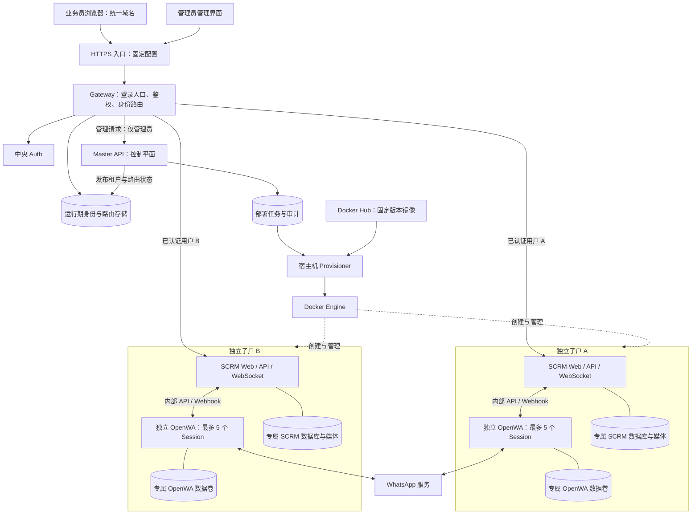

# SCRM Master + 独立 OpenWA 子户：开发交接文档

> **版本：** v1.0  
> **编写日期：** 2026-11-13（Asia/Singapore）  
> **交付对象：** 后端、前端、部署与测试负责人；可直接作为开发任务拆分基线。  
> **文档性质：** 需求确认、架构设计与验收要求，不是已经实现或经过压测的系统。  
> **OpenWA 参考项目：** `rmyndharis/OpenWA`。本文核对其当前公开文档；生产版本、commit 和镜像 digest 尚未锁定。

## 0. 一句话目标与阅读约定

**管理员在 Master 管理界面创建业务员子户，系统使用预制镜像自动部署其独立 SCRM 与 OpenWA；所有业务员访问同一个域名，以各自账号密码登录，并被透明路由到自己的子实例。**

这里的“动态扩容”是**按需创建租户实例**，不是把同一个 WhatsApp 会话复制成多个负载均衡副本。

本文采用三个标记：**已确认**表示用户已经明确的需求；**实现基线**表示本次交接提出的默认工程方案；**待验证**表示必须通过指定版本和真实设备验证，不能作为既成能力承诺。文中接口、数据表、内部令牌与 `SCRM_*` 配置均为本项目设计，不是 OpenWA 原生接口或配置。

外部技术事实使用 `[Sxx]` 标注，来源见文末；无来源标记的流程、配额、安全边界和验收项属于本项目设计要求。

---

## 1. 已确认的业务需求

| 项目 | 已确认内容 |
|---|---|
| 核心用途 | 业务员通过网页与 WhatsApp 客户收发消息，不建设复杂客户生命周期管理 |
| 部署起点 | 一台 Linux 服务器；架构中保留 `host_id`，但第一版不实现多机调度 |
| 管理模式 | 一个 Master 后端，管理所有独立子户的创建、分配、启停和升级 |
| 创建方式 | 管理员点击“创建”，填写账号、初始密码及节点配置；不要求人工执行部署命令 |
| 镜像方式 | 预制不含业务数据的镜像，发布到 Docker Hub；创建时拉取或复用本地镜像 |
| 实例隔离 | 每个子户独立部署 SCRM 运行实例及 OpenWA，不改成所有人共用一个 OpenWA |
| 号码数量 | 每个业务员子户最多绑定 1–5 个 WhatsApp Business 号码；新建时可以暂未绑定 |
| 访问入口 | 所有业务员使用同一个域名，不分配业务员子域名，不暴露容器 IP/端口 |
| 登录体验 | 输入自己的账号密码后，进入自己的子户，不手选容器或节点 |
| 客户来源 | 最多需要识别 Facebook / Instagram 来源；无法确定时显示未知 |
| 非目标 | n8n、AI 自动回复、销售漏斗、营销群发、FB Messenger / IG 私信收发、Kubernetes 均不属于第一版 |

**关于 Master“纯后端”的解释：** Master 服务不承载聊天界面或业务员消息处理，但需要一个薄管理界面调用其 API，才能实现“点击创建”。管理界面可以是单独静态前端；不必与 Master 后端打成同一进程。

## 2. 关键架构决策

| 决策 | 实现基线 | 不采用的方式 |
|---|---|---|
| 子户部署单元 | 一个逻辑节点 = 一套独立 SCRM 运行时 + 一套独立 OpenWA + 专属持久化资源 | 把“独立站点”仅实现为共享实例中的不同页面 |
| 容器组织 | 默认每子户两个容器：`scrm-node` 提供 Web/API/WebSocket；`openwa` 负责通信 | 强制把所有程序、数据库打入一个大容器 |
| 用户认证 | 中央 Auth 保存账号、密码哈希和登录会话 | 长期将业务员明文密码放入各容器环境变量 |
| 访问路由 | Gateway 根据已验证身份查询 Registry，再代理至对应子户 | 轮询任意 OpenWA；信任浏览器传入的节点地址 |
| 动态发现 | Master 创建成功后注册节点；Gateway 动态读取租户到节点映射 | 每新增一个子户就修改并重载静态反向代理规则 |
| 数据持久化 | 每节点专属 OpenWA 数据卷；SCRM 数据使用每租户独立数据库及角色 | 多个 OpenWA 共享同一个认证数据卷或同一套会话表 |
| 数据库服务 | 可以共用一个 PostgreSQL 服务，但不共享业务账号权限 | 每个子户都复制完整 PostgreSQL、缓存和管理服务 |
| 状态管理 | 容器运行、SCRM 就绪、WhatsApp 已连接分别记录 | 容器 `running` 就视为 WhatsApp 可收发 |
| 生命周期 | Master 操作持久化任务，Provisioner 执行部署，支持重试与对账 | 把一次 HTTP 请求中的若干 shell 命令当作完整编排系统 |
| 扩展边界 | 新租户增加独立实例；同一份 WhatsApp 会话数据保持单实例持有 | 对同一份会话数据执行 `--scale openwa=2` |

两个容器是实现建议，不改变“同一套标准镜像模板创建独立子户”的产品要求。业务员只看到一个 SCRM 子户，管理员只管理一个逻辑节点。

该平台的“节点注册表”和“集群管理”是自研 SCRM 控制层能力，不能与 OpenWA 上游尚受限制的多副本集群模式混为一谈。

### 2.1 身份名称必须分开

| 标识 | 含义与生命周期 |
|---|---|
| `user_id` | 人员身份；人员离职不应自动删除聊天数据 |
| `tenant_id` | 子户永久身份；本文的“站点 / 子户”统一使用这个标识 |
| `node_id` | 逻辑运行节点；容器重建时保持稳定 |
| `host_id` | 宿主机身份；第一版固定一个值 |
| `container_id` | Docker 运行实例；重建会变化，不作为业务主键 |
| `wa_account_id` | SCRM 中的一次 WhatsApp 账号绑定身份，关联其历史消息 |
| `provider_session_id` | 对应 OpenWA 内部的会话 ID |
| `login_session_id` | 业务员网页登录会话，与 WhatsApp Session 完全无关 |

第一版采用“一个业务员拥有一个子户”，但人员归属通过关联关系表示，不把 `user_id` 当作 `tenant_id`。业务员交接时变更归属，不复制或重建 WhatsApp 登录凭据。

---

## 3. 总体架构



不支持 Mermaid 的阅读器可以按以下关系理解：

```text
业务员 → 同一个 HTTPS 域名 → Auth + Gateway → 其专属 SCRM → 其专属 OpenWA
管理员 → 管理界面 → Master → 部署任务 → Provisioner → 创建上述专属资源
```

Master 不位于聊天消息必经路径。Gateway、Auth、Registry 和数据库是运行期依赖，即使与 Master 部署在同一台机器上，也必须能够独立运行。

**这仍然是单机部署，不是高可用集群。** 宿主机、入口、Gateway 和共享数据库均可能成为故障点；进程分离不能消除这些共同故障。

## 4. 组件职责与权限

| 组件 | 负责 | 明确不负责 / 不持有 |
|---|---|---|
| Admin UI | 创建子户、查看任务与状态、冻结/升级操作 | 不持有 Docker 凭据，不直接执行部署 |
| Master API | 管理员授权、租户配置、任务提交、版本与审计 | 不转发客户消息；不处理业务员的每次聊天请求 |
| Provisioner | 受控拉取镜像、创建网络/卷/容器、配置数据库、资源回收 | 不接受任意镜像、宿主机挂载、shell 或 Docker 参数 |
| Auth | 账号、密码校验、改密、登录会话、角色与冻结状态 | 不把登录密码分发至子节点 |
| Registry | 已发布的 `tenant_id → node_id → endpoint` 映射及状态 | 不保存业务员明文密码，不充当消息总线 |
| Gateway | HTTP/WS 鉴权与代理、登录上下文校验、租户路由 | 不维护 WhatsApp 连接，不持有 Docker Socket |
| SCRM Node | 聊天 UI、消息存储、发送任务、OpenWA 适配、来源显示 | 不访问其他租户的数据库、会话卷或中央密码库 |
| OpenWA | WhatsApp 会话、收发接口、事件通知 | 不直接向业务员公开管理 API，不拥有部署其他容器的权限 |

第一版可以把 Auth 与 Gateway 的代码放在同一服务中，也可以共用代码仓库；**逻辑权限边界必须保留**。Provisioner 在宿主机执行，Docker 权限只授予该受信执行器。

---

## 5. 创建子户：完整流程

### 5.1 管理接口契约

以下是**自研 Master API**示例，不是 OpenWA API。密码示例为占位内容，生产请求体禁止写入日志。

```http
POST /admin/api/v1/tenants
Content-Type: application/json
Idempotency-Key: <管理员本次创建动作的唯一 UUID>
```

```json
{
  "username": "sales_008",
  "initial_password": "<创建时输入，进入服务后立即哈希>",
  "display_name": "业务员 008",
  "wa_account_limit": 5,
  "deployment_profile": "standard"
}
```

返回任务而不是等待扫码完成：

```json
{
  "tenant_id": "t_008",
  "node_id": "n_008",
  "job_id": "job_008",
  "status": "PROVISIONING",
  "login_path": "/login"
}
```

HTTP 状态为 `202 Accepted`。管理界面查询 `GET /admin/api/v1/jobs/job_008` 展示进度。这里的异步是**待开发系统内的任务机制**，并不是部署已在本文中执行。

### 5.2 执行步骤

| 阶段 | 动作 | 必须满足的条件 |
|---|---|---|
| 校验 | 检查管理员权限、全局唯一账号、配额、资源余量 | `wa_account_limit` 为 1–5；输入不能直接成为 shell 参数或路径 |
| 建档 | 创建租户、用户、归属、节点、部署任务 | 密码立即哈希；任务表不保存明文密码；业务记录同一事务提交 |
| 选版本 | 根据受控部署配置选择镜像与模板 | 管理员只选已批准版本，不提交任意镜像 URL 或可执行命令 |
| 准备 | 创建数据库/角色、网络、空数据卷、节点密钥 | 所有资源带 `tenant_id/node_id/managed_by` 标签，可恢复识别 |
| 拉取 | 获取固定 digest 镜像或复用本地缓存 | 不现场编译；镜像中没有其他租户数据或 WhatsApp 凭据 |
| 启动 | 创建容器时注入配置，挂载独立卷和 Secret | 配置白名单；不向子节点授予宿主机管理权限 |
| 初始化 | 执行数据库迁移、OpenWA 安全初始化、内部集成配置 | 初始化可重复；没有登录 WhatsApp 不应导致节点初始化失败 |
| 探测 | 校验节点身份、数据库与内部 API 可用 | 返回的 `tenant_id/node_id/config_revision` 必须与任务一致 |
| 发布 | 原子发布路由与租户可用状态 | 只有通过探测的节点才接受业务流量 |
| 交付 | 管理界面显示完成，业务员可登录并绑定号码 | “子户创建完成”不等于“WhatsApp 已连接” |

如果资源不足，应拒绝或暂停创建，返回可解释状态；不能为了“创建成功”使现有子户进入 OOM 或磁盘耗尽。

### 5.3 幂等与失败恢复

创建请求使用幂等键；重复点击返回同一个任务。相同幂等键但不同有效参数应报冲突。持久化任务保存步骤、结果、资源 ID、错误码和下一次重试时间，使用任务锁保证同一节点同时只有一个生命周期操作。

数据库事务不能覆盖 Docker 操作，必须用分步骤补偿与周期对账：检查“数据库记录”和“实际容器/卷/网络”是否一致。执行器崩溃后先检查资源，再继续，不得盲目重复创建。

失败后不发布路由；自动清理仅限确认属于当前失败任务、且尚无业务数据的资源。已登录 WhatsApp 或已有聊天数据的卷不得按“失败清理”删除。

---

## 6. 同域名登录与动态路由

### 6.1 固定入口与动态映射

HTTPS 入口只配置一次，将流量交给 Gateway。新增租户时改变的是注册表内容，不是入口代理配置。

```text
公网域名 → 固定 Gateway

Registry：
t_001 → n_001 → http://scrm-n-001:3000 → READY
t_002 → n_002 → http://scrm-n-002:3000 → READY
t_008 → n_008 → http://scrm-n-008:3000 → STARTING（未发布）
```

这些地址是内部命名示例。真实地址由 Provisioner 创建的网络与稳定 DNS alias 决定，不取自用户请求。

这里需要两层能力：**Docker 网络解析负责“服务地址在哪里”，Registry 负责“这个身份应访问哪个服务”**。Compose 网络支持服务名解析，容器更新后地址可能改变，因此不应长期绑定容器 IP。[S08]

不要求引入 Consul、etcd 或 Traefik Docker Provider。Traefik / Nginx / Caddy 可以做固定 TLS 入口，但不能仅靠容器发现替代登录身份路由。

### 6.2 请求路径约定

| 路径 | 路由目标与规则 |
|---|---|
| `/login`、登录页静态资源 | Gateway/Auth 的公共登录入口 |
| `/auth/*` | 中央 Auth；不能代理给租户节点 |
| `/admin/*` | 管理界面与 Master；必须校验平台管理员角色 |
| `/`、`/app/*`、节点前端资源 | 登录后代理至该用户所属的 SCRM 节点 |
| `/api/v1/*` | 登录后代理至该用户所属的 SCRM 节点 |
| `/ws` | 已认证 WebSocket；握手后固定到该用户所属节点 |
| `/internal/*` | 公网入口一律拒绝；只允许规定的内部通信 |
| OpenWA 的原生 API/管理界面 | 不直接映射为公网路由 |

Gateway 实现明确的路由白名单。不能把无法匹配的路径无条件转发给节点。

### 6.3 认证流程

业务员提交账号密码给 Auth。Auth 校验账号状态、密码与租户归属，建立中央登录会话。第一版账号全局唯一，用户名规范化后判重；无需让业务员输入额外的租户编号。

实现基线采用服务器端登录会话和浏览器安全 Cookie：

```http
Set-Cookie: __Host-scrm_sid=<随机不透明会话令牌>; Path=/; HttpOnly; Secure; SameSite=Lax
```

服务端只保存该令牌的校验值及相关会话记录，不把密码或 OpenWA Key 放入 Cookie。登录成功、改密及权限变更按会话策略轮换或撤销。密码使用成熟库的 Argon2id 实现，并根据目标机器测试成本；不要使用可逆加密或普通摘要代替密码哈希。[S10][S11]

每个受保护请求按以下次序处理：

```text
验证登录会话
→ 读取用户状态、角色与当前租户归属
→ 检查租户 ACTIVE 状态
→ 查询已发布的节点路由
→ 检查节点就绪状态与当前路由版本
→ 生成内部身份凭证
→ 代理到对应节点
```

冻结账号必须撤销现有登录会话，而不是只禁止下一次登录。第一版建议安全状态校验直接读取运行期存储；以后引入缓存时必须定义撤销通知及最大生效延迟。

Cookie 鉴权的写接口必须有 CSRF Token 与来源校验，不能只依赖 `SameSite`；登录接口也要防跨站登录及暴力尝试。登录失败使用统一错误，避免泄露账号是否存在；平台管理员上线前启用额外认证因素。二维码、登录请求体与认证响应均禁止缓存或写入普通访问日志。

### 6.4 节点不能只相信一个 `X-Tenant-ID`

Gateway 必须删除客户端伪造的内部身份头、OpenWA 凭据和节点选择信息。浏览器提交的 `tenant_id`、`node_id`、URL 参数只能作为非可信输入，不能决定权限或目标地址。

建议 Gateway 为上游请求签发短时内部身份凭证，节点验证公钥、签发者、有效期和 audience，再核对其固定租户身份。结构示例：

```json
{
  "iss": "scrm-gateway",
  "aud": "n_008",
  "sub": "u_008",
  "tenant_id": "t_008",
  "roles": ["sales"],
  "route_version": 3,
  "iat": 1794550000,
  "exp": 1794550030
}
```

时间仅为格式示例；实际由 Gateway 按请求生成。签名私钥只在 Gateway，节点仅持有验证公钥；算法固定且禁止降级。节点确认 `tenant_id` 与启动时身份一致后，仍须校验 `wa_account_id/chat_id/media_id` 的归属。

中央登录 Cookie 不应原样传到租户节点。节点响应不允许覆盖中央认证 Cookie；Gateway 过滤节点试图设置的认证相关 `Set-Cookie`。内部凭证只用于 Gateway 到节点，不返回浏览器。

### 6.5 WebSocket、代理与不可用处理

WebSocket 在握手时验证登录和 `Origin`，连接绑定 `user_id + tenant_id + node_id + login_session_id`，不根据后续客户端消息切换节点。退出、冻结、交接及登录会话失效时关闭相关连接；已建立连接不能无限绕过后续权限变化。[S12]

节点故障时返回本子户不可用，**不得把请求回退到其他业务员节点**。路由过期或数据库不可用时不得猜测身份。Gateway 不自动重试发送消息的 POST；重试由持久化发送任务结合幂等键控制。

Gateway 要支持 HTTP Upgrade、合理的上传/下载限制、代理超时与流式媒体转发。节点重建后，旧连接断开，客户端重新认证连接，并按消息游标补拉，而不是假设所有实时事件都已经收到。

### 6.6 同域名意味着共享浏览器来源

`localStorage` 按 origin 归属，而不是按后端容器隔离。[S13] 因此“容器独立”不会自动使浏览器缓存独立。

本项目要求：聊天、客户资料和登录信息不进入公共 CDN 缓存；认证 HTML/API 返回 `Cache-Control: private, no-store`；只有不含租户内容且使用内容哈希命名的静态资源可以公共缓存。运行时配置必须单独鉴权读取，不编译进公共 JS。

第一版不启用 Service Worker，不支持同一浏览器配置文件内不同标签页同时登录不同业务员。账号切换时清理前端状态与租户缓存、断开旧连接，并通知其他标签页重新登录。

为防止旧标签页在账号切换后误操作新账号，写请求携带中央登录产生的 `ui_context_id`；Gateway 将其与当前 Cookie 会话比较，不一致即拒绝并要求刷新。该字段只是防串操作保护，**不是认证凭证**。

节点前端代码由平台统一发布，不能允许业务员上传任意脚本或自定义前端。对 HTML/SVG 等不可信附件默认按下载处理，不在统一登录域名下作为可执行页面展示。

---

## 7. 单机部署、网络与数据卷隔离

### 7.1 镜像与模板

```text
平台镜像：master / gateway-auth / admin-ui / provisioner（可按代码库合并构建）
租户镜像：yourorg/scrm-node:<已批准版本>
          yourorg/openwa:<已验证上游版本与封装版本>

每个租户 Compose Project：scrm-t-001、scrm-t-002、……
每个租户独立资源：SCRM 容器、OpenWA 容器、OpenWA 数据卷、媒体卷、网络、数据库角色
```

镜像必须固定版本和 digest，保存与部署模板的对应关系；不能让生产节点无审核跟随 `latest`。所有镜像不包含员工密码、WhatsApp 登录状态、数据库文件、API Key 或其他租户媒体。

Compose 项目名可用于重复部署同一模板。[S07] 但资源隔离仍必须通过实际生成的容器、网络与卷名称检查。

### 7.2 不能直接复制上游 Compose 后仅修改 `-p`

核对时，上游 `docker-compose.yml` 包含固定 `container_name`、显式命名的数据卷及网络，并为内置基础设施管理提供 Docker Socket Proxy。[S03]

因此模板必须做以下改造：

| 上游模板特征 | 本项目要求 |
|---|---|
| 固定 `container_name` | 去除，让 Compose 生成；或使用不可冲突的节点级名称 |
| 固定 volume `name:` | 去除，使用项目作用域；或显式包含不可变租户 ID |
| 固定 network `name:` | 改为受控的租户独立网络；共享网仅用于明确的共享服务 |
| 宿主机端口映射 | 不给每个 OpenWA 发布公网端口；通过内部网络访问 |
| Docker Socket / Socket Proxy | 租户 OpenWA 禁用该能力；基础设施由平台 Provisioner 提供 |
| 内置数据库自动编排 | 不授权给业务员或租户节点，避免创建越权资源 |

**验收不能只看 Compose 项目名不同。必须 `inspect` 实际挂载源、网络与容器名，确认两个子户没有使用同一个认证卷。**

### 7.3 网络实现基线

| 网络 | 成员与用途 |
|---|---|
| `platform-core` | Gateway、Auth、运行期数据库等受信平台组件 |
| 每租户 `ingress` 网络 | 仅 Gateway 与该 SCRM Node，提供入口到节点的访问 |
| 每租户 `wa` 网络 | 该 SCRM Node 与 OpenWA，提供 API 和 Webhook；OpenWA 保留访问 WhatsApp 的出网能力 |
| 每租户 `data` 网络 | 该 SCRM Node 与 PostgreSQL 数据服务端点，配合专属角色进行数据库隔离 |

Provisioner 创建租户时自动连接相应平台服务的网络，并使用全局唯一的 SCRM DNS alias，例如 `scrm-n-008`。不同网络里的同名 `scrm` 不应作为 Gateway 选择节点的依据。

网络成员变更属于自动部署动作，不是修改入口代理配置。网络地址池及平台容器连接网络数量要纳入容量测试。OpenWA 所在网络不能被误设成完全无外网能力；Docker 中 `internal` 网络与“仅供业务内部使用”不是同义词。[S08]

若后续为了简化改为共享数据网络，必须补充东西向访问规则，并明确共享网络不等于强网络隔离。无论网络方案如何，节点都必须验证内部身份，数据库都必须独立授权。

### 7.4 Docker 管理安全

Docker 控制权具有高权限，容器创建参数尤其需要严格限制。[S09] 业务员、SCRM Node、OpenWA、Gateway 均不得访问 Docker Socket；只有受信 Provisioner 使用宿主机管理权限。

Provisioner 只接受“创建已批准模板、停止已归属节点、升级到已批准版本”等有限动作。镜像、挂载目录、网络、容器标签均从服务端规则生成；拒绝任意宿主机路径、特权模式、`host` 网络和用户自带启动命令。

对 Socket 使用 `:ro` 挂载不应被当作 Docker API 只读权限保证；不要把仅做 HTTP 路径过滤的 Socket Proxy 视为完整的租户授权系统。

租户容器默认降权、设置 CPU/内存/PID/日志限制；非 root、只读根文件系统、临时目录与 Chromium 运行需求按选定镜像实测。不能在没有验证的情况下叠加会导致引擎无法启动的安全参数。

---

## 8. 配置、Secrets 与初始化

### 8.1 自研 SCRM Node 的配置契约

以下环境变量由本项目实现，不声称是 OpenWA 原生配置。所有字段应在启动时进行类型、范围与相互关系校验。

```dotenv
SCRM_TENANT_ID=t_008
SCRM_NODE_ID=n_008
SCRM_HOST_ID=host_001
SCRM_CONFIG_REVISION=1
SCRM_PUBLIC_ORIGIN=https://scrm.example.com
SCRM_WA_ACCOUNT_LIMIT=5
SCRM_OPENWA_BASE_URL=http://openwa:2785
SCRM_DATABASE_URL_FILE=/run/secrets/scrm_database_url
SCRM_OPENWA_API_KEY_FILE=/run/secrets/openwa_api_key
SCRM_WEBHOOK_SECRET_FILE=/run/secrets/openwa_webhook_secret
SCRM_GATEWAY_VERIFY_KEY_FILE=/run/secrets/gateway_verify_key
SCRM_MEDIA_PATH=/var/lib/scrm/media
```

`_FILE` 表示自研应用需要主动读取文件，Docker 不会自动将任意 `_FILE` 变量转换成应用密钥。

`SCRM_WA_ACCOUNT_LIMIT` 是允许保留的账号绑定额度，不只是当前在线数量；创建中、等待扫码及断线但未解除绑定的账号也占额度。必须通过数据库事务执行配额检查，不能只在前端隐藏“添加”按钮。

### 8.2 密码与密钥去向

| 信息 | 存储与使用 |
|---|---|
| 业务员账号、初始密码 | Auth 接收；密码只保存哈希，首次登录要求改密；不进入节点镜像或环境 |
| 节点普通身份配置 | 创建容器时注入环境变量 |
| 数据库凭据、OpenWA API Key、Webhook Secret | 每租户独立 Secret 文件或凭据服务；日志脱敏 |
| Gateway 签名私钥 | 仅 Gateway 持有；节点只得到验证公钥 |
| Docker Hub 拉取凭据 | 仅 Provisioner/宿主机持有，不发给租户容器 |
| WhatsApp 登录凭据 | 仅该节点的持久化数据卷；不通过浏览器或管理 API 导出 |

Compose Secrets 可通过按服务授权的文件挂载交付敏感配置。[S06] 在单机 Compose 模式下还必须保护宿主机上的源文件及备份；不能据此宣称已具备完整加密密钥管理系统。

环境变量通常在容器创建时确定。静态配置变更通过受控重建应用；修改业务员密码只变更中央认证记录，不重建 OpenWA。前端构建变量与运行时变量分开，节点 UI 通过鉴权接口取得安全的运行时配置。

### 8.3 OpenWA 配置适配要求

由一个专门的 OpenWA Adapter / 部署封装负责映射当前版本支持的参数，不把自研变量原样当成上游能力。

核对时，上游文档提供会话自启动、数据路径、启动密钥和 SSRF 相关配置；`API_MASTER_KEY` 是首次初始化用途，改变它不等于轮换既有 Key；内网 Webhook 可使用精确的 `SSRF_ALLOWED_HOSTS` 例外。[S04]

实现要求如下：不发明 `API_MASTER_KEY_FILE` 等未经确认的官方变量；需要 Secret 文件支持时在封装入口显式实现。Key 初始化与轮换分成两个动作，并验证重启后仍可访问。开启会话恢复前确认单实例独占；停止/注销会话与容器重启语义分开。

只允许平台为内部 Webhook 接收地址设置精确例外，不全局关闭 SSRF 防护，不允许业务员配置任意回调或媒体抓取内网地址。先启动接收服务并确认 DNS 可解析，再注册 Webhook。

---

## 9. 数据存储与最小模型

### 9.1 存储布局

实现基线为一个共享 PostgreSQL 服务承载平台数据和各租户 SCRM 数据，但每租户使用独立数据库、独立非超级用户角色与凭据。必须处理 `PUBLIC` 默认权限、数据库连接权限及角色继承，不能只创建不同数据库名就宣称隔离。[S14]

OpenWA 自身先使用其经验证的本地存储配置，完整持久化节点专属 `/app/data`；如所选版本或自定义路径有变化，按兼容性矩阵调整。核对时上游 Compose 使用该挂载点。[S03] 不让不同租户的 OpenWA 连接到同一套 Session 业务表。

| 数据 | 保存位置 | 权限边界 |
|---|---|---|
| 用户与登录会话 | 平台认证数据库 | Auth 可写；Gateway 仅按运行期授权访问 |
| 租户、节点与路由 | 平台控制/运行期存储 | Master 写；Gateway 只读所需映射 |
| 部署任务、资源记录、管理审计 | 平台管理数据库 | Master/Provisioner，业务员不可读写 |
| SCRM 会话、消息、来源 | 每租户专属数据库 | 对应节点角色，不授予中央管理权限 |
| OpenWA 会话及应用数据 | 每节点独立数据卷 | 仅对应 OpenWA；维护备份走受信管理流程 |
| SCRM 媒体文件 | 每租户媒体卷 | 对应 SCRM；访问必须经过资源授权 |
| 密钥备份 | 独立加密备份 | 与普通配置、日志、镜像分开 |

OpenWA 记录用于通信恢复与对账；SCRM 数据库是聊天界面的业务记录来源。通过适配层/API 集成，不跨服务直接修改 OpenWA 内部表。

### 9.2 平台侧模型

| 表 / 实体 | 核心字段与约束 |
|---|---|
| `users` | `id, username_normalized UNIQUE, password_hash, status, must_change_password, auth_version` |
| `tenants` | `id, name, status, wa_account_limit, config_revision`；配额范围 1–5 |
| `memberships` | `user_id, tenant_id, role, status`；第一版每业务员最多一个活动子户 |
| `nodes` | `id, tenant_id, host_id, compose_project, desired_state, observed_state, image_digests, config_revision` |
| `tenant_routes` | `tenant_id UNIQUE, node_id, endpoint, route_version, published, updated_at` |
| `login_sessions` | `id, token_hash, user_id, auth_version, ui_context_id, expires_at, revoked_at` |
| `provision_jobs` | `id, tenant_id, operation, idempotency_key, state, step, attempts, locked_until, error_code` |
| `managed_resources` | `tenant_id, node_id, job_id, resource_type, resource_id, lifecycle_state` |
| `credential_refs` | 凭据引用、类型、版本、轮换时间；不在管理响应中返回明文 |
| `admin_audit_logs` | 操作人、目标、动作、结果、请求 ID、时间；敏感内容脱敏 |

### 9.3 节点侧模型

| 表 / 实体 | 核心字段与约束 |
|---|---|
| `wa_accounts` | `id, tenant_id, node_id, provider_session_id, binding_status, phone, display_name` |
| `chats` | `id, tenant_id, wa_account_id, provider_chat_id, last_message_at, unread_count` |
| `messages` | `id, tenant_id, wa_account_id, chat_id, provider_message_id, direction, origin, status, body, timestamps` |
| `send_jobs` | `id, client_request_id, payload_hash, wa_account_id, state, provider_idempotency_key, last_error` |
| `webhook_inbox` | `source_instance_id, provider_event_key, event_type, body, received_at, processed_at` |
| `media_objects` | `id, tenant_id, wa_account_id, storage_key, mime_type, byte_size, checksum, status` |
| `chat_sources` | `chat_id, platform, method, evidence_ref, observed_at, updated_by` |

最低唯一性约束：

```text
chats：          UNIQUE(tenant_id, wa_account_id, provider_chat_id)
messages：       UNIQUE(tenant_id, wa_account_id, provider_message_id)  # 仅适用于非空 provider ID
send_jobs：      UNIQUE(tenant_id, client_request_id)
webhook_inbox：  UNIQUE(source_instance_id, provider_event_key)
wa_accounts：   UNIQUE(node_id, provider_session_id)
```

这些是逻辑约束，不是完整 SQL 迁移。实现时按引擎事件格式核对消息 ID 的唯一性，必要时把 `provider_chat_id` 纳入索引；同一条消息的 ACK、编辑等是不同事件，不能仅按消息 ID 丢弃所有后续更新。

SCRM 账号绑定身份与 OpenWA 会话槽位分开。更换手机号时新建绑定身份或显式记录绑定版本，不把旧客户消息错误归到新号码。除非有明确流程，系统内不允许同一个业务号码同时归属两个活动子户；这不是对 WhatsApp 自身关联设备规则的描述。

---

## 10. OpenWA 适配与消息可靠性

### 10.1 上游能力边界

所参考项目提供单实例多 Session；扩展文档虽然已有部分会话所有权/租约实现，仍要求每份 Session 数据仅使用一个 API 实例。[S01][S02]

本项目采用：

```text
节点 A：自己的 OpenWA + 自己的 Session A1…A5 + 自己的数据卷
节点 B：自己的 OpenWA + 自己的 Session B1…B5 + 自己的数据卷
```

不采用“同一份已登录认证状态复制给 A/B 并同时启动”。数据库共享、粘性会话或入口服务发现都不能把这种有状态进程自动变成无状态副本。

当前 API 文档中的接入事实如下，均须用锁定版本做回归：[S05]

| 能力 | 适配注意点 |
|---|---|
| API 认证 | 服务端使用 `X-API-Key`；浏览器不持有该 Key |
| Webhook 验签 | `X-OpenWA-Signature` 对原始请求字节做 HMAC-SHA256；不能先解析再序列化验签 |
| Webhook 去重 | 使用 `X-OpenWA-Idempotency-Key`，不能把投递 ID 简单当作业务唯一性 |
| 单收件人发送幂等 | 支持 `Idempotency-Key`；文档给出的保留窗口为 24 小时，结果不确定时可能返回 `IDEMPOTENCY_OUTCOME_UNKNOWN` |

上游能力不等于本系统端到端“恰好一次”。浏览器、SCRM 任务、网络、OpenWA 和 WhatsApp 之间仍有故障窗口。

### 10.2 入站消息

```text
客户 → WhatsApp → 本租户 OpenWA
→ 本租户 SCRM 私有 Webhook
→ 验签、检查来源与 Session 归属
→ 事务写入 webhook_inbox
→ 返回成功
→ 幂等投影到 messages/chats
→ WebSocket 通知该租户已认证客户端
```

Webhook 必须在**可靠落库后**返回成功；不能先返回 2xx、再仅放内存等待处理。业务投影失败时保留事件可重试，不因前端断线而丢弃记录。

身份来自接收端已配置的来源实例与对应密钥，事件中的 `tenant_id/session_id` 不能单独作为授权依据。消息更新时间与接收时间分开保存，处理乱序 ACK、重复事件和延迟到达。

### 10.3 出站消息

```text
业务员 → Gateway → 本租户 SCRM
→ 校验账号/聊天归属与配额、冻结状态
→ 以 client_request_id 创建发送任务
→ Worker 调用本节点 OpenWA，使用稳定的 provider_idempotency_key
→ 保存结果，合并发送回显与 ACK
→ 更新前端状态
```

前端一次点击生成一个 `client_request_id`，刷新或网络重试仍使用同一个 ID；相同 ID、不同内容返回冲突。Worker 领取任务要有持久化锁或租约，进程重启先对账再续作。

SCRM 状态建议为 `QUEUED → SENDING → SENT → DELIVERED → READ`，另有 `FAILED` 与 `UNKNOWN`。这是本系统模型，不照搬上游枚举。不同客户端未提供的送达/已读信息显示“未知”，不能用 API 接受请求代替客户已读。

超时不等于未发送。结果未知时保留相同上游幂等键，先查询记录/回显；遇到上游明确未知结果或超过安全重试窗口时，不自动换新键重发。界面显示“结果待确认”，由对账或人工确认处理，避免客户收到重复消息。

### 10.4 手机发送、离线恢复与媒体

手机端发送与 API 发送可能产生回显，SCRM 应根据提供方消息 ID 合并，不重复显示。**手机发出消息是否完整同步、历史消息能补多少、不同引擎是否一致，均属于待验证能力。**

断线恢复后按可用的持久化消息接口、游标和失败事件进行有界对账；对补不回的区间显式记录，不承诺 WhatsApp 全量历史同步。前端重连也要补拉数据库记录，WebSocket 不是持久化消息队列。

媒体接收可能只有元数据，下载可能失败；分别保存消息与媒体状态。下载、查看、转发、删除均检查租户与账号归属；资源大小、类型、请求超时及磁盘配额必须有限制。不把大媒体直接塞进公共日志或无限内存队列。

### 10.5 Adapter 最小接口

```text
createAccountSession / startSession / getPairingCode / getSessionStatus
stopSession / logoutSession
sendText / sendMedia
listPersistedMessages / getMedia
registerWebhook / verifyWebhook / normalizeEvent
```

这是内部接口名称，不是指定上游端点。把上游字段、引擎差异、错误码与重试语义集中封装，不让前端直接依赖 OpenWA 原始结构。

---

## 11. 聊天界面与 FB / IG 来源

第一版页面只包含账号列表/扫码状态、会话列表、消息窗口、发送框、图片/文件/语音展示、发送结果、来源标签及退出登录。不加入客户生命周期、销售阶段和自动营销流程。

多个 WhatsApp 号码应有清晰的当前身份提示。输入框旁显示正在使用哪个业务号码；切换号码时不得把上一号码的草稿或会话目标带入另一号码。

来源字段建议如下：

```json
{
  "platform": "unknown",
  "method": "unknown",
  "evidence_ref": null,
  "observed_at": null
}
```

`platform` 使用 `facebook | instagram | other | unknown`，`method` 使用 `provider_metadata | link_marker | manual | unknown`。

自动识别必须有可复核证据。平台广告字段、广告 ID 或消息元数据是否足以区分 FB/IG，需要针对实际入口采集测试；不能把“有广告信息”直接等同于“知道投放版位”。打开 SCRM 页面的 HTTP Referer 也不能代表 WhatsApp 客户来源。

无法可靠识别时显示未知，允许有审计的手工标记。带预填文案的区分链接只是一种可选的弱证据，客户可以删改或转发；不承诺准确广告归因。自动来源识别未验证前，不应写入必达销售承诺。

---

## 12. 生命周期、恢复与升级

### 12.1 三种状态分开

| 状态对象 | 建议枚举 | 含义 |
|---|---|---|
| 租户业务状态 | `PROVISIONING / ACTIVE / SUSPENDED / DELETE_PENDING / DELETED / PROVISION_FAILED` | 是否交付、能否访问 |
| 节点运行状态 | `PENDING / STARTING / READY / DEGRADED / UNREACHABLE / STOPPED / FAILED` | SCRM/OpenWA 程序及依赖健康程度 |
| WhatsApp 绑定状态 | `UNBOUND / QR_REQUIRED / CONNECTING / CONNECTED / DISCONNECTED / REAUTH_REQUIRED / ERROR` | 某个号码的通信状态 |

这些是自研枚举，上游状态通过 Adapter 映射。节点还需要 `desired_state` 与 `observed_state`：管理员要求运行，不代表当前已经运行。

SCRM 和 OpenWA API 可用、数据库初始化完成即可交付扫码界面；五个号码中一个断线，也不应把其他四个号码全部判为不可用。

### 12.2 典型故障处理

| 场景 | 预期行为 |
|---|---|
| Master API 停止 | 已有节点和运行期 Auth/Gateway/Registry 正常时，业务员仍可登录聊天；暂停管理操作 |
| 某个 SCRM Node 崩溃 | 该租户暂不可访问；其他租户不被路由影响；节点恢复后补投影与补拉 |
| 某个 OpenWA 崩溃 | 保留数据卷，受控重启；本租户显示连接状态，不能伪造发送成功 |
| WhatsApp 凭据失效 | 提示重新扫码；不能无限高速重连或静默新建账号绑定 |
| Gateway 或认证/路由存储故障 | 访问可能中断；鉴权不可用时拒绝，不降级为匿名或其他租户 |
| PostgreSQL 或磁盘故障 | 可靠落库失败时明确报错，不能确认已经接收并丢弃；触发运维告警 |
| Docker Hub 不可用 | 现有节点继续运行；没有本地目标镜像的新建/升级任务明确失败或等待重试 |
| 整台服务器故障 | 全部租户可能中断；依靠异机备份恢复，不声称单机架构具有故障转移 |

### 12.3 冻结、交接与删除

冻结子户首先撤销登录和实时连接、撤下可写访问权限，并通知节点暂停未发送任务。默认保留数据和接收入站消息；是否连 OpenWA 一并停掉，作为独立操作明确展示。冻结指令未在节点落地时，管理端显示未完成，不能提前宣称所有发送已停止。

业务员交接只变更用户归属，撤销旧用户会话并记录审计；不复制 Session 卷。删除使用“禁用 → 停止 → 备份/保留期 → 最终清除”的流程，保留期和删除授权必须配置。

删除本地凭据不等同于已成功从 WhatsApp 手机端解除关联。注销/解除关联结果需要单独确认；失败时保留运维提示，不以删除文件掩盖状态。

### 12.4 升级与迁移

**同一 OpenWA 数据卷采用停旧再启新的 Recreate 策略。** 可以逐租户升级，但不能为了单租户“零停机”而让新旧 OpenWA 同时读取已登录认证数据。

```text
检查任务锁与备份
→ 节点进入维护/停止新发送
→ 等待在途请求与事件落盘
→ 停止旧 OpenWA 并确认退出
→ 执行兼容的迁移
→ 用原数据卷启动新版本
→ 检查身份、API、会话与消息收发
→ 恢复路由/发送权限
```

回滚包含镜像和数据格式兼容性，不只是换回旧 tag。发生不可逆数据库迁移时，按经验证的备份恢复方案执行。

未来跨主机迁移必须先确认原所有者已停止，或隔离原主机后再启新实例。网络不可达不等于旧实例已死亡，不能仅凭心跳超时启动第二份相同凭据。

### 12.5 备份范围

备份平台认证/路由/任务数据库、各租户 SCRM 数据库、完整 OpenWA 数据卷、媒体、部署清单和所需密钥。SQLite 不能只随意复制运行中的主文件而忽略一致性；使用停机一致性备份或数据库支持的备份方法。

备份放到不同故障域，启用加密并定期做恢复演练；记录备份时间与可能的数据丢失范围。恢复 WhatsApp 认证状态仍可能需要重新扫码，不作无条件免扫码承诺。

---

## 13. 资源、监控与日志

容量按**总站点数、总在线 Session 数、实际引擎、媒体峰值和恢复并发**计算，不按“容器数量”或固定经验表给承诺。

```text
主机资源预算
= 平台服务 + 数据库
+ 所有 SCRM 节点开销
+ 所有 OpenWA 实例与 Session 峰值
+ 媒体处理/备份/重连开销
+ 预留余量
```

第一版至少测量单节点 1 个和 5 个号码，以及多个节点同时重连的情况。将测量后的 CPU/内存/PID/磁盘预算写入部署配置，创建时进行准入检查。单机“多创建容器”不会增加宿主机硬件容量。

监控至少覆盖主机磁盘与内存、容器重启/OOM、节点健康、每个 WhatsApp 的连接状态、Webhook 积压/失败、发送结果未知数量、队列最老等待时间、数据库连接数和备份结果。指标与日志携带 `tenant_id/node_id/request_id`，但不包含密码、Cookie、二维码内容、API Key、完整消息正文或未脱敏客户号码。

设置日志轮转和媒体保留策略；在磁盘接近阈值前限制新增节点与大媒体写入。重启和重连采用退避及抖动，避免服务器重启后所有节点同时拉起浏览器引发资源耗尽。

---

## 14. 自研 API 范围与代码组织

以下是本项目待实现接口，不是 OpenWA 官方端点；内部设计可以调整命名，但不得改变身份与权限边界。

| 模块 | 最小 API |
|---|---|
| 认证 | `POST /auth/login`、`POST /auth/logout`、`GET /auth/me`、`POST /auth/change-password` |
| 子户管理 | `POST /admin/api/v1/tenants`、`GET /admin/api/v1/tenants`、`GET /admin/api/v1/tenants/:id` |
| 生命周期 | `/admin/api/v1/tenants/:id/start`、`stop`、`restart`、`upgrade`、`suspend`、`resume`，均为显式操作 |
| 任务 | `GET /admin/api/v1/jobs/:id`；重试操作必须校验原任务状态及权限 |
| 删除与交接 | 管理员显式发起、二次确认、可审计；与简单重启接口分离 |
| 号码 | `GET/POST /api/v1/wa-accounts`；按账号提供扫码状态、连接、停止、注销操作 |
| 聊天 | `GET /api/v1/chats`、`GET /api/v1/chats/:id/messages`、`POST /api/v1/chats/:id/messages` |
| 媒体 | 受限上传、下载与查看接口；对象级授权 |
| 来源 | `GET/PATCH /api/v1/chats/:id/source` |
| 实时 | `/ws`；事件只包含已认证租户资源 |
| 内部回调 | `POST /internal/openwa/events`，仅内部网络与指定签名来源可用 |
| 内部健康 | 存活/就绪/节点身份接口；不向公网暴露细节 |

推荐仓库组织，不强制框架版本：

```text
apps/
  master-api/             # 管理 API 与任务提交
  gateway-auth/           # 中央登录、运行期路由、HTTP/WS 代理
  admin-web/              # 薄管理界面
  scrm-node/              # 每租户部署的业务 API、WebSocket 与前端产物
  provisioner/            # 受信部署执行器
packages/
  contracts/             # DTO、错误码、事件与内部身份契约
  openwa-adapter/         # 版本差异、API、Webhook、错误语义
  deployment-templates/  # 已审核的单节点部署模板
  persistence/           # 平台与租户数据库迁移
ops/
  platform/              # 单机平台部署
  backup-restore/        # 一致性备份、恢复与演练
  compatibility/         # OpenWA 版本/镜像/引擎兼容矩阵
```

语言、框架可沿用团队现有 TypeScript/Node.js 技术栈。第一版可使用 PostgreSQL 持久化任务，不为“自动创建”额外引入 n8n 或专门的工作流平台。是否增加 Redis，由选定 OpenWA 模式、消息可靠性测试和队列需求决定，不把可选组件误称为绝对不需要。

---

## 15. 实施顺序与验收标准

### 15.1 开发顺序

| 阶段 | 交付物 | 退出条件 |
|---|---|---|
| P0：通信验证 | 锁定一个 OpenWA 版本/引擎，制作干净镜像，完成适配实验 | 真实设备收发、手机回显、重启恢复、Webhook 与媒体行为有记录 |
| P1：入口与隔离 | Auth、Gateway、Registry、两个可识别身份的测试 SCRM 节点 | 同域名两账号正确路由，伪造租户与跨对象访问失败 |
| P2：创建流水线 | Master、Provisioner、任务状态、节点模板与空卷初始化 | 管理界面创建新子户，不改入口配置；失败可重试且无共享认证卷 |
| P3：聊天闭环 | 账号绑定、收发、落库、发送状态、媒体、来源字段 | 两个子户真实隔离收发；超时与重复事件不产生静默数据错误 |
| P4：运维闭环 | 冻结、交接、升级、备份恢复、容量准入与告警 | 完成故障演练、权限测试及资源测试后再增加业务号码 |

P1 可先使用模拟节点验证路由，避免将入口问题与 WhatsApp 协议问题混在一起；不能用模拟测试替代 P0/P3 的真实设备测试。

### 15.2 必须执行的验收用例

| 编号 | 测试 | 通过标准 |
|---|---|---|
| A01 | 管理员创建两个子户 | 两套独立 SCRM/OpenWA、空认证卷、密钥和数据库角色，无共享挂载 |
| A02 | 使用相同域名分别登录 | A 进入 A 节点，B 进入 B 节点，浏览器不出现内部节点地址 |
| A03 | 新增第三子户 | 无需修改/重载入口租户路由配置；Registry 发布后即可访问 |
| A04 | 重复点击创建、执行器中途重启 | 不重复创建租户资源；任务可恢复、资源可对账 |
| A05 | 创建资源不足或镜像拉取失败 | 不发布未就绪路由；不影响已有子户；错误可诊断 |
| A06 | 伪造 `tenant_id`、身份头和内部凭证 | 不能进入其他租户；错误凭证被节点拒绝 |
| A07 | A 请求 B 的聊天/媒体/账号 ID | 被拒绝；不能通过 ID 猜测获取信息或发送消息 |
| A08 | A 节点尝试使用其 DB 角色读 B 数据 | 数据库层拒绝，不依赖 UI 过滤 |
| A09 | A 注销后同浏览器登录 B，保留旧标签页 | 旧聊天不泄露；旧页面写操作因上下文失效被拒绝 |
| A10 | 冻结账号/子户 | HTTP 权限撤销、WS 关闭；发送暂停状态可确认，不只禁止新登录 |
| A11 | 绑定额度并发竞争 | 两个并发添加请求不能使绑定数超过配额；断线账号不绕过配额 |
| A12 | 两个子户同时收发 | 来源节点、业务号码、客户会话无串号或串消息 |
| A13 | Webhook 重复、延迟、乱序 | 消息不重复，ACK/编辑不被错误丢弃，不把较旧状态覆盖为新状态 |
| A14 | 发送后响应超时、Worker 重启 | 稳定幂等键与结果对账；未知结果不盲目再发 |
| A15 | 手机 App 发消息 | 按真实结果验证回显完整性；缺失的事件类型/场景写入限制说明 |
| A16 | 断网与重连、前端刷新 | 展示真实断线状态；按游标补拉可用记录，不虚报全量恢复 |
| A17 | OpenWA 容器重建 | 数据卷保留；原会话可恢复或明确提示重新扫码；不出现新旧双持有 |
| A18 | Master API 停止 | 运行期依赖正常时，已有业务员仍可登录收发 |
| A19 | 单租户节点故障 | 其他租户不被错误路由；故障租户不会落到默认节点 |
| A20 | 升级与失败回滚 | 认证数据始终单所有者；数据库版本兼容性经过验证 |
| A21 | 从备份恢复到隔离环境 | 恢复数据与配置；确认旧会话已停止后才允许真实通信 |
| A22 | FB/IG 测试入口与未知入口 | 仅有证据时标记来源，未知不猜测；人工修改留审计 |
| A23 | 密钥、日志、镜像扫描 | 无业务员明文密码、二维码、生产 Session、中央 Cookie 或敏感 API Key 泄漏 |
| A24 | Docker 权限与公网端口检查 | 仅受信执行器可控制 Docker；OpenWA/数据库不直接公开 |
| A25 | 多节点与满配额压力/重连测试 | 有测量结果、资源限制、准入阈值与容量上限，不凭理论数字宣称容量 |
| A26 | 上传媒体与消息内容含 HTML/脚本 | 不在登录域名执行；下载与缓存仍受租户权限控制 |

---

## 16. 待验证事项与上线阻断条件

### 16.1 兼容性矩阵必须补齐

| 项目 | 当前状态 | 交付时填写 |
|---|---|---|
| OpenWA 仓库 | 文档以 `rmyndharis/OpenWA` 为准 | 仓库地址与许可文件随交付保存 |
| OpenWA release / commit | 未锁定 | 精确版本与 commit |
| 镜像 | 尚未构建交付 | Docker Hub 仓库、不可变 digest、构建记录 |
| WhatsApp 引擎 | 未决定 | 选定引擎、版本、已测功能差异 |
| 数据路径与备份 | 设计已定义，未实测 | 实际路径、数据库、备份/恢复日志 |
| API / Webhook / 幂等 | 查阅了当前文档，未联调 | 请求样本、签名与失败场景测试结果 |
| 手机消息回显与历史补齐 | 不保证完整 | 实测场景、缺失范围、UI 提示 |
| FB/IG 自动识别 | 不保证可得 | 每种入口的原始证据与判定规则 |
| 容量 | 未压测 | 目标主机、总站点/号码数、峰值结果 |
| 保留与恢复目标 | 未设定 | 消息/媒体/备份保留期、允许丢失范围与恢复目标 |

**上线阻断项：** 租户隔离失败、数据卷共享、Docker 权限泄露、节点身份未验证、发送结果未知时盲目重发、没有可恢复备份、无法解释号码所属关系、基本双向消息链路不可靠。

历史记录不完整和来源未知必须有明确产品提示；是否将自动归因作为上线硬条件，应依据实际验证结果单独确认，不阻碍先完成独立实例与身份路由基础建设。

### 16.2 非官方接入风险

OpenWA 项目明确其使用非官方客户端而非 Meta Cloud API，存在账号限制或封禁风险。[S01] 容器隔离、独立数据卷和 Gateway 不能消除这一风险，也不意味着各业务号码获得独立信誉或账号安全保证。

首轮通信测试使用经授权且可承担测试风险的号码；不能把主力号码当作未经验证的部署试验对象。用户数据只为正常客户沟通处理，不设计绕过平台限制或未经同意的批量触达功能。

---

## 17. 给开发者的交付边界

本次交接交付的是架构与任务规范，**没有已经运行的服务、实际构建的镜像或压测结论**。不要把文中的示例账号、ID、地址、版本占位符或接口设计误作真实环境参数。

第一版的完成定义不是“能启动容器”，而是：

> 管理员在界面创建子户 → 平台完成独立部署和路由登记 → 业务员在统一域名登录进入自己的实例 → 绑定额度内的 WhatsApp 号码 → 可靠收发并持久化 → 能冻结、恢复、升级及备份，且全过程不会串租户。

**不得偏离的四条边界：独立部署子户；同域名身份路由；人类账号与节点凭据分离；同一份 WhatsApp 认证状态只有一个运行所有者。**

---

## 18. 参考来源与核对范围

核对日期为 2026-11-13。GitHub `main` 与在线文档可能继续更新；开发时须保存与实际镜像对应的版本快照。下列资料支持外部技术事实，不代表上游认可本文整个 SCRM 架构。

| 编号 | 来源及用途 | 地址 |
|---|---|---|
| S01 | OpenWA README：项目定位、多 Session、非官方接入风险 | `https://github.com/rmyndharis/OpenWA/blob/main/README.md` |
| S02 | OpenWA Horizontal Scaling：单 Session 数据卷的单 API 实例支持边界 | `https://github.com/rmyndharis/OpenWA/blob/main/docs/13-horizontal-scaling.md` |
| S03 | OpenWA Compose：固定命名、数据挂载、Docker 管理组件 | `https://github.com/rmyndharis/OpenWA/blob/main/docker-compose.yml` |
| S04 | OpenWA 环境配置：参数来源、初始化密钥、会话恢复、SSRF 例外 | `https://github.com/rmyndharis/OpenWA/blob/main/.env.example` |
| S05 | OpenWA API Specification：认证、Webhook 签名与幂等、发送幂等 | `https://github.com/rmyndharis/OpenWA/blob/main/docs/06-api-specification.md` |
| S06 | Docker Compose Secrets：敏感配置的按服务文件挂载 | `https://docs.docker.com/compose/how-tos/use-secrets/` |
| S07 | Docker Compose 项目名：重复部署与命名作用域 | `https://docs.docker.com/compose/how-tos/project-name/` |
| S08 | Docker Compose Networking：服务名、地址变化与网络行为 | `https://docs.docker.com/compose/how-tos/networking/` |
| S09 | Docker Engine Security：Daemon 权限与创建容器参数风险 | `https://docs.docker.com/engine/security/` |
| S10 | OWASP Password Storage：密码哈希 | `https://cheatsheetseries.owasp.org/cheatsheets/Password_Storage_Cheat_Sheet.html` |
| S11 | OWASP Session Management：网页登录会话安全 | `https://cheatsheetseries.owasp.org/cheatsheets/Session_Management_Cheat_Sheet.html` |
| S12 | OWASP WebSocket Security：握手、来源及连接生命周期授权 | `https://cheatsheetseries.owasp.org/cheatsheets/WebSocket_Security_Cheat_Sheet.html` |
| S13 | MDN localStorage：浏览器存储的 origin 边界 | `https://developer.mozilla.org/en-US/docs/Web/API/Window/localStorage` |
| S14 | PostgreSQL Privileges：角色、对象授权与 PUBLIC 权限 | `https://www.postgresql.org/docs/current/ddl-priv.html` |
