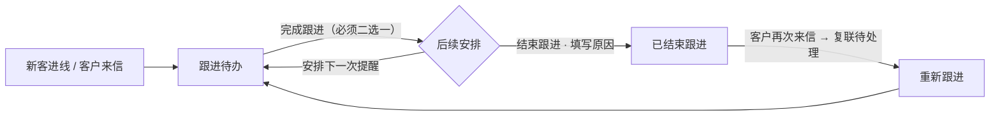

# Plan 001: The prototype closes the customer-engagement loop with tags as support — lifecycle stages, pipelines and deals are removed

> **Executor instructions**: Follow this plan step by step. Run every
> verification command and confirm the expected result before moving to the
> next step. If anything in the "STOP conditions" section occurs, stop and
> report — do not improvise. When done, update the status row for this plan
> in `plans/README.md` — unless a reviewer dispatched you and told you they
> maintain the index.
>
> **Drift check (run first)**: `git diff --stat 53b0bff..HEAD -- work/wa-replica README.md PRODUCT.md DESIGN.md replica/build-log.md outputs/wa-replica-prototype/README.md "启动SCRM原型预览.cmd"`
> If any in-scope file changed since this plan was written, compare the
> "Current state" facts against the live code before proceeding; on a
> mismatch, treat it as a STOP condition. (Changes under `plans/` only are expected and fine.)

## Status

- **Priority**: P1
- **Effort**: L
- **Risk**: MED
- **Depends on**: none
- **Category**: direction
- **Planned at**: commit `53b0bff`, 2026-11-17

## Why this matters

The product owner decided on 2026-11-17: *"strip out the funnel and lifecycle stages for now. Instead, focus on closing the loop on customer engagement, using tags as a supporting mechanism; that should be sufficient."* The prototype currently centres on a stage-based lifecycle (a kanban board per pipeline, a pipeline settings page, stage transitions, and a quotes/orders "deals" centre). That is more process than the team wants, and the project's own handoff document already says the product should "not build complex customer lifecycle management".

After this plan, the prototype has **no stages, no pipelines, no funnel and no quotes/orders**. What remains is the engagement loop: every customer who is being followed up must always have a next follow-up; finishing a follow-up forces a choice between scheduling the next one or explicitly ending follow-up; a customer whose follow-up ended resurfaces when they write again. User-defined tags are the only way to classify customers, and they plug into the loop (filter the follow-up centre by tag; update tags while finishing or ending a follow-up).

### Decisions already made (do not re-open; do not ask)

The owner delegated these to the advisor and said no further review is needed:

1. The **deals centre** (quotes, orders, LTV, repurchase reminders) is removed together with the lifecycle board and pipeline settings. Follow the repo's existing convention for "not for now" features: remove the pages from the build and record the modules as `本轮不展示` (deferred) in the requirement records. The code stays recoverable from git history (commit `53b0bff`).
2. A customer has exactly two engagement states: **open** (`跟进中`) and **closed** (`已结束跟进`). Ending follow-up requires a free-text reason. There is **no hardcoded list of reasons** and no other state.
3. **Tags stay fully user-defined.** The system never creates, renames or auto-applies tags.
4. The follow-up **task type** field (`taskType`: 首响破冰 / 需求跟进 / 报价催单 / 履约回访 / 复购关怀 / 沉睡唤醒) is removed — it is the funnel in disguise.
5. File names, the `lc` identifier prefix, the `lc-*` CSS class names, the localStorage key and the output file names are **kept as they are** so the diff stays reviewable and saved browser data keeps working. Do not rename them.

## Current state

### What this repository is

A zero-dependency, offline, clickable **prototype** (not a production app) of an internal WhatsApp customer workbench. Plain HTML/CSS/JS, no framework, no package.json, no npm dependencies. All data is fictional demo data kept in the browser's `localStorage`. UI text is **Simplified Chinese**; keep all new UI text in Simplified Chinese and use the vocabulary table below exactly.

### How the build works (read this before touching anything)

`work/wa-replica/build-fidelity.cjs` builds everything:

- It reads a frozen baseline app `work/wa-replica/fidelity-base/app.js` (v0.4), applies string substitutions with a `swap(from, to)` helper (which asserts `from` exists), then **concatenates the module files into the body of one big IIFE** in this order (line 104 at `53b0bff`):
  `fidelity-ui.js`, `fidelity-customer-pages.js`, `fidelity-operations.js`, `fidelity-openwa.js`, `fidelity-dashboard.js`, `fidelity-pipelines.js`, `fidelity-lifecycle.js`, `fidelity-pipeline-settings.js`, `fidelity-subsite.js`.
- Because everything shares one function scope, a later file **overrides** an earlier definition simply by re-assigning it (`renderFollowups = function() {...}`), and every file can call helpers defined in earlier files or in the base app.
- It writes the built files to `outputs/wa-replica-prototype/` and two identical standalone bundles `outputs/whatsapp-scrm-lifecycle.html` and `outputs/whatsapp-replica-ui-fidelity.html`. **These outputs are committed to git** and must be regenerated by running the build, never edited by hand.
- Icons: the `lucide` npm package is not installed on this machine, so the build takes icon definitions from the **existing** `outputs/wa-replica-prototype/icons.js` and writes back only the icons the code still references. Consequences: (a) you may only use icon names that are in the list below; (b) every build shrinks `icons.js` to the icons currently referenced, so **restore it from git before every build** (command in "Commands you will need") or an icon you temporarily stopped referencing becomes unavailable.

Icon names available (use only these): `Archive ArrowLeft ArrowRight ArrowRightLeft BadgeCheck Bell BellRing Bot CalendarCheck CalendarClock CalendarDays CalendarPlus ChartColumn Check CheckCheck CheckCircle2 ChevronDown ChevronLeft ChevronRight ChevronUp CircleCheck ClipboardList Clock3 ClockAlert Compass ContactRound Copy DollarSign Download EllipsisVertical Eraser File FileDown FileSpreadsheet FileText Filter Flame GitBranch History Images Inbox Info Kanban Keyboard Languages Layers LayoutDashboard LayoutGrid Link ListOrdered LoaderCircle LockKeyhole LogOut Menu MessageCircle MessageSquare MessageSquareCheck MessageSquareReply MessageSquareText MessagesSquare Network NotebookPen PackageCheck PanelLeftClose PanelLeftOpen PanelsTopLeft Paperclip Pencil Plus QrCode Receipt RefreshCw Repeat RotateCcw RotateCw ScanQrCode Search Send SendHorizontal Settings2 ShieldCheck SlidersHorizontal Smartphone Sparkles SquarePen Star StickyNote Table2 Tag Tags Target Trash2 TrendingUp TriangleAlert Truck UserRound UserRoundPlus UsersRound WifiOff X Zap`

### Files and their roles

- `work/wa-replica/fidelity-lifecycle.js` (2470 lines) — the module this plan mostly edits. It currently holds the lifecycle board, stage transitions, the customer dossier, the deals centre, the follow-up centre, health signals, and overrides of the customer list, dashboard and inbox. After this plan it is the **engagement-loop module** (same file name).
- `work/wa-replica/fidelity-pipelines.js` (211 lines) — pipeline presets and stage definitions. **Delete.**
- `work/wa-replica/fidelity-pipeline-settings.js` (382 lines) — the `#pipelines` settings page. **Delete.**
- `work/wa-replica/fidelity-openwa.js` — simulated WhatsApp binding; line 109 sets `stage:''` on a sample customer. One-property edit.
- `work/wa-replica/fidelity-index.html` — page shell; line 5 is the `<title>`.
- `work/wa-replica/fidelity-lifecycle.css` — styles for `lc-*` classes. Append a few rules only.
- `work/wa-replica/build-fidelity.cjs` — the build (routes, page map, requirement records).
- `work/wa-replica/validate-scrm-lifecycle.cjs` — static validator run after the build; it also rewrites `outputs/wa-replica-prototype/validation.json`.
- `启动SCRM原型预览.cmd` (repo root, UTF-8 Windows batch file, lines 5–6 contain `#lifecycle`).
- Docs: `README.md`, `PRODUCT.md`, `DESIGN.md`, `replica/build-log.md`, `outputs/wa-replica-prototype/README.md`.

### Top-level definitions in `fidelity-lifecycle.js` at `53b0bff` and what happens to each

Line numbers are for orientation only; locate by name.

| Lines | Definition | Disposition |
|---|---|---|
| 1–69 | header comment; `lcPipelines`, `lcDefaultPipeline`, `lcPipeline`, `lcCustomerPipeline`, `lcStageLookup`, `lcDecorate`, `lcStageMeta`, `lcStages`, `lcStageName`, `lcCategory`, `lcIsActive`, `lcIsRecovery`, `lcIsCategory`, `lcRoleStage`, `lcHasRole`, `lcIntakeStage`, `lcReactivateTarget`, `lcLostReasons`, `lcNewId`, `lcChain`, `lcNormalizeCustomer`, `lcStageBadge` | **Delete all**; replace with the engagement helpers in Step 2 |
| 71 | `LC_INTENT_LEVELS` | Keep |
| 73–74 | `lcMoneyFmt`, `lcMoney` | Delete |
| 76–91 | `lcState` | Replace (Step 2) |
| 93–110 | `lcDaysBetween`, `lcDwellDays`, `lcDaysUntil` | Delete |
| 112–437 | `lcSeed` | Modify (Step 3) |
| 438–450 | `lcSeed()` call, `fidResetExtras` override, `ui.openTabs` | Modify (Step 3) |
| 455–458 | `lcCustomerQuotes`, `lcCustomerOrders`, `lcCustomerLtv`, `lcOpenQuotesValue` | Delete |
| 459 | `lcNextTask` | Keep |
| 461–501 | `lcHealth` | Replace (Step 2) |
| 503–516 | `lcLog` | Keep unchanged |
| 518–536 | `lcCreateTask` | Modify: drop `taskType` (Step 2) |
| 541–590 | `lcCustomerMenu`, `viewIcon`, `menuHTML` | Modify (Step 4) |
| 593–994 | `lcMatchesRadar`, `lcBoardPipeline`, `lcMatchesFilters`, `lcFilteredCustomers`, `lcCardHTML`, `renderLifecycleTable`, `lcStageMetric`, `lcPipelineTabs`, `renderLifecycle`, `lcTransitionDynamicFields`, `openLifecycleAdvance` | **Delete all** |
| 996–1218 | `profileHTML` (customer dossier) | Modify (Step 5) |
| 1219–1241 | `openProfile`, `lcRefreshOpenDossier` | Keep unchanged |
| 1243–1364 | `renderDeals` | **Delete** |
| 1366–1470 | `renderFollowups` | Replace (Step 6) |
| 1472–1563 | `filteredCustomers` override, `customerRows`, `renderCustomers`, `fidForms['fid-customer-search-form']`, `fidActions.fidCustomerReset` | Modify (Step 7) |
| 1566–1612 | `renderDashboard` override | Replace body (Step 8) |
| 1616–1676 | `conversationRows`, `chatHTML` override, `toolsRailHTML` | Modify (Step 9) |
| 1678–1701 | `openFollowup` | Replace (Step 10) |
| 1703–1749 | `openTaskCompleteModal` | Replace (Step 10) |
| 1751–1819 | `openQuoteModal`, `openOrderModal`, `openOrderStepModal` | **Delete** |
| 1821–1837 | `openSimLeadModal` | Modify (Step 10) |
| 1839–1872 | `lcFillSmartDraft` | **Delete** |
| 1874–1903 | `lcSimulateCustomerReply` | Modify (Step 10) |
| 1905–1925 | `openLifecycleCustomerForm` | Modify (Step 10) |
| 1927–1994 | `Object.assign(fidActions, {...})` | Modify (Step 11) |
| 1996–2403 | `Object.assign(fidForms, {...})` | Modify (Step 11) |
| 2405–2436 | `lcSyncRuntimeCustomers`, `render` wrapper | Modify (Step 12) |
| 2438–2470 | `change` and `input` listeners | Modify (Step 12) |

### Overrides you must NOT delete (dependency warning)

The base app and `fidelity-ui.js` still contain stage UI (a stage `<select>`, `c.stage` cells, `stage:'新客户'`). They are invisible today only because this module overrides them. **Keep an override in place for every one of these, modified as this plan says — never delete one outright**: `profileHTML`, `openProfile`, `conversationRows`, `chatHTML`, `toolsRailHTML`, `filteredCustomers`, `customerRows`, `renderCustomers`, `renderFollowups`, `renderDashboard`, `openFollowup`, `menuHTML`, `viewIcon`, and the `addCustomer`, `followup`, `newTask`, `taskDone`, `profile`, `profileNote`, `star` actions.

### Helpers available in the shared scope (already defined in earlier files — use them, do not redefine)

- Data: `data` (object with `customers`, `tasks`, `activities`, `messages`, `tags`, `accounts`, …), `ui` (view state), `customer(id)`, `account(id)`, `member(id)`, `tag(id)`, `me()`, `manager()`, `myCustomers()`, `myAccounts()`, `myTasks()`, `myTags()`, `selectedCustomer()`, `conversationMessages(c)` (array of `{side:'in'|'out', ...}`), `nextId(prefix)`.
- Dates: `beforeToday(iso)`, `sameDay(iso)`, `dateLabel(iso, includeTime=true)`, `inputDate(iso)` (value for `datetime-local`), `fidDate(iso)` (`YYYY-MM-DD HH:mm`), `fidDay(offsetDays)` (ISO string), `localTime(c)`.
- Rendering: `esc(text)`, `icon(name)`, `option(value, label, selected)`, `avatar(c, classes)`, `country(c)`, `tagsHTML(c, max=99, remove=false)` (tag chips HTML, `''` when the customer has none), `empty(title, description)`, `paged(list, view)`, `rowNumber(view, i)`, `initial(name)`.
- `fidelity-ui.js` helpers: `fidButton(label, action, glyph='', style='', attrs='')`, `fidIcon(label, action, glyph, id='', extra='')`, `fidActionID(id)` (→ `data-id="…"`), `fidOption(values, selected)`, `fidHead(title, description)`, `fidTable(cls, columns, rowsHTML, emptyLabel, large=false, emptyIcon='Inbox')`, `fidPager(total, key, choices)`, `fidForm(title, id, bodyHTML, submitLabel, {wide})` (renders `<form id="${id}-form">` in the shared `#dialog`), `fidFormRow(label, contentHTML, fieldId='', required=false)`, `fidTagChoices(checkedIds)` (grouped tag checkboxes named `tags`; returns `''` when the agent has no tags), `fidOpenTagPicker(title, formId, checkedIds, {ids, submit})`, `fidLogs()` (rows `{c, entry, at, kind}`), `fidInvite(account)`, `fidPhoneDigits(text)`, `fidActions` and `fidForms` (registries), `fidResetExtras`.
- Flow: `persist()` (save to localStorage), `render()`, `navigate(view)`, `close()` (close dialog), `toast(message)`, `error(message)` (show a form error and focus the first empty `[required]` field), `modal(...)`, `paintIcons(el)`, `$(selector)`.
- Click dispatch: any element with `data-action="name"` calls `fidActions.name(element.dataset.id, element)`. Form submit of `<form id="X">` calls `fidForms['X'](formData, v)` where `v(name)` returns the trimmed string value.
- `[hidden]{display:none!important}` is already global CSS, so the `hidden` attribute works on any element.

### Repo conventions to match

- Two-space indentation inside the module files (they are IIFE body fragments, so top-level code is indented two spaces). Template literals for HTML. Semicolons. Single quotes.
- Exemplar for a page renderer, a dialog and a form handler in the same style: `renderFollowups`, `openTaskCompleteModal` and `'lc-followup-form'` in `fidelity-lifecycle.js`. Match them.
- User-visible strings: Simplified Chinese, full-width punctuation, `「」` for quoting UI terms.
- Commit messages: conventional commits, e.g. from `git log`: `feat(scrm): make customer lifecycle configurable with multiple pipelines (v0.7)`.

### Vocabulary (use exactly these terms in UI text, docs and comments)

| Concept | Chinese term |
|---|---|
| engagement loop | 跟进闭环 |
| follow-up centre (the `#followups` page) | 跟进闭环中心 |
| open / being followed up | 跟进中 |
| follow-up ended (closed) | 已结束跟进 |
| end follow-up (action) | 结束跟进 |
| resume follow-up (action) | 重新跟进 |
| signal: unread customer message on an open customer | 客户待回复 |
| signal: next to-do is overdue | 跟进已逾期 |
| signal: open customer with no pending to-do | 跟进断档 |
| signal: closed customer wrote again | 复联待处理 |
| no signal | 跟进正常 |
| signals needing attention (collective) | 待处理信号 |

**Terms that must no longer appear anywhere in rendered UI** (the smoke test enforces this on every view except the scope page): `生命周期`, `全周期`, `漏斗`, `流程配置`, `推进阶段`, `成交与复购`, `报价单`, `成交订单`, `LTV`, `复购培育`, `复购窗口`, `阶段`.

### Data model after this plan

Per customer object (in `data.customers`):

- `engagement`: `'open'` or `'closed'` (set for every customer by `lcMigrateEngagement`).
- `closedReason` (string), `closedAt` (ISO string) — set when follow-up is ended.
- `reactivatedCount` (number) — existing field, now "times follow-up was resumed".
- Unchanged and still used: `tags`, `unread`, `followup`, `intentLevel`, `qualification`, `attribution`, `notes`, `last`, `preview`, etc.
- Legacy fields from saved browser data (`stage`, `pipelineId`, `stageEnteredAt`, `lostReason`, `lostDetail`, `reactivateWatchAt`, `repurchaseCycleDays`, `nextRepurchaseAt`) and `data.pipelines` / `data.quotes` / `data.orders` may still exist in saved data. **Leave them alone** (never delete them from saved data); the new code must not read them except inside `lcMigrateEngagement`.

Per task object (in `data.tasks`): no `taskType` any more. Existing saved tasks may carry one; ignore it.

## Commands you will need

Run from the repository root. `node` v18 or newer works (`node --version`).

| Purpose | Command | Expected on success |
|---|---|---|
| Restore icon pool (run before **every** build) | `git checkout 53b0bff -- outputs/wa-replica-prototype/icons.js` | exit 0 |
| Build | `node work/wa-replica/build-fidelity.cjs` | exit 0; prints JSON with `"version": "0.8-scrm-engagement"` (after Step 13) |
| Validate | `node work/wa-replica/validate-scrm-lifecycle.cjs` | exit 0; prints JSON with `"status": "passed"` |
| Browser smoke | `bash "$SMOKE"` (script from Step 1) | last line `SMOKE PASS` |
| Scope check | `git status --porcelain` | only in-scope paths |

There is no test suite, linter or typechecker in this repo. The build fails on a JavaScript **syntax** error but not on a reference to an undefined function — the validator's identifier guard (Step 14) and the browser smoke test are what catch those. Run all three after every step from Step 3 onward.

## Scope

**In scope** (the only files you may modify, create or delete):

- `work/wa-replica/fidelity-lifecycle.js` (modify)
- `work/wa-replica/fidelity-pipelines.js` (delete)
- `work/wa-replica/fidelity-pipeline-settings.js` (delete)
- `work/wa-replica/fidelity-openwa.js` (one property on line 109)
- `work/wa-replica/fidelity-index.html` (the `<title>` only)
- `work/wa-replica/fidelity-lifecycle.css` (append rules only)
- `work/wa-replica/build-fidelity.cjs`
- `work/wa-replica/validate-scrm-lifecycle.cjs`
- `启动SCRM原型预览.cmd`
- `README.md`, `PRODUCT.md`, `DESIGN.md`, `replica/build-log.md`, `outputs/wa-replica-prototype/README.md`
- Build outputs, **only by running the build/validator**: `outputs/wa-replica-prototype/{index.html,app.js,app.css,tokens.css,components.css,demo-data.js,icons.js,element-review.js,lucide-license.txt,requirements-data.js,requirements.json,validation.json}`, `outputs/whatsapp-scrm-lifecycle.html`, `outputs/whatsapp-replica-ui-fidelity.html`

**Out of scope** (do NOT touch, even though they look related):

- `work/wa-replica/fidelity-base/**` — frozen v0.4 baseline; it still contains stage code that the overrides hide. Editing it breaks the build's `swap` anchors.
- `work/wa-replica/fidelity-ui.js`, `fidelity-dashboard.js`, `fidelity-dashboard.css`, `fidelity-customer-pages.js`, `fidelity-operations.js`, `fidelity-subsite.js`, `fidelity.css`, `serve.cjs`, `element-review.js`, `review-prompt-format.js`, `baseline.json`, and the legacy scripts `build.cjs`, `validate.cjs`, `validate-fidelity.cjs`, `prepare.cjs`, `compile-styles.cjs`, `overrides.js`.
- Removing now-unused CSS rules from `fidelity-lifecycle.css` (board, stepper, pipeline settings). Dead CSS is accepted debt; removing it risks visual regressions for no functional gain.
- Renaming files, the `lc` prefix, `lc-*` CSS classes, the localStorage key `wa-desk-scrm-lifecycle-v06`, the output file names, `layout:'reference-aligned-scrm-lifecycle'`, or the export name `whatsapp-scrm-lifecycle-reviewed.json`.
- `outputs/review-prompts/**`, `outputs/*.png`, `outputs/*.json`, `outputs/*.csv`, other `outputs/*.html`, `outputs/wa-replica-prototype/SCRM_Master_OpenWA_Handoff.md` (its "生命周期" mentions are about server/tenant lifecycle, unrelated), `outputs/wa-replica-prototype/design.html`, `interaction-validation.json`, `replica/**` except `replica/build-log.md`, `plans/**`.
- Adding any dependency, test framework, package.json or new tooling file to the repo.

## Git workflow

- Work on the branch your worktree is already on. If (and only if) you find yourself on `main`, create and switch to `advisor/001-engagement-loop` first.
- Commit per logical unit (suggested: one commit after Step 12 for the module, one after Step 14 for build/validator, one after Step 16 for docs and rebuilt outputs). Message style: conventional commits, e.g. `feat(scrm): replace lifecycle stages with an engagement loop (v0.8)`.
- Do NOT push, merge, rebase onto main, or open a PR.

## Steps

### Step 1: Create the browser smoke script (outside the repo) and record the baseline

Create a temp directory **outside the repository** and save this script there. It renders every page of the standalone bundle in headless Chrome (installed at `/usr/bin/google-chrome`), fails on any JavaScript error, and checks rendered text.

```bash
export SMOKE_DIR=$(mktemp -d) && export SMOKE="$SMOKE_DIR/smoke.sh" && cat > "$SMOKE" <<'EOF'
#!/usr/bin/env bash
# Renders each view of the standalone bundle in headless Chrome and checks it.
set -u
ROOT=$(git rev-parse --show-toplevel); OUT=$(mktemp -d); FAIL=0
HTML="$ROOT/outputs/whatsapp-scrm-lifecycle.html"
TERMS='生命周期|全周期|漏斗|流程配置|推进阶段|成交与复购|报价单|成交订单|LTV|复购培育|复购窗口|阶段'
strip() { node -e "const fs=require('fs');const s=fs.readFileSync(process.argv[1],'utf8').replace(/<script[\s\S]*?<\/script>/g,'').replace(/<style[\s\S]*?<\/style>/g,'').replace(/<!--[\s\S]*?-->/g,'');fs.writeFileSync(process.argv[2],s)" "$1" "$2"; }
for view in dashboard inbox accounts customers followups chat-records tags tag-stats materials scope lifecycle deals pipelines; do
  prof=$(mktemp -d)
  timeout 90 /usr/bin/google-chrome --headless=new --no-sandbox --disable-gpu --user-data-dir="$prof" --enable-logging=stderr --v=0 --virtual-time-budget=4000 --dump-dom "file://$HTML#$view" 2>"$OUT/$view.log" >"$OUT/$view.html"
  rm -rf "$prof"
  strip "$OUT/$view.html" "$OUT/$view.txt"
  errs=$(grep -ciE 'Uncaught|ReferenceError|TypeError|SyntaxError' "$OUT/$view.log")
  size=$(wc -c <"$OUT/$view.txt")
  if [ "$view" = scope ]; then terms=0; else terms=$(grep -cE "$TERMS" "$OUT/$view.txt"); fi
  echo "view=$view js_errors=$errs rendered_bytes=$size forbidden_term_lines=$terms"
  { [ "$errs" = 0 ] && [ "$size" -gt 15000 ] && [ "$terms" = 0 ]; } || FAIL=1
done
need() { grep -q "$2" "$OUT/$1.txt" && echo "ok   $1 contains: $2" || { echo "MISS $1 should contain: $2"; FAIL=1; }; }
need followups '跟进闭环中心'
need followups '待处理信号'
need followups '已结束跟进'
need followups '按标签筛选'
need dashboard '跟进闭环概览'
need dashboard '客户待回复'
need customers '跟进状态 / 下次跟进'
need scope '客户全生命周期看板'
need scope '成交履约与复购中心'
need scope '客户跟进闭环'
need lifecycle '跟进闭环概览'
need deals '跟进闭环概览'
need pipelines '跟进闭环概览'
echo "artifacts: $OUT"
[ "$FAIL" = 0 ] && echo "SMOKE PASS" || { echo "SMOKE FAIL"; exit 1; }
EOF
chmod +x "$SMOKE" && echo "$SMOKE"
```

Notes: the three removed routes (`#lifecycle`, `#deals`, `#pipelines`) must fall back to the dashboard, which is why the script expects the dashboard panel on them. The `scope` view is exempt from the forbidden-term check because it legitimately lists the deferred modules by name.

**Verify**: `git checkout 53b0bff -- outputs/wa-replica-prototype/icons.js && node work/wa-replica/build-fidelity.cjs >/dev/null && bash "$SMOKE"; git status --porcelain` → every `view=` line shows `js_errors=0`; the run ends with `SMOKE FAIL` (expected now — the lifecycle UI still exists); `git status --porcelain` prints **nothing** (the build is reproducible at the planned commit). If `js_errors` is non-zero or `git status` shows changes at this point, STOP.

### Step 2: Replace the stage helpers with engagement helpers in `fidelity-lifecycle.js`

2a. Delete everything from the top of the file through the end of `lcStageBadge` (the table's rows "1–69"), and put this in its place:

```js
  // ============================================================================
  // WhatsApp SCRM Customer Engagement Loop (v0.8)
  // Every customer being followed up must have a next follow-up. A customer leaves
  // the loop only when follow-up is explicitly ended, and resurfaces when they write
  // again. User-defined tags are the only classification.
  // Lifecycle stages, pipelines and quotes/orders were removed in v0.8 (deferred).
  // The file name and the `lc` prefix are kept from the lifecycle build on purpose.
  // ============================================================================

  const lcIsClosed = c => c?.engagement === 'closed';

  // Saved data from the stage-based builds (v0.6 / v0.7): a customer archived as lost becomes "已结束跟进".
  // This is the only place allowed to read the legacy stage fields.
  function lcMigrateEngagement(c) {
    if (c.engagement === 'open' || c.engagement === 'closed') return;
    const legacyStage = (data.pipelines || []).flatMap(p => p.stages || []).find(s => s.id === c.stage);
    const wasLost = legacyStage?.category === 'lost' || c.stage === '流失归档';
    c.engagement = wasLost ? 'closed' : 'open';
    if (wasLost) {
      c.closedReason ||= [c.lostReason, c.lostDetail].filter(Boolean).join(' · ') || '未记录原因';
      c.closedAt ||= c.stageEnteredAt || c.updatedAt || null;
    }
  }
```

2b. Keep `LC_INTENT_LEVELS`. Delete `lcMoneyFmt`, `lcMoney`, `lcDaysBetween`, `lcDwellDays`, `lcDaysUntil`. Replace the `lcState` object with:

```js
  const lcState = {
    followTab: 'todo',
    signal: 'all',
    followTags: [],
    customerHealthFilter: 'all',
    dossierTab: 'overview',
    timelineFilter: 'all',
  };
```

2c. Delete `lcCustomerQuotes`, `lcCustomerOrders`, `lcCustomerLtv`, `lcOpenQuotesValue`. Keep `lcNextTask`. Replace the whole `lcHealth` function with the following, and add the signal helpers directly after it:

```js
  function lcHealth(c) {
    const closed = lcIsClosed(c);
    const nextTask = lcNextTask(c.id);
    const awaitingReply = !closed && c.unread > 0;
    const recontact = closed && c.unread > 0;
    const overdue = !closed && Boolean(nextTask && beforeToday(nextTask.due));
    const noPlan = !closed && !nextTask;

    let primary = { key: 'healthy', label: '跟进正常', tone: 'ok', icon: 'BadgeCheck' };
    if (recontact) primary = { key: 'recontact', label: '复联待处理', tone: 'hot', icon: 'Flame' };
    else if (overdue) primary = { key: 'overdue', label: '跟进已逾期', tone: 'hot', icon: 'ClockAlert' };
    else if (awaitingReply) primary = { key: 'reply', label: '客户待回复', tone: 'warn', icon: 'Zap' };
    else if (noPlan) primary = { key: 'noplan', label: '跟进断档', tone: 'warn', icon: 'TriangleAlert' };
    else if (closed) primary = { key: 'closed', label: '已结束跟进', tone: 'neutral', icon: 'Archive' };

    return { primary, nextTask, closed, awaitingReply, recontact, overdue, noPlan };
  }

  // [id, label, icon] of the attention signals; 'all' means "any signal".
  const lcSignalDefs = [
    ['all', '全部信号', 'UsersRound'],
    ['reply', '客户待回复', 'Zap'],
    ['overdue', '跟进已逾期', 'ClockAlert'],
    ['noplan', '跟进断档', 'TriangleAlert'],
    ['recontact', '复联待处理', 'Flame'],
  ];
  const lcNeedsAttention = h => h.recontact || h.overdue || h.awaitingReply || h.noPlan;
  function lcMatchesSignal(c, signal) {
    const h = lcHealth(c);
    if (signal === 'reply') return h.awaitingReply;
    if (signal === 'overdue') return h.overdue;
    if (signal === 'noplan') return h.noPlan;
    if (signal === 'recontact') return h.recontact;
    return lcNeedsAttention(h);
  }
  const lcHasFollowTags = c => lcState.followTags.every(id => c.tags.includes(id));
```

2d. In `lcCreateTask`, remove the `taskType = '需求跟进'` parameter and the `taskType,` property of the task object. Leave `lcLog` unchanged. After `lcCreateTask`, add:

```js
  // End follow-up: the customer leaves the loop and pending to-dos are settled.
  // A later inbound message raises the "复联待处理" signal.
  function lcCloseEngagement(c, reason) {
    c.engagement = 'closed';
    c.closedReason = reason;
    c.closedAt = new Date().toISOString();
    for (const t of data.tasks) {
      if (t.customer === c.id && !t.done) {
        t.done = true;
        t.outcome = '随结束跟进自动结清';
        t.completedAt = c.closedAt;
      }
    }
    c.followup = null;
    lcLog(c.id, 'followup', `结束跟进 · ${reason}`);
  }

  // Resume follow-up for a customer whose follow-up had ended; all history is kept.
  function lcReopenEngagement(c) {
    if (!lcIsClosed(c)) return;
    c.engagement = 'open';
    c.reactivatedCount = (c.reactivatedCount || 0) + 1;
    c.unread = 0;
    lcLog(c.id, 'followup', `重新跟进（第 ${c.reactivatedCount} 次）· 此前结束原因：${c.closedReason || '未记录'}`);
  }

  // Apply the tag checkboxes embedded in a follow-up dialog. Tags the current agent cannot see stay untouched.
  function lcApplyFormTags(c, f) {
    if (f.get('tagsTouched') !== '1') return;
    const allowed = new Set(myTags().map(t => t.id));
    const chosen = f.getAll('tags').map(String).filter(id => allowed.has(id));
    const next = [...new Set([...c.tags.filter(id => !allowed.has(id)), ...chosen])];
    if (next.length === c.tags.length && next.every(id => c.tags.includes(id))) return;
    c.tags = next;
    lcLog(c.id, 'profile', '同步更新客户标签');
  }

  // Collapsed tag picker for follow-up dialogs; '' when the agent has no tags yet.
  function lcTagDetails(c) {
    const choices = fidTagChoices(c.tags);
    return choices
      ? `<details class="lc-tag-details"><summary>同步更新客户标签（当前 ${c.tags.length} 个）</summary><input type="hidden" name="tagsTouched" value="1"><div class="fid-tag-picker">${choices}</div></details>`
      : '';
  }
```

**Verify**: the file will not run yet (later code still calls deleted helpers) — that is expected until Step 12. Check only: `node -e "new (require('vm').Script)('(()=>{'+require('fs').readFileSync('work/wa-replica/fidelity-lifecycle.js','utf8')+'})')" && echo SYNTAX_OK` → `SYNTAX_OK`.

### Step 3: Make the demo seed stage-free (`lcSeed` and the lines after it)

In `lcSeed`:

1. Delete these three lines at its top: `data.quotes ??= [];`, `data.orders ??= [];`, and the `if (!Array.isArray(data.pipelines) ...) data.pipelines = lcPresetPipelines();` line.
2. Change the comment above `if (!data.lcSeededV06) {` to: `// Seed extra demo customers once so every engagement signal has a realistic case`.
3. In the four `extraCustomers` objects (`c9`–`c12`): remove the `stage: '…',` property and the `stageEnteredAt: …` property from each. In `c11` also remove `repurchaseCycleDays: 30`, and set its `notes` to `'首单已收款并发出 USPS Priority，预计明日签收，签收后回访。'`. In `c12` remove `lostReason`, `lostDetail` and `reactivateWatchAt`, add `engagement: 'closed', closedReason: '客户季度预算冻结，下一轮预算开放后再联系', closedAt: fidDay(-12),`, and set its `notes` to `'因季度预算排期暂缓，已结束跟进；预算开放后再联系。'`.
4. In `enrichMap`: remove `stage: '…'` and `stageEnteredAt: …` from every entry; remove `repurchaseCycleDays` and `nextRepurchaseAt` from `c3` and `c6`; keep `intentLevel`, `qualification`, and `reactivatedCount: 1` on `c3`. `c7` and `c8` become `{ intentLevel: '高意向' }`. Update the comment above it to `// Enrich the base customers c1-c8 with requirement profiles`.
5. Delete the whole `if (!data.quotes.length) { data.quotes.push(...) }` block and the whole `if (!data.orders.length) { data.orders.push(...) }` block.
6. In the task seeding block: remove the `taskType: '…'` property from tasks `t9` and `t11`; delete the `taskTypePatch` constant and the `for (const t of data.tasks) { ... }` loop that follows it. Change the comment above the block to `// To-dos for the new customers (c10 deliberately has none, to demonstrate the 跟进断档 signal)`.
7. Replace the four `data.activities.c3/c4/c11/c12 = [...]` assignments with:

```js
      data.activities.c3 = [
        { category: 'followup', text: '完成回访：客户确认第二批到货满意，约定下月初再确认补货需求', by: '林予', time: '23天前', createdAt: fidDay(-23) },
        { category: 'followup', text: '首次合作交付完成，已建立老客户回访节奏', by: '林予', time: '49天前', createdAt: fidDay(-49) },
      ];
      data.activities.c4 = [
        { category: 'followup', text: '已发送方案与价格说明，约定今日确认加州签收时效', by: '林予', time: '昨天 14:05', createdAt: fidDay(-1) },
      ];
      data.activities.c11 = [
        { category: 'followup', text: '已同步发货单号（USPS Priority），约定签收后回访', by: '林予', time: '昨天 15:40', createdAt: fidDay(-1) },
        { category: 'inbound', text: '客户确认付款并询问发货时间', by: '林予', time: '3天前', createdAt: fidDay(-3) },
      ];
      data.activities.c12 = [
        { category: 'followup', text: '结束跟进 · 客户季度预算冻结，下一轮预算开放后再联系', by: '林予', time: '12天前', createdAt: fidDay(-12) },
      ];
```

8. Delete the whole `// v0.7: move the dealer-style demo customer ...` block (`if (!data.lcPipelinesV07) { ... }`).
9. In the final `for (const c of data.customers) { ... }` loop: replace `lcNormalizeCustomer(c);` with `lcMigrateEngagement(c);`; delete the `c.stageEnteredAt ||= …` line and the `c.repurchaseCycleDays ||= 30;` line; keep the rest. Change the comment above the loop to `// Ensure every customer has an engagement state and safe defaults`.

After `lcSeed();`:

10. Replace the `fidResetExtras` override body's `Object.assign(lcState, {...})` with `Object.assign(lcState, { followTab: 'todo', signal: 'all', followTags: [], customerHealthFilter: 'all' });`.
11. Replace the `// Ensure key SCRM lifecycle views ...` comment and the `ui.openTabs = ...` line with:

```js
  // Keep the engagement views in the workspace tabs; the base customer list's stage filter is no longer offered
  ui.openTabs = [...new Set(['dashboard', 'inbox', 'customers', 'followups', ...ui.openTabs.filter(id => Object.hasOwn(views, id))])];
  ui.customerStage = 'all';
```

12. Replace the section comment `// Real-Time Customer Metrics, LTV & Anti-Leakage Health Signals` with `// Engagement health signals`.

**Verify**: syntax check from Step 2 → `SYNTAX_OK`; `grep -nE "stage: '|taskType|data\.quotes|data\.orders|lcPipelinesV07|lcNormalizeCustomer" work/wa-replica/fidelity-lifecycle.js | awk -F: '$1<440'` → no output.

### Step 4: Navigation

- `lcCustomerMenu` becomes `['customers', 'followups', 'chat-records', 'tags', 'tag-stats']`.
- In `viewIcon`, remove the `lifecycle`, `deals` and `pipelines` entries.
- In `menuHTML`:
  - Replace the `gapCount` computation with `const attention = myCustomers().filter(c => lcNeedsAttention(lcHealth(c))).length;`.
  - The badge condition `id === 'lifecycle' && gapCount && !mobile` becomes `id === 'followups' && attention && !mobile`, and the badge is `<span class="nav-count" title="待处理信号">${attention}</span>`.
  - Remove `renderItem('lifecycle', views.lifecycle) +` and `renderItem('pipelines', views.pipelines) +`.
  - The caption `客户全生命管理` becomes `客户与跟进`.
  - `lcCustomerMenu.filter(id => id !== 'lifecycle')` becomes `lcCustomerMenu`.

**Verify**: syntax check → `SYNTAX_OK`.

### Step 5: Delete the board/transition code and adapt the customer dossier

5a. Delete these functions entirely, together with the section comment banners above them: `lcMatchesRadar`, `lcBoardPipeline`, `lcMatchesFilters`, `lcFilteredCustomers`, `lcCardHTML`, `renderLifecycleTable`, `lcStageMetric`, `lcPipelineTabs`, `renderLifecycle`, `lcTransitionDynamicFields`, `openLifecycleAdvance`, and (further down) `renderDeals`.

5b. Edit `profileHTML` (the dossier drawer). Change the banner comment above it to `// Customer 360° dossier drawer`. Then:

- Remove these local constants: `quotes`, `orders`, `ltv`, `openQuoteVal`, `currentIdx`, `pipeline`, `pipelineStages`, and the whole `stepper` constant.
- The `tab` constant becomes `const tab = ['overview', 'timeline', 'notes'].includes(lcState.dossierTab) ? lcState.dossierTab : 'overview';`.
- `nextCard` (inside `if (tab === 'overview')`) keeps its three-way shape but with these conditions and contents:
  1. `h.nextTask` → keep the existing card, but (i) the `<small>` line is `计划时间：${esc(dateLabel(h.nextTask.due))}` with no "类型" part, and (ii) add a third button to its action group: `${fidButton('结束跟进', 'lcCloseOpen', 'Archive', 'slim', fidActionID(c.id))}`.
  2. `!h.closed` (no next task) → the existing warn block, title `跟进断档预警`, with buttons `立即补排跟进` (action `followup`) and `结束跟进` (action `lcCloseOpen`, icon `Archive`, style `slim`), and the paragraph text `该客户尚未安排下一次跟进，极易造成意向流失。请补排跟进，或明确结束跟进。`.
  3. otherwise (closed) → a plain `lc-card-block` with heading `${icon('Archive')}已结束跟进`, a button `重新跟进` (action `followup`, icon `RotateCcw`, style `slim blue`), and the paragraph `结束原因：${esc(c.closedReason || '未记录')}${c.closedAt ? `（${esc(fidDate(c.closedAt).slice(0, 10))}）` : ''}。客户再次来信时会提示「复联待处理」。`.
- Delete the whole `else if (tab === 'deals') { ... }` branch.
- In the timeline branch: `catLabels` becomes `{ all: '全部轨迹', followup: '跟进动作', inbound: '客户来信', profile: '资料与标签' }` and the category inference becomes `const cat = item.category || (item.text.includes('跟进') ? 'followup' : 'profile');`.
- In the returned markup:
  - `aria-label` of the `<aside>`: `${esc(c.name)}的客户档案`.
  - The eyebrow text `SCRM 客户 360° 全生命档案` becomes `SCRM 客户 360° 档案`.
  - In the identity action group, replace the `推进阶段` button with `${fidButton(h.closed ? '重新跟进' : '安排跟进', 'followup', 'CalendarPlus', 'tint slim', fidActionID(c.id))}`. Keep `打开会话`.
  - Delete the `lc-stepper-head` div and the `lc-stepper` div.
  - The four KPI tiles become: `当前跟进状态` → `esc(h.primary.label)`; `下次跟进` → `h.nextTask ? esc(dateLabel(h.nextTask.due)) : '未安排'`; `最近互动` → `esc(c.last || '—')`; `重新跟进次数` → `${c.reactivatedCount || 0} 次`.
  - The tab list becomes `[['overview', '画像与跟进', ''], ['timeline', '互动轨迹', (data.activities[c.id] || []).length], ['notes', '沟通备注', '']]`.

Leave the qualification form, the tags-and-attribution block, the notes tab, `openProfile` and `lcRefreshOpenDossier` as they are.

**Verify**: syntax check → `SYNTAX_OK`; `grep -cE "function (renderLifecycle|renderDeals|lcCardHTML|openLifecycleAdvance)\b" work/wa-replica/fidelity-lifecycle.js` → `0`.

### Step 6: Replace `renderFollowups` (the follow-up centre)

Change the banner comment above it to `// Page: #followups (跟进闭环中心 — 待办队列 + 待处理信号 + 已结束跟进 + 操作日志)` and replace the whole function with:

```js
  renderFollowups = function() {
    const inScope = c => Boolean(c) && lcHasFollowTags(c);
    const allTasks = myTasks().filter(t => inScope(customer(t.customer)));
    const pending = allTasks.filter(t => !t.done);
    const overdue = pending.filter(t => beforeToday(t.due));
    const today = pending.filter(t => sameDay(t.due));
    const done = allTasks.filter(t => t.done);
    const customers = myCustomers().filter(inScope);
    const attention = customers.filter(c => lcNeedsAttention(lcHealth(c)));
    const closedList = customers.filter(lcIsClosed);
    const marked = lcState.followTags.map(tag).filter(Boolean);
    const tab = ['todo', 'signals', 'closed', 'history'].includes(lcState.followTab) ? lcState.followTab : 'todo';

    const subtab = (id, label, glyph, count) =>
      `<button type="button" class="lc-subtab" data-action="lcFollowTab" data-id="${id}" aria-pressed="${tab === id}">${icon(glyph)}${label}<b>${count}</b></button>`;
    const headerTabs = `<div class="lc-radar-bar" style="margin-bottom:14px">
      <div class="lc-subtabs" role="tablist" aria-label="跟进闭环视图">
        ${subtab('todo', '跟进待办队列', 'ClipboardList', pending.length)}
        ${subtab('signals', '待处理信号', 'TriangleAlert', attention.length)}
        ${subtab('closed', '已结束跟进', 'Archive', closedList.length)}
        ${subtab('history', '跟进与操作日志', 'History', fidLogs().length)}
      </div>
      <div class="lc-radar-controls">
        ${fidButton('模拟新客进线', 'lcSimLeadOpen', 'Sparkles', 'tint')}
        ${fidButton('新建跟进任务', 'newTask', 'Plus', 'blue')}
      </div>
    </div>`;
    const tagBar = `<div class="fid-actions fid-tag-filter lc-follow-tags"><span>按标签筛选</span><span class="fid-small-note" aria-live="polite">${marked.length ? marked.map(t => esc(t.name)).join('、') : '未选'}</span>${fidButton('选择标签', 'lcFollowTagFilter', 'Tag')}${marked.length ? fidButton('清除标签', 'lcFollowTagClear', 'X') : ''}</div>`;
    const tagCell = c => `<div class="tag-row">${tagsHTML(c, 3) || '<span class="muted">未打标</span>'}</div>`;
    const nameCell = c => `<button type="button" class="fid-link" data-action="profile" ${fidActionID(c.id)}><strong>${esc(c.name)}</strong></button><span class="fid-cell-detail">${esc(c.phone)}</span>`;
    const page = (description, body) => `<section class="fid-page"><div class="lc-wrap">
      ${fidHead('跟进闭环中心', description)}
      ${headerTabs}
      ${body}
    </div></section>`;

    if (tab === 'signals') {
      const counts = Object.fromEntries(lcSignalDefs.map(([id]) => [id, customers.filter(c => lcMatchesSignal(c, id)).length]));
      const rows = customers.filter(c => lcMatchesSignal(c, lcState.signal)).map(c => {
        const h = lcHealth(c);
        return `<tr>
          <td style="text-align:left">${nameCell(c)}</td>
          <td><span class="lc-pill ${h.primary.tone}">${icon(h.primary.icon)}${esc(h.primary.label)}</span></td>
          <td style="text-align:left">${tagCell(c)}</td>
          <td>${esc(account(c.account)?.name || '—')}</td>
          <td style="text-align:left">${esc(c.preview || c.notes || '—')}<span class="fid-cell-detail">最后活跃：${esc(c.last || '—')}</span></td>
          <td><div class="fid-icon-actions">
            ${fidButton(h.closed ? '重新跟进' : '安排跟进', 'followup', 'CalendarPlus', 'slim blue', fidActionID(c.id))}
            ${fidButton('去聊天', 'openConversation', 'MessageCircle', 'slim', fidActionID(c.id))}
            ${h.closed ? '' : fidButton('结束跟进', 'lcCloseOpen', 'Archive', 'slim', fidActionID(c.id))}
          </div></td>
        </tr>`;
      }).join('');
      const chips = lcSignalDefs.map(([id, label, glyph]) => {
        const tone = !counts[id] || id === 'all' ? '' : (id === 'overdue' || id === 'recontact') ? 'is-hot' : 'is-alert';
        return `<button type="button" class="lc-radar-chip ${tone}" data-action="lcSignal" ${fidActionID(id)} aria-pressed="${lcState.signal === id}">${icon(glyph)}${esc(label)}<b>${counts[id]}</b></button>`;
      }).join('');
      return page('集中处理客户待回复、跟进已逾期、跟进断档与复联待处理四类信号，确保没有客户悬空。', `${tagBar}
        <div class="lc-radar-chips" style="margin-bottom:14px" role="group" aria-label="信号筛选">${chips}</div>
        <div class="fid-table-card">${fidTable('lc-signals-table', ['客户', '信号', '标签', '接待 WhatsApp 号', '最近沟通上下文', '处理'], rows, '当前没有需要处理的信号，跟进闭环完整。', true, 'BadgeCheck')}</div>`);
    }

    if (tab === 'closed') {
      const rows = closedList.map(c => {
        const h = lcHealth(c);
        return `<tr>
          <td style="text-align:left">${nameCell(c)}</td>
          <td style="text-align:left">${esc(c.closedReason || '未记录原因')}<span class="fid-cell-detail">结束于 ${esc(c.closedAt ? fidDate(c.closedAt).slice(0, 10) : '—')}</span></td>
          <td style="text-align:left">${tagCell(c)}</td>
          <td><span class="lc-pill ${h.primary.tone}">${icon(h.primary.icon)}${esc(h.primary.label)}</span></td>
          <td>${c.reactivatedCount || 0} 次</td>
          <td><div class="fid-icon-actions">
            ${fidButton('重新跟进', 'followup', 'RotateCcw', h.recontact ? 'slim blue' : 'slim tint', fidActionID(c.id))}
            ${fidButton('模拟客户复联', 'lcSimReply', 'MessageSquareReply', 'slim', fidActionID(c.id))}
            ${fidButton('去聊天', 'openConversation', 'MessageCircle', 'slim', fidActionID(c.id))}
          </div></td>
        </tr>`;
      }).join('');
      return page('已结束跟进的客户不再产生提醒；客户再次来信时会提示「复联待处理」，可随时重新跟进并保留全部历史。', `${tagBar}
        <div class="fid-table-card">${fidTable('lc-closed-table', ['客户', '结束原因', '标签', '当前信号', '重新跟进次数', '操作'], rows, '暂无已结束跟进的客户', true, 'Archive')}</div>`);
    }

    if (tab === 'history') {
      const f = fid.logFilter;
      const rows = fidLogs();
      const body = paged(rows, 'followups').map(({ c, entry, at, kind }) => {
        const label = entry.category === 'inbound' ? '客户来信' : kind;
        return `<tr><td>${esc(fidInvite(account(c.account)))}</td><td>${esc(entry.by)}</td><td><span class="lc-pill neutral">${esc(label)}</span></td><td>${esc(account(c.account)?.name || '—')}</td><td><button class="fid-link" data-action="profile" ${fidActionID(c.id)}>${esc(c.name)}</button></td><td>${esc(c.phone)}</td><td>${esc(fidDate(at))}</td><td style="text-align:left">${esc(entry.text)}</td></tr>`;
      }).join('');
      return page('完整留存每一次跟进结果、结束与重新跟进、标签与资料修改记录。', `<div class="fid-panel fid-log">
          <form class="fid-filter-row fid-log-filter" id="fid-log-search-form"><div class="fid-range">${icon('Clock3')}<input id="fid-log-start" aria-label="开始时间" placeholder="开始时间" value="${esc(f.start)}" data-fid-date><span>~</span><input id="fid-log-end" aria-label="截止时间" placeholder="截止时间" value="${esc(f.end)}" data-fid-date></div><select class="fid-select" id="fid-log-app" aria-label="选择APP">${fidOption([['all', '请选择APP'], ['wa', 'WhatsApp']], f.app)}</select><div class="fid-joined"><select class="fid-select" id="fid-log-field" aria-label="跟进查询字段">${fidOption([['invite', '邀请码'], ['customer', '线索账号'], ['text', '内容'], ['actor', '操作人']], f.field)}</select><input class="fid-input" id="fid-log-query" aria-label="搜索跟进记录" placeholder="请输入线索账号或内容" value="${esc(f.query)}"></div><button class="fid-btn blue" type="submit">${icon('Search')}搜索</button>${fidButton('重选', 'fidLogReset', 'RotateCw')}</form>
          <div style="margin-top:14px">${fidTable('fid-log-table', ['邀请码', '操作人', '操作类型', '主账号', '线索账号信息', '线索账号', '创建日期', '内容'], body)}${fidPager(rows.length, 'followups')}</div>
        </div>`);
    }

    const filterKey = ui.taskFilter || 'pending';
    const list = (filterKey === 'done' ? done : filterKey === 'overdue' ? overdue : filterKey === 'today' ? today : pending)
      .slice().sort((a, b) => new Date(a.due) - new Date(b.due));
    const taskRows = paged(list, 'followups').map(t => {
      const c = customer(t.customer);
      if (!c) return '';
      const isOverdue = !t.done && beforeToday(t.due);
      return `<tr>
        <td style="text-align:left"><button type="button" class="fid-link" data-action="profile" ${fidActionID(c.id)}><strong>${esc(c.name)}</strong></button><span class="fid-cell-detail">${esc(account(c.account)?.name || '')} · ${esc(c.language)}</span></td>
        <td style="text-align:left">${tagCell(c)}</td>
        <td style="text-align:left"><span class="task-title ${t.done ? 'completed' : ''}"><strong>${esc(t.title)}</strong></span>${t.outcome ? `<span class="fid-cell-detail">结果：${esc(t.outcome)}</span>` : ''}</td>
        <td><span class="${isOverdue ? 'overdue' : ''}" style="font-weight:${isOverdue ? '700' : '400'}">${esc(dateLabel(t.due))}${isOverdue ? ' · 已逾期' : ''}</span></td>
        <td>${t.priority === 'high' ? '<span class="priority-badge">重点</span>' : '普通'}</td>
        <td><div class="fid-icon-actions">
          ${t.done
            ? fidButton('重开', 'taskDone', 'RotateCcw', 'slim', fidActionID(t.id))
            : fidButton('完成并闭环', 'taskDone', 'CheckCircle2', 'slim blue', fidActionID(t.id))}
          ${fidIcon('打开会话', 'openConversation', 'MessageCircle', c.id)}
          ${fidIcon('360° 档案', 'profile', 'ContactRound', c.id)}
        </div></td>
      </tr>`;
    }).join('');
    const taskChips = [
      ['pending', '全部待处理', pending.length, ''],
      ['overdue', '已逾期必处理', overdue.length, overdue.length ? 'is-hot' : ''],
      ['today', '今日到期', today.length, ''],
      ['done', '已完成', done.length, ''],
    ].map(([id, label, n, cls]) =>
      `<button type="button" class="lc-radar-chip ${cls}" data-action="taskFilter" ${fidActionID(id)} aria-pressed="${filterKey === id}">${esc(label)}<b>${n}</b></button>`
    ).join('');
    return page('完成一次跟进时，必须安排下一次跟进或明确结束跟进，确保每位客户都不会悬空。', `${tagBar}
      <div class="fid-panel">
        <div class="lc-radar-chips" style="margin-bottom:14px">${taskChips}</div>
        ${fidTable('lc-todo-table', ['客户 / 接待号', '标签', '跟进事项与结果', '计划跟进时间', '优先级', '闭环操作'], taskRows, '当前筛选下没有跟进任务', true, 'CalendarCheck')}
        ${fidPager(list.length, 'followups')}
      </div>`);
  };
```

`fid.logFilter`, `fidLogs`, `fidPager`, `taskFilter` and the `fid-log-search-form` handler already exist in `fidelity-ui.js`; do not redefine them.

**Verify**: syntax check → `SYNTAX_OK`.

### Step 7: Customer list overrides

- `filteredCustomers` override: the filter body becomes — `all` → true; `reply` → `h.awaitingReply`; `overdue` → `h.overdue`; `noplan` → `h.noPlan`; `recontact` → `h.recontact`; `closed` → `h.closed`. Change the banner comment above this section to `// Page: #customers (客户列表 — 跟进状态筛选与标签)`.
- `customerRows`:
  - Remove the `ltv`, `oq` and `valueText` constants.
  - Delete the table cell that renders `lcStageBadge(c.stage, c.id)` and `valueText`.
  - Keep the cell with the health pill and the next-follow-up date.
  - In the last cell, replace the `lcAdvance` icon button with `${fidIcon('安排跟进：' + c.name, 'followup', 'CalendarPlus', c.id)}`.
- `renderCustomers`:
  - Delete the `<select … id="fid-customer-stage-select" …>` element.
  - The health `<select>` options become `[['all', '全部跟进状态'], ['reply', '客户待回复'], ['overdue', '跟进已逾期'], ['noplan', '跟进断档(无待办)'], ['recontact', '复联待处理'], ['closed', '已结束跟进']]`.
  - In `toolbar`: delete the `全周期看板` button and the trailing `<span class="fid-small-note">点击阶段胶囊可直接推进生命周期</span>`; rename the `跟进与防漏` button label to `跟进闭环` (keep its `data-nav="followups"`).
  - In `header`: delete the `'生命周期 / 价值'` entry and rename `'防漏状态 / 下次跟进'` to `'跟进状态 / 下次跟进'`. The header array and the row cells must have the **same number of columns (11)**.
- `fidForms['fid-customer-search-form']`: delete the line `ui.customerStage = $('#fid-customer-stage-select')?.value || 'all';`.

**Verify**: syntax check → `SYNTAX_OK`; `grep -n "fid-customer-stage-select\|生命周期 / 价值" work/wa-replica/fidelity-lifecycle.js` → no output.

### Step 8: Dashboard override

Change the banner comment to `// Page: #dashboard (经营概览 + 跟进闭环概览)` and replace the body of the `renderDashboard` override (keep the `const lcBaseRenderDashboard = renderDashboard;` line above it) with:

```js
  renderDashboard = function() {
    const html = lcBaseRenderDashboard();
    const customers = myCustomers();
    const closedCount = customers.filter(lcIsClosed).length;
    const chip = (id, label, glyph, tone) => {
      const n = customers.filter(c => lcMatchesSignal(c, id)).length;
      return `<button type="button" class="lc-radar-chip ${n ? tone : ''}" data-action="lcJumpSignal" data-id="${id}">${icon(glyph)}${label} <b>${n}</b></button>`;
    };
    const lcPanel = `<section class="dash-lc-panel" aria-label="跟进闭环概览">
      <div class="dash-lc-head">
        <h2>${icon('ClipboardList')}跟进闭环概览</h2>
        <div style="display:flex;gap:10px;align-items:center;flex-wrap:wrap">
          <span style="font-size:12px;color:var(--color-text-muted)">跟进中：<b>${customers.length - closedCount}</b> · 已结束跟进：<b>${closedCount}</b></span>
          <a class="dash-link" href="#followups" data-nav="followups">进入跟进闭环中心${icon('ChevronRight')}</a>
        </div>
      </div>
      <div class="dash-lc-alerts">
        <span style="font-size:12px;color:var(--color-text-muted);font-weight:600">待处理信号：</span>
        ${chip('reply', '客户待回复', 'Zap', 'is-alert')}
        ${chip('overdue', '跟进已逾期', 'ClockAlert', 'is-hot')}
        ${chip('noplan', '跟进断档', 'TriangleAlert', 'is-alert')}
        ${chip('recontact', '复联待处理', 'Flame', 'is-hot')}
      </div>
    </section>`;
    return html.replace('<div class="dash-grid">', lcPanel + '<div class="dash-grid">');
  };
```

**Verify**: syntax check → `SYNTAX_OK`.

### Step 9: Inbox overrides

Change the banner comment to `// Page: #inbox (WhatsApp 在线聊天与跟进闭环联动)`.

- `conversationRows`: replace the `<span class="mini-stage" …>…</span>` element with `${h.primary.key === 'healthy' ? '' : `<span class="mini-stage" title="跟进状态：${esc(h.primary.label)}">${esc(h.primary.label)}</span>`}`. (The CSS class name `mini-stage` is kept on purpose.)
- `chatHTML` override: remove the `ltv` and `oq` constants and replace the `strip` template with:

```js
    const strip = `<div class="lc-chat-strip" aria-label="客户跟进协同栏">
      <span class="lc-pill ${h.primary.tone}">${icon(h.primary.icon)}${esc(h.primary.label)}</span>
      ${h.nextTask ? `<span class="lc-pill info">${icon('CalendarClock')}下次跟进 ${esc(dateLabel(h.nextTask.due))}</span>` : ''}
      <span class="tag-row">${tagsHTML(c, 3)}</span>
      <div class="lc-chat-strip-right">
        ${fidButton(h.closed ? '重新跟进' : '安排跟进', 'followup', 'CalendarPlus', h.closed ? 'slim blue' : 'slim tint', fidActionID(c.id))}
        ${fidButton('设置标签', 'assignTags', 'Tags', 'slim', fidActionID(c.id))}
        ${fidButton('模拟对方回复', 'lcSimReply', 'MessageSquareReply', 'slim', fidActionID(c.id))}
        ${fidButton('360° 档案', 'profile', 'ContactRound', 'slim', fidActionID(c.id))}
      </div>
    </div>`;
```

- `toolsRailHTML`: delete the two entries `推进生命周期阶段` (action `lcAdvance`) and `报价与成交订单` (action `profile` with `data-tab="deals"`); rename the label `客户 360° 全周期档案` to `客户 360° 档案`.

**Verify**: syntax check → `SYNTAX_OK`.

### Step 10: Dialogs

Change the banner comment `// Modals: Follow-up Scheduling, Closed-Loop Task Completion, Quotes, Orders & Sim` to `// Dialogs: follow-up scheduling, closed-loop completion, ending follow-up, simulations`.

10a. Replace `openFollowup` with:

```js
  openFollowup = function(id = null) {
    const list = myCustomers();
    const c = id ? customer(id) : selectedCustomer();
    if (!list.length) return toast('请先新增客户。');
    const closed = lcIsClosed(c);
    fidForm(
      closed ? `重新跟进 · ${c.name}` : '安排客户下一步跟进',
      'lc-followup',
      `${fidFormRow('目标客户', `<select class="fid-select" style="width:100%" name="customer">${list.map(x => option(x.id, `${x.name}（${account(x.account)?.name || '未绑号'}${lcIsClosed(x) ? ' · 已结束跟进' : ''}）`, c?.id)).join('')}</select>`, '', true)}
       ${closed ? '<p class="fid-field-help" style="margin:0 0 12px">该客户已结束跟进。保存后重新纳入跟进闭环，历史记录全部保留。</p>' : ''}
       ${fidFormRow('跟进事项', `<input class="fid-input" style="width:100%" name="title" required maxlength="100" value="${esc(closed ? '重新联系并了解最新需求' : '跟进客户最新反馈')}" placeholder="写清本次跟进要达成的具体目标">`, '', true)}
       ${fidFormRow('提醒时间', `<input class="fid-input" style="width:100%" type="datetime-local" id="lc-due-input" name="due" required value="${inputDate(new Date(Date.now() + 24 * 3600000).toISOString())}">
         <div class="lc-quick-dates">
           <button type="button" data-action="lcQuickDue" data-id="2">2小时后</button>
           <button type="button" data-action="lcQuickDue" data-id="24">明天此时</button>
           <button type="button" data-action="lcQuickDue" data-id="72">3天后</button>
           <button type="button" data-action="lcQuickDue" data-id="168">7天后</button>
           <button type="button" data-action="lcQuickDue" data-id="720">30天后</button>
         </div>`, 'lc-due-input', true)}
       ${fidFormRow('优先级', `<select class="fid-select" style="width:100%" name="priority">${fidOption([['normal', '普通'], ['high', '重点优先']], 'normal')}</select>`)}`,
      '保存跟进计划',
      { wide: true }
    );
  };
```

10b. Replace `openTaskCompleteModal` with:

```js
  function openTaskCompleteModal(taskId) {
    const t = data.tasks.find(x => x.id === taskId);
    if (!t || (!manager() && t.owner !== ui.persona)) return;
    const c = customer(t.customer);
    if (!c) return;
    if (t.done) {
      if (lcIsClosed(c)) lcReopenEngagement(c);
      t.done = false;
      c.followup = lcNextTask(c.id)?.due || t.due;
      lcLog(c.id, 'followup', `重新打开跟进待办：${t.title}`);
      persist();
      render();
      lcRefreshOpenDossier(c.id);
      toast('已重新打开该条跟进待办。');
      return;
    }
    fidForm(
      `完成跟进闭环 · ${c.name}`,
      'lc-complete-task',
      `<input type="hidden" name="taskId" value="${esc(t.id)}">
       <div class="lc-card-block" style="margin-bottom:14px;background:var(--color-surface-alt)">
         <strong style="font-size:13px">已完成事项：${esc(t.title)}</strong>
         <small style="display:block;margin-top:3px;color:var(--color-text-muted)">完成后必须二选一：安排下一次跟进，或明确结束跟进，客户不会悬空。</small>
       </div>
       ${fidFormRow('跟进结果', `<select class="fid-select" style="width:100%" name="outcome" required>
         ${fidOption(['客户已积极回复推进', '已发送资料/方案待看', '客户暂未回复需顺延追访', '客户提出价格/时效异议', '客户确认意向', '已确认下单', '明确无需求/暂缓'], '客户已积极回复推进')}
       </select>`, '', true)}
       ${fidFormRow('结果纪要', `<input class="fid-input" style="width:100%" name="outcomeNote" placeholder="选填：补充客户反馈细节，将自动写入互动轨迹">`)}
       ${lcTagDetails(c)}
       ${fidFormRow('后续安排', `<select class="fid-select" style="width:100%" name="nextAction" id="lc-complete-next">${fidOption([['next', '继续跟进：安排下一次提醒'], ['close', '结束跟进：不再提醒，客户再次来信时提示复联']], 'next')}</select>`, 'lc-complete-next', true)}
       <div class="lc-card-block" id="lc-complete-next-block" style="background:var(--color-surface-alt)">
         <div class="lc-qual-grid">
           <label class="lc-field full"><span>下次跟进事项</span><input class="fid-input" name="nextTitle" required value="跟进客户最新反馈"></label>
           <label class="lc-field"><span>下次提醒时间</span><input class="fid-input" type="datetime-local" id="lc-due-input" name="nextDue" value="${inputDate(new Date(Date.now() + 48 * 3600000).toISOString())}"></label>
           <label class="lc-field"><span>优先级</span><select class="fid-select" name="nextPriority">${fidOption([['normal', '普通'], ['high', '重点优先']], 'normal')}</select></label>
         </div>
       </div>
       <div class="lc-card-block" id="lc-complete-close-block" style="background:var(--color-surface-alt)" hidden>
         <label class="lc-field full"><span>结束原因</span><input class="fid-input" name="closeReason" maxlength="80" placeholder="如：预算暂缓，下季度再联系"></label>
       </div>`,
      '确认完成并闭环',
      { wide: true }
    );
  }
```

10c. Delete `openQuoteModal`, `openOrderModal`, `openOrderStepModal` and `lcFillSmartDraft` entirely. In their place add:

```js
  function openCloseEngagement(id) {
    const c = customer(id);
    if (!c || !myCustomers().includes(c) || lcIsClosed(c)) return;
    const pendingCount = data.tasks.filter(t => t.customer === c.id && !t.done).length;
    fidForm(
      `结束跟进 · ${c.name}`,
      'lc-close-engagement',
      `<input type="hidden" name="customerId" value="${esc(c.id)}">
       <p class="fid-field-help" style="margin:0 0 12px">结束后不再提醒跟进${pendingCount ? `，该客户名下 ${pendingCount} 条未完成待办会自动结清` : ''}。聊天、备注与轨迹全部保留；客户再次来信时会提示「复联待处理」，可随时重新跟进。</p>
       ${fidFormRow('结束原因', `<input class="fid-input" style="width:100%" name="closeReason" required maxlength="80" placeholder="如：预算暂缓，下季度再联系">`, '', true)}
       ${lcTagDetails(c)}`,
      '确认结束跟进',
      { wide: true }
    );
  }
```

10d. `openSimLeadModal`: title becomes `'模拟新客户进线'`; the help paragraph becomes `模拟一位潜在客户添加你的 WhatsApp 号码并发来首条咨询，系统自动建立首响待办并点亮「客户待回复」信号。`; delete the `进入流程` form row (the `pipelineId` select).

10e. `lcSimulateCustomerReply`: replace `const inRecovery = lcIsRecovery(c.stage);` with `const closed = lcIsClosed(c);` and use `closed` wherever `inRecovery` was used. Delete the middle branch of the `pair` expression (the `lcStageMeta(c.stage).capture === 'quote' ? (...)` variant), so `pair` chooses between the "closed" pair and the default pair only. The `lcLog` texts become `'已结束跟进的客户主动发来新消息（触发复联信号）'` and `'收到客户最新 WhatsApp 回复消息'`. The closed-customer toast becomes `` `收到 ${c.name} 的复联消息！已点亮「复联待处理」，可重新跟进。` ``.

10f. `openLifecycleCustomerForm`: change the comment above it to `// New customers join the engagement loop with a first follow-up to-do`; title `'新增 WhatsApp 客户档案'`; delete the `所属流程` form row (the `pipelineId` select); submit label `'创建并纳入跟进闭环'`.

**Verify**: syntax check → `SYNTAX_OK`.

### Step 11: Actions and form handlers

Change the banner comment `// Register All SCRM Lifecycle Actions & Form Submissions` to `// Register engagement actions & form submissions`.

11a. In `Object.assign(fidActions, { ... })`:

- **Delete** these entries: `lcMode`, `lcStageFilter`, `lcRadar`, `lcResetFilters`, `lcToggleSop`, `lcJumpStage`, `lcPipeline`, `lcJumpRadar`, `lcAdvance`, `lcDealsTab`, `lcQuoteOpen`, `lcQuoteToOrder`, `lcQuoteExpire`, `lcOrderOpen`, `lcOrderStep`, `lcChatDraft`.
- **Keep**: `lcSimLeadOpen`, `lcSimReply`, `lcDossierTab`, `lcTimelineFilter`, `lcFollowTab`, `fidTasks`, `taskDone`, `followup`, `newTask`, `addCustomer`, `profile`, `profileNote`, `star`, `lcQuickDue`.
- **Add**:

```js
    lcSignal: id => { lcState.signal = id; render(); },
    lcJumpSignal: id => { lcState.followTab = 'signals'; lcState.signal = id; ui.pages.followups = 0; navigate('followups'); },
    lcCloseOpen: id => openCloseEngagement(id),
    lcFollowTagFilter: () => fidOpenTagPicker('按标签筛选跟进', 'lc-follow-tag-filter', lcState.followTags, { submit: '筛选' }),
    lcFollowTagClear: () => { lcState.followTags = []; ui.pages.followups = 0; render(); },
```

11b. In `Object.assign(fidForms, { ... })`:

- **Delete** these handlers entirely: `'lc-transition-form'`, `'lc-quote-form'`, `'lc-order-form'`, `'lc-order-step-form'`.
- **Keep unchanged**: `'lc-qual-form'`.
- `'lc-followup-form'`: after the date validation and before `lcCreateTask(...)`, add `if (lcIsClosed(c)) lcReopenEngagement(c);`. Remove the `taskType` argument from the `lcCreateTask` call. The log text becomes `` `安排跟进待办：${v('title')}（${dateLabel(due.toISOString())}）` ``. The toast becomes `'跟进计划已建立，跟进状态已更新。'`.
- Replace `'lc-complete-task-form'` with:

```js
    'lc-complete-task-form': (f, v) => {
      const t = data.tasks.find(x => x.id === v('taskId'));
      if (!t) return;
      const c = customer(t.customer);
      if (!c) return;
      const closing = v('nextAction') === 'close';
      const due = new Date(v('nextDue'));
      if (closing && !v('closeReason')) return error('请填写结束跟进的原因。');
      if (!closing && (!v('nextTitle') || Number.isNaN(due.getTime()))) return error('请填写下次跟进事项和提醒时间，或选择结束跟进。');
      t.done = true;
      t.outcome = v('outcome') + (v('outcomeNote') ? ' — ' + v('outcomeNote') : '');
      t.completedAt = new Date().toISOString();
      lcLog(c.id, 'followup', `完成跟进「${t.title}」· 结果：${t.outcome}`);
      lcApplyFormTags(c, f);
      if (closing) lcCloseEngagement(c, v('closeReason'));
      else lcCreateTask({ customerId: c.id, title: v('nextTitle'), dueIso: due.toISOString(), priority: v('nextPriority') || 'normal' });
      persist();
      close();
      render();
      toast(closing ? `已结束对 ${c.name} 的跟进，待办已结清。` : '本次跟进已闭环，下一步计划已同步。');
    },
```

- **Add**:

```js
    'lc-close-engagement-form': (f, v) => {
      const c = customer(v('customerId'));
      if (!c || lcIsClosed(c)) return;
      if (!v('closeReason')) return error('请填写结束跟进的原因。');
      lcApplyFormTags(c, f);
      lcCloseEngagement(c, v('closeReason'));
      persist();
      close();
      render();
      toast(`已结束对 ${c.name} 的跟进；客户再次来信时会提示复联。`);
    },

    'lc-follow-tag-filter-form': f => {
      lcState.followTags = f.getAll('tags').map(String).filter(id => myTags().some(t => t.id === id));
      ui.pages.followups = 0;
      close();
      render();
    },
```

- `'lc-sim-lead-form'`: delete the `leadPipeline` and `intake` constants. In the new customer object replace `pipelineId: leadPipeline.id, stage: intake, stageEnteredAt: nowIso,` with `engagement: 'open',` and remove `repurchaseCycleDays: 30,`. Remove `taskType` from the `lcCreateTask` call. The log becomes `` lcLog(id, 'inbound', `通过「${c.source}」首次进线，已自动建立首响待办`); ``. Replace the three lines that set `lcState.pipeline` / `lcState.stageFilter` / `lcState.radar` and `navigate('lifecycle')` with `lcState.followTab = 'signals'; lcState.signal = 'all'; navigate('followups');`. The toast becomes `` `新客户 ${name} 已进线，已建立首响待办。` ``.
- `'lc-new-customer-form'`: the duplicate-phone error becomes `` `该号码已存在于客户「${dup.name}」，请直接前往其档案跟进避免撞单。` ``; delete the `newPipeline` and `intake` constants; in the new customer object replace `pipelineId: newPipeline.id, stage: intake, stageEnteredAt: nowIso,` with `engagement: 'open',` and remove `repurchaseCycleDays: 30,`; remove `taskType` from the `lcCreateTask` call; the log becomes `lcLog(id, 'profile', '手动建档并自动建立首次跟进待办');`; the toast becomes `` `客户 ${c.name} 已创建并纳入跟进闭环。` ``.

**Verify**: syntax check → `SYNTAX_OK`.

### Step 12: Runtime sync, listeners, the OpenWA flag, CSS

12a. Replace `lcSyncRuntimeCustomers` with:

```js
  // Customers added outside this module (OpenWA sample chats, legacy saves) join the loop on the next render
  function lcSyncRuntimeCustomers() {
    for (const c of data.customers) {
      lcMigrateEngagement(c);
      c.qualification ||= {
        demand: c.notes || c.preview || '',
        volume: '待确认',
        deliveryRegion: country(c),
        objection: '',
        commWindow: (c.language || '英语') + '沟通',
      };
      if (c.needsFirstReply) {
        delete c.needsFirstReply;
        lcCreateTask({
          customerId: c.id,
          title: `首响回复 ${c.name} 并确认咨询需求`,
          dueIso: new Date(Date.now() + 2 * 3600000).toISOString(),
          priority: 'high',
        });
        lcLog(c.id, 'inbound', 'OpenWA 扫码进线会话已自动建立首响待办');
      }
    }
  }
```

Keep the `render` wrapper that calls it.

12b. In the `change` listener: delete the `if (t.id === 'lc-target-stage') {...}` block and the `if (t.id === 'lc-account-filter') {...}` block; add:

```js
    if (t.id === 'lc-complete-next') {
      const closing = t.value === 'close';
      $('#lc-complete-next-block').hidden = closing;
      $('#lc-complete-close-block').hidden = !closing;
      $('#dialog [name="nextTitle"]').required = !closing;
      $('#dialog [name="closeReason"]').required = closing;
    }
```

Delete the whole `document.addEventListener('input', e => { ... })` block (both of its handlers served deleted pages). Update the comment above the `change` listener to `// Dialog field toggles for the completion dialog`.

12c. `work/wa-replica/fidelity-openwa.js` line 109: replace `stage:'', // lifecycle engine assigns the default pipeline's intake stage` with `needsFirstReply:true, // the engagement module creates the first-reply to-do on the next render`. Change nothing else in that file.

12d. Append to the **end** of `work/wa-replica/fidelity-lifecycle.css`:

```css
/* Engagement loop (v0.8) */
.lc-tag-details {
  margin: 0 0 12px;
}
.lc-tag-details summary {
  cursor: pointer;
  font-size: 12px;
  font-weight: 650;
  color: var(--fid-ink);
}
.lc-follow-tags {
  margin-bottom: 14px;
}
.lc-chat-strip .tag-row {
  flex-wrap: nowrap;
  overflow: hidden;
}
```

12e. Final sweep of the module. This must print nothing:

```bash
grep -nE "\b(lcPipelines|lcDefaultPipeline|lcPipeline|lcCustomerPipeline|lcStageLookup|lcDecorate|lcStageMeta|lcStages|lcStageName|lcCategory|lcIsActive|lcIsRecovery|lcIsCategory|lcRoleStage|lcHasRole|lcIntakeStage|lcReactivateTarget|lcLostReasons|lcNewId|lcChain|lcNormalizeCustomer|lcStageBadge|lcMoney|lcDaysBetween|lcDwellDays|lcDaysUntil|lcCustomerQuotes|lcCustomerOrders|lcCustomerLtv|lcOpenQuotesValue|lcMatchesRadar|lcBoardPipeline|lcMatchesFilters|lcFilteredCustomers|lcCardHTML|renderLifecycleTable|lcStageMetric|lcPipelineTabs|renderLifecycle|lcTransitionDynamicFields|openLifecycleAdvance|renderDeals|openQuoteModal|openOrderModal|openOrderStepModal|lcFillSmartDraft|lcPresetPipelines|LC_CATEGORIES|LC_CAPTURES|LC_METRICS|LC_ROLES|LC_TASK_TYPES|LC_LEGACY_STAGE_IDS|taskType|lcAdvance|lcJumpStage|lcJumpRadar|lcStageFilter|lcRadar|lcDealsTab|lcQuoteOpen|lcQuoteToOrder|lcQuoteExpire|lcOrderOpen|lcOrderStep|lcChatDraft|lcMode|lcResetFilters|lcToggleSop)\b" work/wa-replica/fidelity-lifecycle.js
```

Also confirm the only remaining reads of legacy stage data are inside `lcMigrateEngagement`: `grep -nE "\.stage\b|data\.pipelines|pipelineId" work/wa-replica/fidelity-lifecycle.js` → only lines inside `lcMigrateEngagement`.

**Verify**: both greps as described; syntax check → `SYNTAX_OK`. (Do not build yet — the build script still references the deleted pages; Step 13 fixes that.)

### Step 13: Build script (`work/wa-replica/build-fidelity.cjs`), page title, deleted modules

13a. Delete the two files: `git rm work/wa-replica/fidelity-pipelines.js work/wa-replica/fidelity-pipeline-settings.js`.

13b. `work/wa-replica/fidelity-index.html` line 5: the title becomes `<title>WA Desk SCRM · WhatsApp 客户跟进闭环工作台原型</title>`.

13c. In `build-fidelity.cjs` (every edit below is inside a string literal or a small statement; do not change `swap`'s first argument anywhere — those are anchors into the frozen baseline):

1. The `views` replacement (line 43): remove `lifecycle:'全周期看板',`, `deals:'成交与复购',` and `pipelines:'流程配置',` from the second argument. Change `followups:'跟进与待办'` to `followups:'跟进闭环'`.
2. Line 59: `'const pages={dashboard:renderDashboard,lifecycle:renderLifecycle,inbox:renderInbox'` → `'const pages={dashboard:renderDashboard,inbox:renderInbox'`.
3. Line 60: remove `deals:renderDeals,` and `pipelines:renderPipelines,` from the second argument.
4. Line 61 (scope descriptions): replace the `'P-LIFECYCLE':'…','P-PIPELINES':'…','P-DEALS':'…'` part of the second argument with `'P-LIFECYCLE':'客户全生命周期看板与阶段漏斗暂缓。','P-PIPELINES':'生命周期流程配置暂缓。','P-DEALS':'报价、订单与复购台账暂缓。','P-FOLLOW':'每位客户要么有下一步跟进，要么已明确结束跟进；以自定义标签辅助筛选。'`.
5. Line 63: `deferredScopeIds` becomes `JSON.stringify(['P-COMMERCIAL','P-TEAM','P-AUTO','P-REPLY-MANAGEMENT','P-BROADCAST','P-LIFECYCLE','P-PIPELINES','P-DEALS'])`.
6. Line 66: in the second argument remove `||nav.dataset.nav==="deals"`.
7. Lines 67 and 68: remove `||id==='lifecycle'` from both second arguments.
8. Line 95: `'SCRM 全周期闭环原型'` → `'SCRM 跟进闭环原型'`.
9. Delete the two lines that read `fidelity-pipelines.js` and `fidelity-pipeline-settings.js` (`const pipelineDefinitions = …` and `const pipelineSettings = …`), and remove `pipelineDefinitions, ` and `pipelineSettings, ` from the array on the `swap('  render();\n})();', [...]` line.
10. `requirement.version = '0.7-scrm-pipelines';` → `requirement.version = '0.8-scrm-engagement';`.
11. Replace the pushed review item (`id: 'LIFECYCLE'`, with its title and question) with:

```js
requirement.review.items.push({
  id: 'ENGAGEMENT',
  title: '客户跟进闭环',
  question: '生命周期阶段与漏斗已暂缓。请评审跟进闭环是否够用：完成跟进时必须安排下一步或结束跟进；客户待回复、跟进已逾期、跟进断档、复联待处理四类信号；以自定义标签辅助筛选。',
  status: '待评审',
  notes: '',
});
```

12. Delete the line `requirement.modelOutline.entities.push('Pipeline', 'PipelineStage', 'Quote', 'Order', 'LifecycleTransition');`. In the `requirement.modelOutline.relationships.push(...)` call keep the first string (`每个标签包含一个名称…`) and replace the other three strings with these two:

```js
  '客户跟进状态只有「跟进中」与「已结束跟进」两种。跟进中的客户必须有下一条待办，否则提示跟进断档；结束跟进需填写原因并结清待办，客户再次来信时提示复联，可重新跟进并保留全部历史。',
  '标签是唯一的客户分类手段：完全自定义，用于筛选跟进队列，并可在完成或结束跟进时同步更新。'
```

13. The `stagePresets` (assumption `A006`) text becomes `'语言、来源、备注和跟进时间先提供通用预设，后续可修改。客户不设固定阶段，以自定义标签分类。'`. The `proposal` (assumption `A005`) text becomes `'桌面在原工作台框架上补齐跟进闭环中心、客户档案与待处理信号。窄屏保留自适应切换。'`.
14. In the `requirement.modules.unshift(...)` call:
    - `P-DASHBOARD`: `name:'首页经营概览'`, `basis:'用户要求首页仪表盘'`, `features:['未读与跟进概况','跟进闭环信号直达','号码状态与重连','客户来源分布']`, `notes:'汇总当前聊手名下未读、待办与跟进闭环信号。'`.
    - `P-LIFECYCLE`, `P-PIPELINES`, `P-DEALS`: keep `id`, `name`, `originalIds` and `features`; set `decision:'本轮不展示'`, `basis:'用户确认暂缓（2026-11-17）'`, `screens:[]`, and `notes:'阶段、漏斗与交易台账暂缓；聚焦跟进闭环并以标签辅助。实现保留在 Git 历史（v0.7）。'` on each.
15. Directly after that `unshift(...)` call add:

```js
const follow = requirement.modules.find(module => module.id === 'P-FOLLOW');
Object.assign(follow, {
  name: '跟进闭环',
  features: ['待办队列（逾期/今日/全部）', '待处理信号（待回复/逾期/断档/复联）', '完成跟进必须安排下一步或结束跟进', '已结束跟进与重新跟进', '按标签筛选', '操作日志'],
  notes: '每位客户要么有下一步跟进，要么已明确结束跟进。',
});
const customersModule = requirement.modules.find(module => module.id === 'P-CUSTOMERS');
customersModule.features = customersModule.features.map(feature => feature === '客户阶段' ? '跟进状态' : feature);
requirement.modules.find(module => module.id === 'P-TAGS').notes = '标签完全自定义，用于筛选跟进队列，并可在完成或结束跟进时同步更新。';
```

**Verify**: `git checkout 53b0bff -- outputs/wa-replica-prototype/icons.js && node work/wa-replica/build-fidelity.cjs` → exit 0 and the printed JSON contains `"version": "0.8-scrm-engagement"`. Then `bash "$SMOKE"` → last line `SMOKE PASS`. If the smoke reports `js_errors` > 0, open the `.log` file in the printed artifacts directory, find the `Uncaught …` line, fix the cause in `fidelity-lifecycle.js`, and rebuild (restore `icons.js` first).

### Step 14: Validator (`work/wa-replica/validate-scrm-lifecycle.cjs`)

1. In section "2." replace the version assertion and the module assertions with:

```js
assert.equal(req.version, '0.8-scrm-engagement');
for (const id of ['P-LIFECYCLE', 'P-PIPELINES', 'P-DEALS']) {
  const deferred = req.modules.find(m => m.id === id);
  assert.equal(deferred?.decision, '本轮不展示', `${id} must be recorded as deferred`);
  assert.deepEqual(deferred.screens, [], `${id} must not expose a screen`);
}
assert(req.modules.some(m => m.id === 'P-FOLLOW' && m.screens.includes('followups')));
assert(req.review.items.some(i => i.id === 'ENGAGEMENT'));
assert(!req.review.items.some(i => i.id === 'LIFECYCLE'));
```

Keep the existing `P-BROADCAST` and `P-MATERIALS` assertions.

2. Delete the whole section "4. Verify the preset pipelines are structurally sound" and the whole section "5. Guard against hardcoding …" (everything from the `// 4.` comment up to, but not including, `const summary = {`). Put this in their place:

```js
// 4. The stage-based modules are gone and nothing in the engagement module still refers to them
for (const removed of ['fidelity-pipelines.js', 'fidelity-pipeline-settings.js']) {
  assert(!fs.existsSync(path.join(__dirname, removed)), `${removed} must not exist`);
}
const moduleSource = read(path.join(__dirname, 'fidelity-lifecycle.js'));
const removedIdentifiers = ['lcPipelines', 'lcDefaultPipeline', 'lcPipeline', 'lcCustomerPipeline', 'lcStageLookup', 'lcDecorate', 'lcStageMeta', 'lcStages', 'lcStageName', 'lcCategory', 'lcIsActive', 'lcIsRecovery', 'lcIsCategory', 'lcRoleStage', 'lcHasRole', 'lcIntakeStage', 'lcReactivateTarget', 'lcLostReasons', 'lcNewId', 'lcChain', 'lcNormalizeCustomer', 'lcStageBadge', 'lcMoney', 'lcDaysBetween', 'lcDwellDays', 'lcDaysUntil', 'lcCustomerQuotes', 'lcCustomerOrders', 'lcCustomerLtv', 'lcOpenQuotesValue', 'lcMatchesRadar', 'lcBoardPipeline', 'lcMatchesFilters', 'lcFilteredCustomers', 'lcCardHTML', 'renderLifecycleTable', 'lcStageMetric', 'lcPipelineTabs', 'renderLifecycle', 'lcTransitionDynamicFields', 'openLifecycleAdvance', 'renderDeals', 'openQuoteModal', 'openOrderModal', 'openOrderStepModal', 'lcFillSmartDraft', 'renderPipelines', 'lcPresetPipelines', 'LC_CATEGORIES', 'LC_CAPTURES', 'LC_METRICS', 'LC_ROLES', 'LC_TASK_TYPES', 'LC_LEGACY_STAGE_IDS', 'taskType', 'lcAdvance', 'lcJumpStage', 'lcJumpRadar', 'lcStageFilter', 'lcRadar', 'lcDealsTab', 'lcQuoteOpen', 'lcQuoteToOrder', 'lcQuoteExpire', 'lcOrderOpen', 'lcOrderStep', 'lcChatDraft', 'lcMode', 'lcResetFilters', 'lcToggleSop'];
for (const name of removedIdentifiers) {
  assert(!new RegExp(`\\b${name}\\b`).test(moduleSource), `fidelity-lifecycle.js still refers to removed identifier ${name}`);
  assert(!new RegExp(`\\b${name}\\b`).test(appJs), `app.js still refers to removed identifier ${name}`);
}

// 5. No lifecycle, funnel or deals wording is left in the UI source of the modules
const removedTerms = ['生命周期', '全周期', '漏斗', '流程配置', '推进阶段', '成交与复购', '报价单', '成交订单', 'LTV', '复购培育', '复购窗口'];
for (const file of ['fidelity-lifecycle.js', 'fidelity-dashboard.js', 'fidelity-ui.js', 'fidelity-customer-pages.js', 'fidelity-openwa.js', 'fidelity-operations.js', 'fidelity-subsite.js', 'fidelity-index.html']) {
  read(path.join(__dirname, file)).split('\n').forEach((line, index) => {
    for (const term of removedTerms) assert(!line.includes(term), `${file}:${index + 1} still mentions "${term}"`);
  });
}

// 6. The engagement loop is wired: two states, four signals, forced choice on completion
for (const required of ['lcMigrateEngagement', 'lcCloseEngagement', 'lcReopenEngagement', 'lcApplyFormTags', "'lc-close-engagement-form'", "'lc-follow-tag-filter-form'", '请填写下次跟进事项和提醒时间，或选择结束跟进。']) {
  assert(moduleSource.includes(required), `fidelity-lifecycle.js is missing ${required}`);
}

```

3. In the `summary` object replace the `lifecyclePipelines: …` and `stageNameHardcoding: 'none',` entries with:

```js
  engagementStates: ['open', 'closed'],
  attentionSignals: ['reply', 'overdue', 'noplan', 'recontact'],
  deferredModules: ['P-LIFECYCLE', 'P-PIPELINES', 'P-DEALS'],
```

Note: `appJs` is already defined earlier in the validator (`const appJs = read(path.join(out, 'app.js'));`); the new section 4 must come after that line (it does, if you insert it where the old sections 4–5 were). The base app code inside `app.js` does not contain any of the removed identifiers; if the `app.js` assertion fires for a name, the cause is in a module file, not the base.

**Verify**: `git checkout 53b0bff -- outputs/wa-replica-prototype/icons.js && node work/wa-replica/build-fidelity.cjs >/dev/null && node work/wa-replica/validate-scrm-lifecycle.cjs` → exit 0, JSON with `"status": "passed"`, `"version": "0.8-scrm-engagement"`. Then `bash "$SMOKE"` → `SMOKE PASS`.

### Step 15: Launcher and documentation

15a. `启动SCRM原型预览.cmd` — replace only these substrings, preserving the file's encoding and line endings (use `sed -i`, not an editor that may re-encode):

```bash
sed -i 's/#lifecycle/#followups/g; s/客户全生命周期原型预览服务/客户跟进闭环原型预览服务/' "启动SCRM原型预览.cmd"
```

**Verify**: `grep -c "#followups" "启动SCRM原型预览.cmd"` → `2`; `grep -c "lifecycle" "启动SCRM原型预览.cmd"` → `0`; `file "启动SCRM原型预览.cmd"` still reports `UTF-8 text`.

15b. `README.md` (keep the existing structure and style; edit only what is listed):

- Title line and intro paragraph: replace `客户全生命周期工作台` / `客户全生命周期管理（SCRM）` wording with `客户跟进闭环工作台` / `客户跟进闭环管理（SCRM）`; replace `无断点客户全生命流程闭环` with `无断点客户跟进闭环`. Keep the screenshot line as is.
- In section 1, the Windows shortcut sentence: `#lifecycle` → `#followups`.
- Replace the whole of section 2 (from its `## 2.` heading down to, but not including, `## 3.`) with:

```markdown
## 2. 客户跟进闭环设计（`v0.8-scrm-engagement`）

自 v0.8 起原型不再设置生命周期阶段、漏斗、流程配置与报价/订单台账（均已暂缓，实现保留在 Git 历史 v0.7）。系统只做一件事：**保证每位客户的跟进不断档**，并以**完全自定义的标签**辅助分类与筛选。



- **两种跟进状态**：跟进中、已结束跟进。跟进中的客户必须有下一条待办，否则提示「跟进断档」。
- **四类待处理信号**：客户待回复、跟进已逾期、跟进断档、复联待处理。
- **标签为辅**：标签由用户自建；可按标签筛选跟进闭环中心，并在完成或结束跟进时同步更新客户标签。系统不预置、不自动打标。

### 核心模块清单

| 模块路由 | 页面名称 | 核心能力 |
| :--- | :--- | :--- |
| `#dashboard` | **首页经营概览** | 未读会话、待跟进、在线号码、客户总数、跟进闭环概览与四类信号直达 |
| `#followups` | **跟进闭环中心** | 跟进待办队列、待处理信号、已结束跟进、操作日志四视图；按标签筛选；「完成并闭环」必须安排下一步或结束跟进；模拟新客进线 |
| `#inbox` | **WhatsApp API 在线聊天** | OpenWA 扫码绑定/掉线重连模拟、英/西语接收译文与草稿预览、聊天窗内嵌跟进协同条（跟进状态、下次跟进、标签、安排跟进） |
| `Drawer` | **客户 360° 档案** | 600px 宽屏抽屉：跟进状态与下次跟进、`画像与跟进 / 互动轨迹 / 沟通备注` 三栏、结束跟进与重新跟进、跨号接触防撞单提示 |
| `#customers` | **客户列表** | 多维组合检索、按跟进状态筛选、点击查看客户标签集合、CSV 导出 |
| `#tags` / `#tag-stats` | **标签管理与标签统计** | 自建分组维护自定义标签、批量打标与客户穿透查询 |
| `#materials` | **素材管理** | 运营常用文本、图片、名片、音视频素材分组维护与导入导出 |
| `#scope` | **功能范围与原型评审** | 模块保留/暂缓决策记录（含已暂缓的生命周期看板、流程配置与成交复购中心）、点选界面备注说明与需求评审 JSON 导出 |

---
```

- In section 3's directory tree: delete the lines for `fidelity-pipelines.js` and `fidelity-pipeline-settings.js`; the `fidelity-lifecycle.js / .css` line's comment becomes `# 跟进闭环引擎：跟进状态、待处理信号、跟进闭环中心与客户档案（文件名沿用）`; the `PRODUCT.md` and `DESIGN.md` comment lines become `# 产品定位、跟进闭环业务边界与范围说明` and `# 桌面/窄屏布局规范与跟进闭环交互架构`; `validate-scrm-lifecycle.cjs` comment stays.

**Verify**: `grep -cE "生命周期|全周期|漏斗|7 阶段" README.md` → the only matches are inside section 2's "已暂缓" sentence, the `#scope` table row, and file names containing `lifecycle` (expect a count of 3 or fewer; read each remaining match and confirm it describes a deferred feature or a file name).

15c. `PRODUCT.md`:

- Title: `# WhatsApp SCRM 内部客户跟进闭环工作台`. In the first paragraph replace `从加微进线到长期复购/流失回流的客户全生命流程` with `客户跟进`.
- Replace everything from the `## 业务主线与全生命周期闭环（…）` heading down to, but not including, `## 原型边界与评审说明` with:

```markdown
## 业务主线：客户跟进闭环（v0.8-scrm-engagement）

以 Facebook / Instagram 广告及转介绍进入 WhatsApp 私域为核心场景（初始地区覆盖美国与波多黎各，英语/西语双语接待，客户字段保持通用不绑定具体 SKU）。产品只保证一件事：**每位客户的跟进不断档**。

1. **进线即建待办**：新客进线、手动建档或 OpenWA 扫码进线时自动建立首响待办。
2. **两种跟进状态**：跟进中、已结束跟进。跟进中的客户必须有下一条待办，否则提示「跟进断档」。
3. **完成即闭环**：完成一次跟进时必须二选一——安排下一次提醒，或填写原因结束跟进（同时结清该客户未完成的待办）。
4. **复联回流**：已结束跟进的客户再次来信时提示「复联待处理」，可重新跟进，保留全部历史。
5. **四类待处理信号**：客户待回复、跟进已逾期、跟进断档、复联待处理，在首页与跟进闭环中心集中处理。
6. **标签为辅**：标签完全自定义，是唯一的客户分类手段；可按标签筛选跟进闭环中心，并在完成或结束跟进时同步更新。系统不预置、不自动打标。

## 已暂缓（2026-11-17 确认）

- 生命周期阶段、漏斗看板与流程配置。
- 报价单、订单履约、LTV 与复购提醒（成交与复购中心）。
- 跟进任务类型。

以上实现保留在 Git 历史（v0.7，提交 `53b0bff`），需要时可恢复。

```

- In `## 原型边界与评审说明`: version `0.7-scrm-pipelines` → `0.8-scrm-engagement`; in the bullet about the review perspective replace `标签体系保持用户自定义并与生命周期阶段解耦` with `标签体系保持用户自定义`.

15d. `DESIGN.md`: rename the heading `## 全生命周期交互架构` to `## 跟进闭环交互架构` and replace the numbered list under it (all items, including the `#pipelines` item) with:

```markdown
1. **跟进闭环中心（`#followups`）**：四个视图页签——「跟进待办队列」「待处理信号」「已结束跟进」「跟进与操作日志」；页签下方是「按标签筛选」条。待处理信号视图用筛选胶囊切换客户待回复、跟进已逾期、跟进断档、复联待处理。
2. **完成跟进闭环弹窗（`lc-complete-task`）**：记录跟进结果后必须在「继续跟进：安排下一次提醒」与「结束跟进」之间二选一；可在同一弹窗内折叠展开标签选择器同步更新客户标签。
3. **结束跟进弹窗（`lc-close-engagement`）**：必填结束原因，可同步更新标签；确认后结清该客户未完成待办。
4. **客户 360° 档案抽屉（`600px` 侧滑抽屉）**：顶部四个指标（当前跟进状态、下次跟进、最近互动、重新跟进次数），下设「画像与跟进」「互动轨迹」「沟通备注」三栏。
5. **首页跟进闭环概览（`#dashboard`）**：显示跟进中与已结束跟进的客户数，四类信号胶囊点击直达跟进闭环中心对应筛选。
6. **WhatsApp 在线聊天联动（`#inbox`）**：会话列表在需要关注时显示跟进状态；聊天窗顶部协同条显示跟进状态、下次跟进时间与客户标签，并提供安排跟进（或重新跟进）、设置标签、模拟对方回复与打开档案。
```

Also, anywhere else in `DESIGN.md` that mentions `全生命周期` in running text, replace it with `跟进闭环`.

15e. `outputs/wa-replica-prototype/README.md`: title becomes `# WA Desk SCRM · WhatsApp 客户跟进闭环可交互原型 (v0.8)`; first paragraph: replace `围绕「管理加上我的 WhatsApp 的客户全生命流程」构建的闭环可交互原型` with `围绕「加上我的 WhatsApp 的客户跟进不断档」构建的可交互原型`. In "快速打开方式" replace the `#lifecycle` URL with `#followups` and delete the `成交与复购：…#deals` bullet. Replace the whole section `## 推荐体验的 5 条核心闭环路径` (heading and all its numbered items, to the end of the file) with:

```markdown
## 推荐体验的 4 条核心闭环路径

1. **新客进线 → 首响待办**
   - 在「跟进闭环中心（`#followups`）」点击 **「模拟新客进线」**，新客户出现在「待处理信号」并点亮「客户待回复」，同时自动建立首响待办。
2. **完成跟进必须闭环**
   - 在「跟进待办队列」点击任意任务的 **「完成并闭环」**：记录结果后必须选择「继续跟进：安排下一次提醒」或「结束跟进」，不允许留空。
   - 示例客户 Harper Davis 没有任何待办，会出现在「待处理信号 → 跟进断档」，可一键补排。
3. **结束跟进 → 客户复联 → 重新跟进**
   - 在「已结束跟进」视图（示例客户 Rachel Green）点击 **「模拟客户复联」**，立即点亮「复联待处理」；点击 **「重新跟进」** 安排新的待办即可回到跟进中，历史记录全部保留。
4. **标签为辅**
   - 在「标签管理」自建标签后，回到跟进闭环中心用 **「按标签筛选」** 只看某类客户；在「完成并闭环」或「结束跟进」弹窗中展开 **「同步更新客户标签」** 可顺手改标签。
   - 在任意页面按住 **Alt + 左键** 点击控件，可提交界面修改意见。
```

15f. Append to the end of `replica/build-log.md`:

```markdown

## 0.8 跟进闭环 · 2026-11-17

按产品负责人决定暂缓生命周期阶段与漏斗：移除全周期看板、流程配置页、阶段推进与成交复购中心（报价单、订单、LTV、复购提醒），在功能范围中记录为「本轮不展示」；实现保留在 Git 历史（v0.7）。跟进任务类型一并移除。

改为聚焦跟进闭环：客户只有「跟进中」「已结束跟进」两种状态；完成跟进时必须安排下一次提醒或填写原因结束跟进；已结束跟进的客户再次来信时提示复联，可重新跟进。客户待回复、跟进已逾期、跟进断档、复联待处理四类信号集中在首页与跟进闭环中心。

标签为辅：标签完全自定义，可按标签筛选跟进闭环中心，并在完成或结束跟进时同步更新；系统不预置、不自动打标。

沿用原存储键。浏览器中已保存的 v0.6/v0.7 数据在加载时迁移：原「流失归档」类客户变为已结束跟进，其余为跟进中；旧的阶段、报价与订单字段保留但不再读取。

校验脚本改为检查：三个暂缓模块已记录且无页面、模块源码不再引用已移除的函数、界面源码不含生命周期/漏斗/报价订单用语、跟进闭环的关键处理已接入。
```

**Verify**: `grep -c "0.8 跟进闭环" replica/build-log.md` → `1`; `grep -cE "#lifecycle|#deals|#pipelines" README.md outputs/wa-replica-prototype/README.md` → each `0`.

### Step 16: Final rebuild and full verification

```bash
git checkout 53b0bff -- outputs/wa-replica-prototype/icons.js
node work/wa-replica/build-fidelity.cjs
node work/wa-replica/validate-scrm-lifecycle.cjs
bash "$SMOKE"
git status --porcelain
```

**Verify**: build exit 0 with `"version": "0.8-scrm-engagement"`; validator `"status": "passed"`; smoke ends with `SMOKE PASS` and every `view=` line has `js_errors=0` and `forbidden_term_lines=0`; `git status --porcelain` lists only in-scope paths. Commit.

## Test plan

This repo has no automated behavioural tests; its verification pattern is the static validator plus browser checks. Follow that pattern:

- **Validator** (`work/wa-replica/validate-scrm-lifecycle.cjs`) — extended in Step 14 with: deferred-module records, removed-identifier guard on the module source and on the built `app.js`, removed-wording guard on the UI sources, and presence of the engagement-loop handlers. Model new assertions on the existing ones in that file (plain `node:assert/strict`).
- **Browser smoke** (`$SMOKE`, Step 1) — every view renders without JavaScript errors; removed wording is absent from rendered UI; the follow-up centre, dashboard panel, customer list header and scope page contain the expected text; removed routes fall back to the dashboard.
- **Interactive flows** (dialogs: complete-and-close-the-loop, end follow-up, resume follow-up, tag filter, simulated lead/re-contact) cannot be exercised by the smoke script. The **reviewer** runs a scripted browser session against your build for these. You are not expected to add a browser test framework — doing so is out of scope.

## Done criteria

Machine-checkable. ALL must hold:

- [ ] `git checkout 53b0bff -- outputs/wa-replica-prototype/icons.js && node work/wa-replica/build-fidelity.cjs` exits 0 and prints `"version": "0.8-scrm-engagement"`
- [ ] `node work/wa-replica/validate-scrm-lifecycle.cjs` exits 0 and prints `"status": "passed"`
- [ ] `bash "$SMOKE"` ends with `SMOKE PASS`
- [ ] `ls work/wa-replica/fidelity-pipelines.js work/wa-replica/fidelity-pipeline-settings.js 2>&1 | grep -c "No such file"` → `2`
- [ ] The Step 12e identifier grep prints nothing
- [ ] `grep -nE "\.stage\b|data\.pipelines|pipelineId" work/wa-replica/fidelity-lifecycle.js` shows only lines inside `lcMigrateEngagement`
- [ ] `node -e "const r=require('./outputs/wa-replica-prototype/requirements.json');console.log(r.version, ['P-LIFECYCLE','P-PIPELINES','P-DEALS'].map(id=>r.modules.find(m=>m.id===id).decision).join(','))"` → `0.8-scrm-engagement 本轮不展示,本轮不展示,本轮不展示`
- [ ] `cmp outputs/whatsapp-scrm-lifecycle.html outputs/whatsapp-replica-ui-fidelity.html` → identical (no output)
- [ ] `git diff --stat 53b0bff -- work/wa-replica/fidelity-base work/wa-replica/fidelity-ui.js work/wa-replica/fidelity-dashboard.js work/wa-replica/fidelity-customer-pages.js work/wa-replica/fidelity-operations.js work/wa-replica/fidelity-subsite.js work/wa-replica/fidelity.css outputs/review-prompts` → empty
- [ ] `git status --porcelain` is empty after your final commit, and `git diff --name-only 53b0bff..HEAD` lists only in-scope paths
- [ ] `plans/README.md` status row updated (skip if a reviewer dispatched you and said they maintain the index)

## STOP conditions

Stop and report back (do not improvise) if:

- Step 1's baseline check fails (JavaScript errors at the planned commit, or the build is not reproducible there) — the environment differs from what this plan was verified against.
- A function named in the disposition table does not exist, or the code at a described location does not match what the plan describes (the codebase has drifted).
- A `swap(...)` in the build script throws `Missing prototype source anchor` after your edit — you changed a first argument (a baseline anchor); revert that edit and re-read step 13c.
- The build fails with `Unable to load icon definitions`, or an icon you need is not in the allowed list.
- The smoke test still reports `js_errors` after two fix attempts for the same error.
- Removing something appears to require editing an out-of-scope file (especially anything under `fidelity-base/` or `fidelity-ui.js`).
- You find stage, pipeline, quote or order UI that this plan does not mention and that would remain visible after all steps.
- You believe a decision in "Decisions already made" is wrong. Report it; do not act on it.

## Maintenance notes

- **Legacy data**: saved browser data still carries `stage`, `pipelineId`, `data.pipelines`, `data.quotes`, `data.orders` and task `taskType`. They are deliberately left in place and ignored (except by `lcMigrateEngagement`) so that restoring the lifecycle later does not lose reviewers' data. If the storage version is ever bumped, decide then whether to drop them.
- **Restoring the deferred features**: the lifecycle board, pipeline settings and deals centre live in git history at commit `53b0bff` (`fidelity-pipelines.js`, `fidelity-pipeline-settings.js`, and the removed parts of `fidelity-lifecycle.js`). `outputs/wa-replica-prototype/icons.js` at that commit also holds icons this build drops (`Kanban`, `Receipt`, `Truck`, `PackageCheck`, `GitBranch`, …); on a machine without the `lucide` package they can only be recovered from that file.
- **Naming debt accepted on purpose**: the module is still called `fidelity-lifecycle.js`, uses the `lc` prefix and `lc-*` CSS classes, the bundle is `whatsapp-scrm-lifecycle.html`, and the validator is `validate-scrm-lifecycle.cjs`. `fidelity-lifecycle.css` still contains unused rules for the removed board, stepper and settings page. A rename/cleanup is a separate, purely mechanical change.
- **What a reviewer should scrutinise**: (1) no override listed under "Overrides you must NOT delete" was removed — otherwise the base app's stage UI resurfaces; (2) the completion handler refuses to finish a follow-up without a next step or a close reason; (3) `lcCloseEngagement` settles pending to-dos and `lcReopenEngagement` is reached from both the scheduling form and re-opening a finished task; (4) tags are never created or auto-applied by the system; (5) customer list header and row cell counts match.
- **Follow-ups explicitly deferred**: automated browser tests for the dialogs; renaming/cleanup above; an "awaiting reply" signal based on message direction rather than the unread count.
